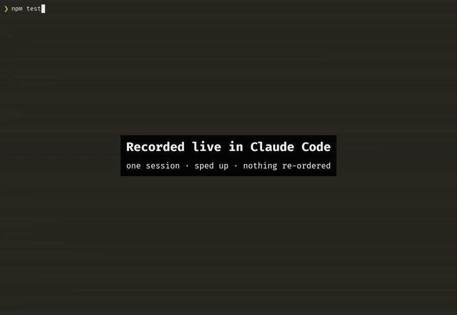

<!-- maintainers: this README is governed by docs/portfolio/readme-charter.md — run `cd server && npm run validate:readme` before committing changes -->

<div align="center">


<h1>Claude Prompts</h1>

**The portable workflow layer beside your AI coding harness.**

<p>Your client executes with its own tools, agents, and context.<br>
Claude Prompts adds reusable prompt resources, composable chains, validation gates, and client-native skill export.</p>

<p>
<a href="#claude-code-recommended"></a>
<a href="#codex-install"></a>
</p>

<p>
<a href="https://www.npmjs.com/package/claude-prompts"></a>
<a href="https://opensource.org/licenses/MIT"></a>
</p>

[Quick Start](#quick-start) · [What You Get](#what-you-get) · [Compose Workflows](#compose-workflows) · [Run Anywhere](#run-anywhere) · [Docs](#documentation)

</div>

### What your AI client gives you — and what this server adds

| Your client already does   | This server adds                                                                      |
| -------------------------- | ------------------------------------------------------------------------------------- |
| Run a prompt               | Compose prompts with validation, reasoning guidance, and formatting in one expression |
| Single-shot skills         | Multi-step workflows that thread context between steps                                |
| Execute subagents          | Hand off mid-chain steps to agents with full workflow context                         |
| Client-native skill format | Author once as YAML, export to any client with `skills:export`                        |
| Manual prompt writing      | Versioned templates with hot-reload, rollback, and history                            |
| Trust the output           | Validate output between steps: self-evaluation and shell commands                     |

### Is this for me?

- **Use this if** you write the same prompts repeatedly, run multi-step workflows, or want to share reusable prompts with a team.
- **Skip if** your client's built-in `/commands` already handle what you need, or you're looking for a no-code prompt library.
- **Works with** Claude Code, Claude Desktop, Cursor, VS Code, OpenCode, Gemini CLI, Codex, and Windsurf. Hook coverage differs by client; the [client list](#every-client) shows it.

---

<!-- diataxis: how-to -->

## Quick Start

### Claude Code (Recommended)

```bash
/plugin marketplace add minipuft/minipuft-plugins  # first time only
/plugin install claude-prompts@minipuft
>>tech_evaluation_chain library:'zod' context:'API validation'
```

<a id="codex-install"></a>

### Codex (Experimental)

Turn on hooks in `~/.codex/config.toml`, then install the plugin:

```toml
[features]
hooks = true
```

```bash
codex plugin marketplace add https://github.com/minipuft/minipuft-plugins.git
codex plugin add codex-prompts@minipuft
```

Restart Codex, run `/hooks` to review and trust the plugin hooks, then try the same `>>tech_evaluation_chain` command. Needs Codex CLI 0.117 or later; not available on Windows ([requirements](https://github.com/minipuft/codex-prompts#requirements)).

---

<!-- diataxis: how-to -->

## Every Client

<!-- BEGIN GENERATED: client-matrix:setup (generated from docs/reference/clients.json: edit that file, run npm --prefix server run generate:client-matrix) -->

<details>
<summary><strong>All 8 clients: setup and hook coverage</strong><br><sub>2 full · 1 experimental · 1 partial · 4 MCP tools only</sub></summary>

**Hooks** are what make `>>`, `-->`, and `::` work in conversation; "MCP tools only" means the three MCP tools without them. See [With Hooks](#with-hooks). Config locations and `--client` presets: [Client Capabilities Reference](docs/reference/client-capabilities.md).

<details name="clients"><summary><picture></picture> <strong>Claude Code</strong> <sub>Plugin</sub></summary>

[Steps in Quick Start](#claude-code-recommended).

</details>
<details name="clients"><summary><picture></picture> <strong>OpenCode</strong> <sub>npm installer</sub></summary>

```bash
npm install -g opencode-prompts && opencode-prompts install
```

For MCP tools without hooks, use the manual config in the [Client Integration Guide](docs/guides/client-integration.md).

</details>
<details name="clients"><summary><picture></picture> <strong>Codex</strong> <sub>Plugin</sub></summary>

[Steps in Quick Start](#codex-install). Hooks are off by default and need a one-time `/hooks` trust review.

</details>
<details name="clients"><summary><picture></picture> <strong>Gemini CLI</strong> <sub>Extension</sub></summary>

```bash
gemini extensions install https://github.com/minipuft/gemini-prompts
```

For MCP tools without hooks, use the manual config in the [Client Integration Guide](docs/guides/client-integration.md).

</details>
<details name="clients"><summary><picture></picture> <strong>Claude Desktop</strong> <sub>Desktop bundle or npx config</sub></summary>

**Option A: GitHub Release** (recommended): download `claude-prompts-{version}.mcpb` from [Releases](https://github.com/minipuft/claude-prompts-mcp/releases/latest) and drag it into Claude Desktop Settings → MCP Servers. The `.mcpb` bundle is self-contained (~5MB); no npm required.

**Option B: NPX** (auto-updates): add this to your config file (macOS: `~/Library/Application Support/Claude/claude_desktop_config.json`, Windows: `%APPDATA%\Claude\claude_desktop_config.json`):

```json
{
  "mcpServers": {
    "claude-prompts": {
      "command": "npx",
      "args": ["-y", "claude-prompts@latest", "--client", "claude-code"]
    }
  }
}
```

Restart Claude Desktop and test: `>>research_chain topic:'remote team policies'`

</details>
<details name="clients"><summary><picture></picture> <strong>Cursor, VS Code, Windsurf</strong> <sub>MCP config</sub></summary>

**Cursor and Windsurf** (now Devin Desktop) use the same block. Add it to `~/.cursor/mcp.json` for Cursor, or to `~/.config/devin/mcp_config.json` for Windsurf (Windows: `%APPDATA%\devin\mcp_config.json`):

```json
{
  "mcpServers": {
    "claude-prompts": {
      "command": "npx",
      "args": ["-y", "claude-prompts@latest", "--client=cursor"]
    }
  }
}
```

**VS Code** uses a different shape. Add this to `.vscode/mcp.json` in your project, or to your user profile's `mcp.json`:

```json
{
  "servers": {
    "claude-prompts": {
      "type": "stdio",
      "command": "npx",
      "args": ["-y", "claude-prompts@latest", "--client=unknown"]
    }
  }
}
```

Restart the client after saving. Presets and verification: [Client Integration Guide](docs/guides/client-integration.md).

</details>

</details>

<!-- END GENERATED: client-matrix:setup -->

---

<!-- diataxis: reference -->

## What You Get

Four primitives you author, version, and compose. The bundled set ships 52 prompts across 9 categories — a starting library, not the ceiling: your AI writes new prompts and chains through `resource_manager` as it works, so the set grows around what you actually do. All hot-reloadable, all versioned with rollback.

| Primitive       | Symbol | What it is                                                                                                                                                                                                               | Example                                      |
| --------------- | ------ | ------------------------------------------------------------------------------------------------------------------------------------------------------------------------------------------------------------------------ | -------------------------------------------- |
| Prompt template | `>>`   | Versioned YAML with named arguments; hot-reload on save                                                                                                                                                                  | `>>review target:'src/auth/'`                |
| Gate            | `::`   | Validation criterion the AI checks its own output against; blocking or advisory; can shell-verify                                                                                                                        | `:: 'cite sources'` · `:: verify:"npm test"` |
| Framework       | `^`    | Reasoning framework that shapes how the AI works through the problem; plug in your own or use built-ins like `^ReACT`, `^5W1H`, or the project's own `^CAGEERF` scaffold ([Frameworks Guide](docs/guides/frameworks.md)) | `^ReACT` · `^your_framework`                 |
| Style           | `#`    | Output formatting and tone                                                                                                                                                                                               | `#analytical` · `#procedural`                |

Prompts, gates, and frameworks are managed through the `resource_manager` tool. Your AI creates, edits, versions, and rolls them back through MCP, no file editing required. Styles are managed with the bundled `cpm` CLI. Failed gate checks can retry automatically or pause for your decision ([Gates Guide](docs/guides/gates.md)). Build your first primitive: [Prompt Authoring Tutorial](docs/tutorials/build-first-prompt.md).

### Your own prompts

Your own prompts, gates and frameworks live in a workspace you choose. `--init=~/my-prompts` scaffolds a starter workspace: three example prompts plus `config.jsonc`. Edit them (YAML schema), or have your AI author new prompts, gates, and frameworks via `resource_manager`. Point `MCP_RESOURCES_PATH` at an existing workspace if you already have one in the right shape. Resources that belong to one repository go in `.claude-prompts/` at its root (`cpm init --project` scaffolds it) and load above your workspace over STDIO. See [Custom Resources Guide](docs/guides/custom-resources.md).

### The Three Tools

Everything above reaches your client through three MCP tools:

| Tool               | Purpose                                          |
| ------------------ | ------------------------------------------------ |
| `prompt_engine`    | Execute prompts with frameworks and validation   |
| `resource_manager` | Create, update, version, and roll back resources |
| `system_control`   | Status, analytics, framework switching           |

Most users invoke these via `>>` syntax in conversation; hooks construct the actual calls. For programmatic MCP clients calling tools directly, see [MCP Tools Reference](docs/reference/mcp-tools.md).

---

<!-- diataxis: how-to -->

## Compose Workflows

### How to write a chain

<!-- illustrative-prompts: security_scan implementation -->

```
>>review target:'src/auth/' ^ReACT :: 'cite sources'
  --> security_scan :: verify:"npm test"
  ==> implementation
```

Read top-to-bottom:

- `>>review target:'src/auth/'` runs the `review` prompt against your auth folder.
- `^ReACT` overlays the ReACT reasoning framework on this step.
- `:: 'cite sources'` adds a gate the AI must satisfy (cite sources, or retry).
- `--> security_scan :: verify:"npm test"` chains to step 2, which must pass `npm test` before producing output.
- `==> implementation` hands the final step off to a client-native agent (a subagent in Claude Code).

`review` ships with the server; `security_scan` and `implementation` stand in for prompts you write.

Validation runs between steps, not only at the end. For the full operator grammar and examples, see [MCP Tools Reference](docs/reference/mcp-tools.md).

<div align="center">

<video src="https://github.com/user-attachments/assets/3123e6c5-e890-4e03-8e35-ebfc0467125b" width="720" autoplay loop muted playsinline controls title="One Claude Code session, with a side panel showing what the hooks and the server do: npm test fails, >>status is routed by the hook, resource_manager creates a prompt, a two-step chain runs it under ^ReACT, the server runs npm test as the gate, and the review step approves the result"></video>

<details>
<summary>No video player here? Open the GIF.</summary>
>status is routed by the hook, resource_manager creates a prompt, a two-step chain runs it under ^ReACT, the server runs npm test as the gate, and the review step approves the result" width="720" />
</details>

<sub>Recorded live in Claude Code (Sonnet), sped up, nothing re-ordered or retyped. The side panel shows what each hook and the server's <code>npm test</code> gate did.</sub>

</div>

Two patterns extend the basic syntax. Chains also support context threading between steps and agent handoffs. See [Chains Lifecycle](docs/concepts/chains-lifecycle.md) and [MCP Tools Reference](docs/reference/mcp-tools.md).

<details>
<summary><strong>See the output</strong>: tech evaluation chain with context7 research</summary>

<br>


<sub>Context7 fetches live library docs mid-chain. The final output is a structured assessment with sources.</sub>

</details>

### Verification Loops

<!-- illustrative-prompts: implement-feature -->

Ground-truth validation via shell commands. The AI keeps iterating until tests pass:

```
>>implement-feature :: verify:"npm test" loop:true
```

Implements, runs the test, reads failures, fixes, retries. Spawns a fresh context after repeated failures to avoid context rot.

`implement-feature` stands for your own prompt: `:: verify` attaches to any of them.

| Preset      | Tries | Timeout | Use Case          |
| ----------- | ----- | ------- | ----------------- |
| `:fast`     | 1     | 30s     | Quick check       |
| `:full`     | 5     | 5 min   | CI validation     |
| `:extended` | 10    | 10 min  | Large test suites |

For autonomous test-fix cycles with context-rot prevention: [Ralph Loops Guide](docs/guides/ralph-loops.md).

### Judge Mode

Let the AI pick the right resources for the task:

```
%judge Help me refactor this authentication module
```

Analyzes available templates, reasoning frameworks, validation rules, and styles, then recommends the best combination. You confirm before it runs. For scoring and overrides see [Judge Mode Guide](docs/guides/judge-mode.md).

---

<!-- diataxis: how-to -->

## Run Anywhere

Author workflows as YAML templates. Export as native skills to your client.

```yaml
# skills-sync.yaml — choose what to export
registrations:
  claude-code:
    user:
      - prompt:development/review
      - prompt:development/validate_work
```

```bash
npm run skills:export
```

The `review` prompt becomes a `/review` Claude Code skill. `validate_work` becomes `/validate_work`. Same source, native experience; no MCP call required at runtime.

Compiles to native skill packages for Claude Code, Cursor, Codex and OpenCode. `npm run skills:diff` flags when exports drift from source. Configuration, supported clients, and drift detection: [Skills Sync Guide](docs/guides/skills-sync.md).

---

<!-- diataxis: explanation -->

## With Hooks

Without hooks, you're calling the three MCP tools explicitly (the LLM constructs each call). With hooks, the operators work in conversation: `>>`, `-->`, `==>`, `::` feel native rather than mediated, and workflow state survives across LLM turns and context compaction.

What hooks unlock:

| Hook                                   | Unlocks                                                                                                      |
| -------------------------------------- | ------------------------------------------------------------------------------------------------------------ |
| **Auto-routing**                       | `>>research_chain topic:'X'` in chat fires the right MCP tool call without you naming it                     |
| **Chain continuity across compaction** | Multi-step chains preserve state when context compacts mid-execution; the chain doesn't restart from scratch |
| **Cross-step verdict tracking**        | Gate pass/fail verdicts thread across all chain steps without the LLM re-deriving them                       |
| **Native agent handoffs**              | `==>` routes to your client's subagent system automatically; no manual subagent invocation                   |
| **Session persistence**                | Workflow state preserved when context compacts mid-chain                                                     |

Hooks ship with the plugin install; the [client list](#every-client) shows which clients have them. Detail: [hooks/README.md](hooks/README.md).

---

<!-- diataxis: explanation -->

## How It Works

Command with operators → server parses and injects resources (framework, gates, style) → client executes the rendered prompt and self-evaluates against the gates → router decides: next step on pass, retry on fail, return on done.

Full request lifecycle, pipeline stages, and subsystem diagrams: [Architecture Overview](docs/architecture/overview.md).

---

<!-- diataxis: reference -->

## Documentation

Choose a guide based on what you want to do: learn by building, complete a task, look up syntax, or understand the design.

→ **[docs/README.md](docs/README.md)**

Quick jumps: [Build your first prompt](docs/tutorials/build-first-prompt.md) · [Chains lifecycle](docs/concepts/chains-lifecycle.md) · [MCP Tools reference](docs/reference/mcp-tools.md) · [Architecture overview](docs/architecture/overview.md) · [Troubleshooting](docs/guides/troubleshooting.md)

---

<!-- diataxis: how-to -->

## Contributing

Run it from source, as a Claude Code plugin or for any other MCP client:

```bash
git clone https://github.com/minipuft/claude-prompts-mcp.git && cd claude-prompts-mcp
(cd server && npm install && npm run build)   # esbuild bundles to server/dist/index.js
claude --plugin-dir .                         # load it as a Claude Code plugin
```

For any other MCP client, point its config at `server/dist/index.js`; transport is `--transport=stdio` (default) or `--transport=streamable-http`. Edit hooks or prompts → restart the client. Edit TypeScript → rebuild first.

```bash
cd server
npm test             # Run test suite
npm run validate:all # Full CI validation
```

The build produces a self-contained bundle. `server/dist/` is gitignored, and CI builds fresh from source.

See [CONTRIBUTING.md](CONTRIBUTING.md) for workflow details.

---

<!-- diataxis: reference -->

## License

[MIT](LICENSE)
