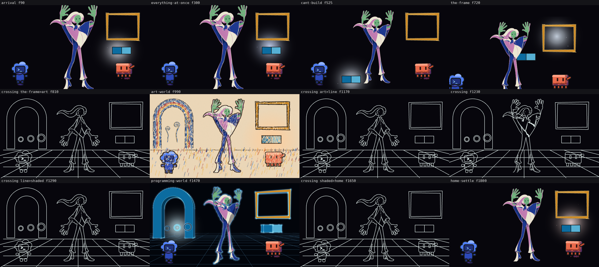

# Animatic 02 (2026-10-15): the 65 s film through the `animation_animatic` chain

The owner has not watched this. It is the second animatic of the eight-beat, 65 s episode, run end to end through the chain `animation_animatic` on the isolated server (drive receipts `evidence/drive-*`, mailbox `mailbox/animatic-trail`; the first attempt's mailbox is `mailbox/animatic-trail-run1`). Graded against `v3/rubric.md` v1.9. Seven of seven probes pass, against two of seven in `animatic-scaffold-01.md`; the grade finds five failures a probe cannot see.

Codes used below

C-numbers are rubric rows (`v3/rubric.md`); D-numbers are owner rulings (`v3/creative-spec.md`). "Crossing" is the 70-frame window around a change of world. Frame numbers are at 30 per second; the film is 1950 frames.

## What the viewer sees (per beat, one line)

- **Arrival, 0-180 (6 s).** A tall figure stands at centre, hair blown to one side, arms down and then raised; a blue cloud-robot at the left, a coral block-robot at the right, an empty gold frame above a small blue join with a soft white glow. No box, no lid, no bubble.
- **Everything at once, 180-420 (8 s).** The same picture; the glow steps up at 180 and drifts up and right; nothing floods in.
- **Cant build, 420-630 (7 s).** The same figure with arms raised; the light sits low at the left on the floor beside the blue robot; the camera pans right and up and settles.
- **The frame, 630-810 (6 s).** The figure shrinks and leans; the join blocks cross her leg; the gold frame's interior glows white; at 780 the blue robot is cut by the left edge.
- **Art world, 810-1170 (12 s).** The picture turns to crayon on a paper field: rainbow arch, curled stalks, crayon strokes boiling, warm amber light on the frame.
- **Crossing, 1170-1290 (4 s).** Pale contour lines on black over a perspective floor grid, the figure drawn in outline with arms spread; no light.
- **Programming world, 1290-1650 (12 s).** Cyan shaded forms on black, a lit arch with three rings that light one after another, the figure rim-lit in cyan.
- **Home settle, 1650-1950 (10 s).** Back on the black field with the original cast and a near-white glow at the frame; the last frame is close to the first beat's composition.

The human holds the raised-arms pose in 8 of the 12 contact-strip frames, whatever the beat does.

## Changed

Nothing under `v3/` except this study and its folder: the timeline, exposure sheet, light script and eight blocking files regenerated byte-identical or were left alone (`cmp`; git shows no change). Re-rendered, because a fresh sample failed the reuse test: `out/animatic-seq`, `-seq-b`, `-fig-seq`, `-figline-seq` (the replaced frames are kept as `*-prev`), `out/animatic-01.mp4` and `out/animatic-01b.mp4` (the second took a longer page-render timeout after a first attempt died at frame 1109 under machine load). Written: `out/animatic-02-contact.png` and `v3/studies/animatic-02/`.

## The probes (the gate's own lines, verbatim in `animatic-02/probe-all.txt`)

Command for all rows: `python3 scripts/animation/probe-all.py out/animatic-seq --timeline v3/timeline.json --xsheet v3/xsheet.json --second-frames out/animatic-seq-b --subset --figure-frames out/animatic-fig-seq --figure-line-frames out/animatic-figline-seq` (exit 0, 235 s).

| Claim | Probe | Control (trips first) | Measured |
| --- | --- | --- | --- |
| The drawing changes on twos while the camera moves on ones (C27) | `twos-ones` | a change on frame 7 refused; one planted inside a crossing refused on the figure layer | pass |
| Holds last 11-27 frames or a key declares them; moves use 3-6 drawings (C28) | `hold-band` | a 40-frame hold refused; a 1-drawing move refused; a pose change inside a crossing with no key row refused | pass |
| Each beat holds the screen for its frames (C26) | `screen-time` | beat shifted 3 frames against the sheet refused | pass |
| The brightest 0.5 % of non-identity pixels sit within 3 % of the width of the emitter (C29) | `eye-trace` | blob 10 % off refused (10.0 %); the same blob against an emitter projected through a moved camera refused (10.9 %) | pass |
| The figure's outline is closed and inside the frame in the line world | `loop-closure` | a 4 px band erased across the shins flips closed to open | pass |
| Every frame inside its beat's hue pair; no hue detour at a crossing (C30) | `colour-continuity` | an off-pair magenta patch refused; a detour through green refused | pass |
| Two renders of the same frames match within the rasteriser's own noise (C12) | `determinism` | 60 pixels 40 levels off refused; every pixel 3 levels off refused | pass on the pair `animatic-seq` / `animatic-seq-b` |

Other probes run by hand (the chain's gates for the first four steps, which the engine did not run after step 1, see the findings in the handoff):

| Claim | Command | Control | Measured |
| --- | --- | --- | --- |
| Timeline contract | `python3 scripts/animation/probe-timeline.py v3/timeline.json` | 0-frame beat, 3-frame gap, crossing outside its beat, unknown world, 8-frame beat each refused | pass: 8 beats, 1950 frames, 4 crossings |
| Blocking contract | `python3 scripts/animation/probe-blocking.py v3/timeline.json v3/blocking` | actor with no position, emitter outside the frame, missing card, overlapping boxes, beat with no file each refused | pass: 8 beats staged |
| Colour script | `python3 scripts/animation/probe-colour.py --contract v3/light.json --timeline v3/timeline.json` | two emitters on one frame, handoff 1 frame apart, hue path via green each refused | pass: 8 pairs, 7 emitters, 4 crossings |
| Frames reusable? | `probe-determinism.py out/animatic-seq out/animatic-det60 --subset` on 60 fresh frames (every 32nd from 7) | same control line as above | FAIL: frame 1063 (crayon, arch region) 203 pixels beyond 2 levels, allowance 23, largest 42 levels; two lone renders of 1063 equal each other and the sequence, so the 60-frame subset render is what drifts |
| Full renders agree? | `probe-determinism.py` old sequence against the new one | same | FAIL: 1948 of 1950; over the bar at 841 and 1111 (crayon) |
| New pair agrees | `probe-determinism.py` new sequence against new `seq-b`, `fig-seq`, `figline-seq` | same | pass on all three (195, 1950, 142 frames) |
| The two mp4s agree | `ffmpeg psnr`, `framemd5` | | 1438 of 1950 decoded frames byte-equal; 512 differ, at least 40.6 dB, mean 51.1 dB |

## Provisional parts of this film (the owner's list of what is not real yet)

- Keys: one chart (`liftChart`, renamed `s02-cant-build-frame` keys) plays every beat; the figure does not act the ledger.
- Blocking: eight files, all `provisional: true`; `arrival` and `everything-at-once` derive from the test scene although an s01 layout exists, and their emitter sits 26 % of the frame width from the layout's box seam.
- The box, bubble, stalks, gadget and structure are placed in the contracts and not drawn.
- One crossing operator (the line world) for all four crossings.
- Emitter colours are pale tints of each beat's pair; the arrival light runs at intensity 0.824.
- Cards cited per beat are board §1 and §8 picks not yet chosen against a layout.

## Wall time

Whole pass about 1 h 5 min, mostly the renders: xsheet 1 s; determinism sample 36 s; full sequence 570 s; every-10th frame subset 79 s; figure layer 45 s; figure-line layer 13 s; mp4 first 602 s; mp4 second 615 s (after a failed 532 s attempt); the probe 235 s. Chain steps: timeline 64 s, blocking 84 s plus 28 s for a structural retry, light 54 s, grade 81 s. A first drive died with its 30 min background limit after step 4 and was replayed from the saved replies.

## Before and after against `animatic-scaffold-01.md`

| Probe | scaffold 01 (2 of 7) | now (7 of 7) | What moved it |
| --- | --- | --- | --- |
| twos-ones | pass | pass | |
| hold-band | FAIL 36-frame holds | pass | key holds honoured exactly (row 4.5) |
| screen-time | pass | pass | |
| eye-trace | FAIL 1820 of 1820 | pass | cast masked, glow follows the blocking emitter (rows 4.2, 4.6) |
| loop-closure | FAIL 13 of 142 closed | pass | figure scaled to 0.58 so it fits (row 4.4) |
| colour-continuity | FAIL 1620 frames | pass | radiance hue read, fills masked (row 4.3) |
| determinism | FAIL 178 of 195 | pass on the pair, FAIL on two other comparisons | seeded noise bitmaps (row 4.1), crayon frames still drift |

## Grades (receipt part 2; criteria not listed were not touched)

| Criterion | Mark | Evidence |
| --- | --- | --- |
| C26, C27, C28, C29, C30 | HOLDS | the probe lines above; decided by the probes |
| C6 one emitter per shot | HOLDS | one glow in each of 24 viewed frames |
| C12 determinism | FAILS | frame 1063 on the 60-frame sample; 841 and 1111 across full renders; 512 of 1950 mp4 frames differ |
| C15 palette travel | FAILS | art-to-line crossing: value 0.84 at 1135, 0.35 at 1150 (muddy tan), 0.12 at 1160; `animatic-02/crossing-f1150.png`; the colour probe cannot see it |
| C10 composition hierarchy | FAILS | arrival f90, everything-at-once f300, cant-build f525 show no box, flood or reach; the-frame f780 holds |
| C8 Seuss architecture | FAILS | no towers, stalks or structure in any home-world beat |
| C25 matches the layout | FAILS | emitter 26 % of the width from `s01-arrival-overwhelm.json`'s box seam (contract against contract) |
| C13 motion, C14 acting, C18 light lag | UNPROVEN | stills only; I did not watch the mp4 |

Controls: the five probes that flipped from scaffold 01 beat their own controls above; C12's failing control is scaffold 01's frames 850 and 860 (45 000 pixels); C15's is beat4-seuss-07 frame 60.

## Owner (TASTE, each with the default the planner takes if unanswered)

1. Every crossing is the same line-world drawing, so three worlds read as joined by one hallway. Keep it for now or draw each with its own move's leading line? Default: keep until the pose pass fills the beats.
2. The crossing beat is 4 s with four ledger actions and 6 frames to spare. Lengthen to 5 s (later beats move +30 frames) or keep? Default: keep; decide after watching `animatic-02.mp4`.

## Next (one fix per failure)

- C12: find the state the crayon scene carries between frames in one browser tab and seed it; re-run the 60-frame sample.
- C15: hold the paper through the crossing and cut to the black line field, or interpolate on the pair; add a brightness-dip control to `probe-colour.py`.
- C10, C8: draw the box, bubble, stalks, gadget and structure the blocking already places.
- C25: re-point the arrival and everything-at-once blocking and light at `v3/layouts/s01-arrival-overwhelm.json`, then re-render the animatic.

## Filed

| Path under `v3/studies/animatic-02/` | sha256 prefix |
| --- | --- |
| `animatic-02.mp4` (copy of `out/animatic-01.mp4`) | f1daee09a10e |
| `contact-strip.png` (copy of `out/animatic-02-contact.png`) | 01298a29d8d6 |
| `crossing-f1150.png` | 089b106ebb8c |
| `the-frame-f780.png` | 5625ecc19b0d |
| `staging-0090.png`, `-0990`, `-1230`, `-1470` | 5f9123b91f03, d701003481a1, 2113e7fe19e3, 24b827ee2d88 |
| `probe-all.txt` | 0d735fa84b55 |
| `determinism-sample-60.txt`, `determinism-full-new-vs-old.txt` | 52d2ea782528, 83d18b6bfe0c |
| `render-times.txt` | 2d767d169951 |
