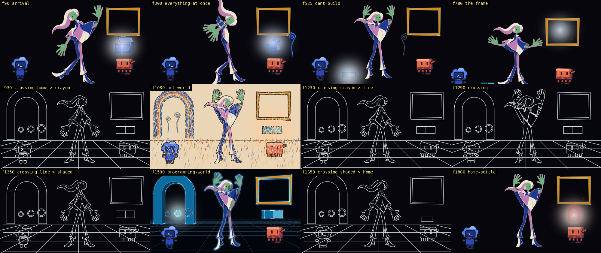
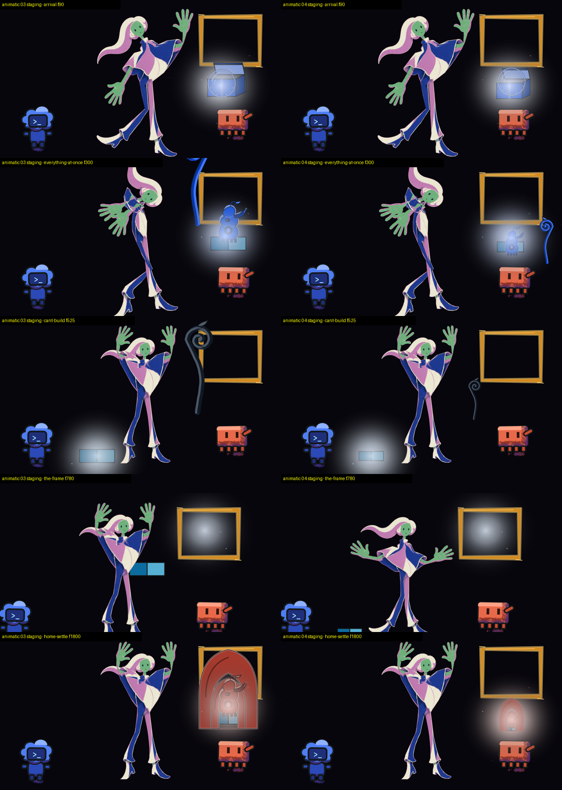
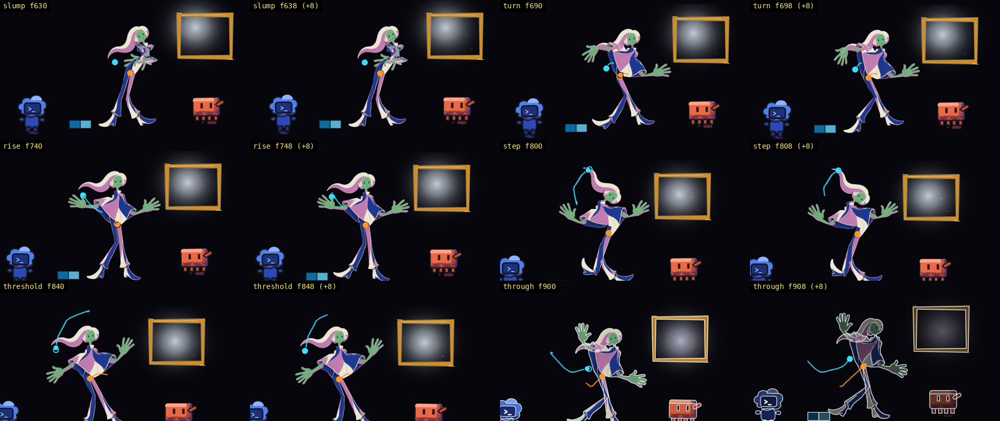

# Animatic 04 (2026-10-19): the film with its props apart and beat 4 played from its six keys

The owner has not watched this. It is the fourth animatic of the eight-beat, 65 s episode, run through the `animation_animatic` chain on the isolated server (drive receipt `evidence/drive-uzeuoq`, mailbox `mailbox/animatic-04`). **The chain stopped at its second step.** The vocabulary check that now runs on that step refused the tree because of one proposal of the light work (p007) that this run was told not to touch, so the chain's light, render, grade and evidence steps have not run, and the bible check has not run inside the chain. The renders, probes and strips below were made by hand from the same commands the chain's gates run, and each is labelled as such.

[](../../out/animatic-04.mp4)

The video is `out/animatic-04.mp4` (65.0 s, 1950 frames at 30 fps, half size, rendered once at concurrency 4 as a watched preview, not the determinism render).

<details><summary>Codes used below</summary>
C-numbers are rubric rows (`v3/rubric.md`); D-numbers are owner rulings (`v3/creative-spec.md`); p-numbers are proposals on the bible page (`v3/proposals/`). A crossing is the 70-frame window around a change of world. Frame numbers are at 30 per second. A "hold" is a drawing left on screen; a "move" is the drawings between two holds.
</details>

## What the viewer sees (per beat, one line)

- **Arrival, 0-180 (6 s).** The tall figure leans toward a small blue box under the gold frame; the lid is up and a pale bubble rises out of it; the soft glow sits on the seam. Codex at the left, Clawd below the box. Nothing overlaps the frame's lower bar any more.
- **Everything at once, 180-420 (8 s).** The same picture with the gadget standing on the box's blocks, small, and a blue stalk rooted on the floor at the right edge, beside Clawd (it pushes him).
- **Cant build, 420-630 (7 s).** The human with arms up; the glow lies on the floor at the left between Codex and her feet; a thin dark stalk stands just past her reach, clear of the frame.
- **The frame, 630-930 (10 s).** New. A bowed, tired figure straightens into a turn toward the lit frame, rises with arms wide, steps, plants one foot with the other heel lifted, and goes through (see the next section). The frame's interior is the only light; the kit blocks lie at the bottom left where they were lost.
- **Art world, 930-1230 (10 s).** Unchanged: crayon strokes on paper, rainbow arch, amber light on the frame.
- **Crossing, 1230-1350 (4 s).** Unchanged: pale contour lines on black over a perspective grid.
- **Programming world, 1350-1650 (10 s).** Unchanged: cyan shaded forms, a lit arch with three rings.
- **Home settle, 1650-1950 (10 s).** The figure, Codex and Clawd as before; the structure now stands small under the frame with the gadget and the lit joins inside it, and the frame above it is clear. The last picture has less in it than animatic 03's (p012).

Outside beats 1, 2 and 4 the human still holds the raised-arms stand-in pose.

## The collisions and how each was resolved

Animatic 03's strip showed four things the plan rows left open for the blocking step, and a fifth the new beat 4 revealed. The blocking step now has a sixth check, `props apart`: the frame, the kit blocks, Codex, Clawd, the human's body (the joints of the keys the beat plays, grown by a limb's width) and every prop keep their own rectangles; two things that touch on purpose are listed in the beat's `contacts` with a reason; a box, stalk or structure stands on the floor band; every prop lies on the stage. Run on animatic 03's blocking it refuses 16 times on five beats (`out/a04-work/blocking-before-probe.txt`); on the restaged blocking it passes.



| Beat | What was wrong | Resolution (stage pixels) | Touching on purpose |
| --- | --- | --- | --- |
| Arrival | the box covered the blocks and the bubble and its top overlapped the frame's lower bar by 16 px | box at 0.9 scale at (1040, 450), top below the bar; bubble rises from its opening at (1050, 372); the two blocks lie inside the box; the light stays on the seam | box and blocks (the blocks lie inside until the lid is up), box and bubble, blocks and bubble |
| Everything at once | the stalk was rooted at y 300 and cut by the top edge; the gadget overlapped the frame by 131 x 105 px | stalk rooted on the floor at (1212, 478) at half scale beside Clawd; gadget at 0.55 scale standing on the join; the light follows the gadget's dial | gadget and blocks, stalk and Clawd |
| Cant build | the stalk ran through the frame's left bar (41 x 193 px) | stalk at 0.45 scale rooted at (880, 470), just past the human's reach; blocks narrowed so the dial lies between Codex and her feet | none |
| The frame | the blocks lay inside the human's body | the blocks stay where they were lost, as in cant build; the figure plays the six-key sheet (`poseShot` in the blocking) | none |
| Home settle | the structure covered the frame (264 x 222 px), the gadget and the blocks | structure at half scale at (1050, 452) with the gadget and the lit joins inside it; the frame is clear | structure and gadget, structure and blocks, gadget and blocks |

The pixel check agrees with the geometry: omitting each prop and measuring what changes, the only pairs that still share pixels are the declared ones (arrival box and bubble 3 301 px, home settle gadget and structure 20 px). The prop-drawn check (`probe-props.py`) passes on the new blocking, 7 props named, each drawn within 420 px of its anchor. It first failed on cant build: leaving the stalk out of the tree also changes 68 631 px of the floor glow around the join, and the check took the centre of all of it. It now counts only the pixels within reach of the anchor; a box moved 700 px away from where it is drawn is still refused (`out/animatic-04-props-probe.txt`).

The light followed the props: the eye-trace offset at the frames I measured before and after (the committed code's frames against this render) fell from 2.5 % to 0.5 % at frame 90, 1.9 % to 0.4 % at 300, 3.8 % to 0.9 % at 525, 5.0 % to 0.6 % at 1700 and 4.0 % to 0.4 % at 1800, because the lit blocks no longer sit under a prop.

## Beat 4: the six keys and their derived secondaries



The strip is read left to right, two tiles per key (landing, then eight frames on). Over the picture: the orange line and dot are the cloak's path over the 24 frames before and where it is; the ring is where it would be if it rode the body rigidly. The cyan line and dot are the hair's tip, which the figure's rig does not draw (the third question of study s02-01, still open), so the cyan dot is a marker, not hair in the frame.

| Key | Frame | Ruled hold | What the viewer sees |
| --- | --- | --- | --- |
| Slump | 630 | 26 | bowed forward from the hips, arms drawn in, the cloth hanging |
| Turn | 690 | 16 | a small sink away from the frame first, then shoulders and head open toward it, one arm out |
| Rise | 740 | 20 | upright and plumb for the instant, arms wide; the body is drawn a little past upright and back (overshoot) |
| Step | 800 | 14 | a small weight shift back, then the weight arrives on the leading foot |
| Threshold | 840 | 24 | one foot planted, the other heel lifted; the heel lands at 828 and the body settles at 836 |
| Through | 900 | 30 | a small S, the figure going on alone; the key sits inside the first half of the crossing out |

The secondaries are the sheet's own (cloak is cloth, hair is hair; no lag is written in the sheet) and the animatic draws them: the full frames carry the cloak following the body, while the figure-only layers the hold probes read carry the body alone. Measured on the joints this animatic plays (`node scripts/animation/played-joints.mjs s02-the-frame --animatic`, `out/animatic-04-followthrough.txt`), `probe-followthrough.py` passes with the same numbers the shot's own dump gave: the cloak trails by 6 frames, settles in 14 and overshoots 0.18; the hair trails by 4, settles in 12 and overshoots 0.25; the heel contact at 828 settles at 836.

What is not in the picture: the cloak heap is not drawn on the floor (no heap prop exists; the cloak's tip stays where the body left it from frame 760), the hair is not drawn, and the pose sheet's moving holds are left to the shot render, as s01's are.

## The gates

### In the chain (engine runs, from `mailbox/animatic-04`)

Step 1, Timeline (`01-step.md` and `02-step.md`, drive `evidence/drive-uzeuoq`):

```
## Shell Verification Results

### Animation Timeline Contract — PASSED

**Command:** `python3 scripts/animation/probe-timeline.py v3/timeline.json`
**Exit Code:** 0
**Duration:** 222ms
```

Step 2, Blocking (`04-step.md`, after the answer; the same block again in `05-step.md`, 223 ms and 82 ms):

```
## Shell Verification Results

### Animation Blocking Contract — PASSED

**Command:** `python3 scripts/animation/probe-blocking.py v3/timeline.json v3/blocking`
**Exit Code:** 0
**Duration:** 221ms

### Animation Vocabulary — FAILED

**Command:** `python3 scripts/animation/probe-vocabulary.py v3/vocabulary.json --overrides v3/vocabulary-overrides.json`
**Exit Code:** 1
**Duration:** 85ms
```

with the vocabulary probe's own lines under it:

```
  ok   vocabulary: 112 terms in 14 domains, each with a one-line definition and a lane, material property or facet it governs, and every term D96 names is present
  ok   overrides: 8 register phrases map to vocabulary terms, 8 film words (worlds and hue pairs) restate no vocabulary term, 4 hue pairs match the light script
  ok   facets: 72 words of 12 aligned facets of the inspiration board are each a term, an alias or declared unmapped
  FAIL proposals: owner-ask p007 has no intent, options, default
  ok   rulings: 53 rulings read: 4 in the ruling form (0 with an intent word, all in the vocabulary; 4 with a sentence of reasons, not checked), the rest free prose
  ok   poses: 2 pose sheets read, 58 breakdown kinds and key intents are vocabulary terms
  ok   materials: 73 material intents read, all material terms; 0 presets named by registers
refused: proposals: owner-ask p007 has no intent, options, default - replace a refused word with a term of the vocabulary; do not edit the vocabulary to pass
```

This is the animation-vocabulary gate refusing inside `animation_animatic` (until now it had only been shown in a one-node workflow). My honest verdict was FAIL (`04-reply.md`); the engine held the step (attempt 2 of 2) and its structural check also asked for the word "placeholder" to be removed from the Analysis section, which `mailbox/animatic-04/drafts/05-reply.blocking-second-attempt.md` does. I did not send it: a second answer with p007 unchanged would fail the same way and use the last attempt. The driver is still waiting on `mailbox/animatic-04/05-reply.md` (process 311633, server 311645); once p007 carries its intent, options and default, copying the draft to `05-reply.md` re-runs the gates, and the verdict is then sent as `06-reply.md`.

The animation-bible gate has not run in the chain (it sits on step 6). By hand, the gate's own command passes, `out/animatic-04-bible.txt`:

```
pass: bible 55b3c0f6c449 covers 1950 frames in 10 tracks (393 items), 12 proposal(s) sit inside their beats, 53 ruling(s) mirrored, and the page shows this bible
```

and in a one-node workflow (not the chain; `evidence/drive-b79eE1`, `mailbox/animatic-04-bible-node/01-step.md`) the engine ran it and printed:

```
### Animation Bible — PASSED

**Command:** `python3 scripts/animation/probe-bible.py v3/bible.json --page out/bible.html`
**Exit Code:** 0
**Duration:** 50ms
```

Without p007 (a temporary copy of the proposals directory, nothing edited; `out/animatic-04-vocabulary-without-p007.txt`), the vocabulary check passes, and so do the five proposals this run filed:

```
  ok   proposals: 11 proposals read: 0 carry an intent word and all resolve, 11 older ones carry none (free prose, not checked)
pass: 112 vocabulary terms, 8 film words and 8 register phrases; every intent word in the proposals, rulings, pose sheets and materials that exist resolves
```

### By hand: the animatic's probes (`out/animatic-04-probe-all.txt`, exit 1)

Command: `python3 scripts/animation/probe-all.py out/animatic-seq --timeline v3/timeline.json --xsheet v3/xsheet.json --second-frames out/animatic-seq-b --subset --figure-frames out/animatic-fig-seq --figure-line-frames out/animatic-figline-seq`. Four of seven pass; the three that fail each name a cause that is a decision, not a drawing fault.

| Probe | Result | The line |
| --- | --- | --- |
| twos on the figure, ones on the camera | pass | control tripped first |
| hold band | **FAIL** | `FAIL hold band: hold of 36 frames at 630-665 is over 27 and no key declares it; hold of 36 frames at 740-775 is over 27 and no key declares it; hold of 36 frames at 840-875 is over 27 and no key declares it` |
| screen time per beat | pass | |
| eye trace | **FAIL** | `FAIL emitter within tolerance: 462 frame(s) over 3 % of the width: [(630, 30.0), (631, 30.0), ...]`: 270 of beat 4's 300 frames and 192 of the shaded world's |
| loop closure in the line world | pass | |
| colour per beat | **FAIL** | `FAIL radiance hue per frame: the light's own hue sits inside the beat's pair on 1174 of 1190 frames where it is drawn and readable (630 drawn but unreadable: the brightest region outside the fixed fills is not on the emitter ...)` |
| two renders of the same frames | pass | `animatic-seq` against `animatic-seq-b` |
| all | `FAIL: probe-all - 4 of 7 probes passed` | |

- The hold band fails on the pose sheet's own pacing: the sheet rules slump, rise and threshold at 26, 20 and 24 frames, and the first drawing of each move lands 10 frames after the ruled hold ends, so they are on screen 36 frames. That is the second question of study `s02-01`, whose default (keep the drawings) cannot pass the band (p009).
- The eye trace was red in beat 4 before this run: on the committed code's frames at 700 and 780 it read 19.7 % and 19.6 %, and it reads 24.9 % and 23.7 % now. In beat 4 the brightest unmasked region is on Clawd, not the frame's dim glow; the shaded world's 192 frames were not touched by this run. That is the question p007 asks (p011 carries the numbers).
- The colour check fails on the same unreadable beat-4 frames, and on 16 shaded frames from 1488 that sit off their pair.

## Findings filed on the bible page (kind finding, from the director)

| Proposal | Beat and frame | What it says |
| --- | --- | --- |
| p008 | everything-at-once, 200 | the vocabulary gate refuses the tree while p007 is open; what unblocks the chain |
| p009 | the-frame, 630 | slump, rise and threshold are on screen 36 frames against 26, 20 and 24 ruled; three ways out |
| p010 | the-frame, 800 | the beat 4 camera cuts off her feet from frame 733 (166 frames touch the bottom edge) and Codex is half out by 780 |
| p011 | the-frame, 700 | the eye trace and the colour check in beat 4 and the shaded world, with the before and after numbers |
| p012 (change) | home-settle, 1800 | the structure stands small under the frame: frame clear, ending small, last picture thinner |

`npm run bible` passes after the five were filed: `pass: bible 55b3c0f6c449 covers 1950 frames in 10 tracks (393 items), 12 proposal(s) sit inside their beats, 53 ruling(s) mirrored, and the page shows this bible`.

## Left for the owner

1. TASTE The three 36-frame holds in beat 4 (p009). Keep the ruled holds and widen the moves, or keep the drawings and rule the three holds at 36? Default: widen the moves, because the ruled holds are the beat's timing.
2. TASTE The beat 4 camera (p010). Pull back and down toward the end so the whole human stays in the picture and 'through' reads small? Default: yes.
3. TASTE The small structure in the last picture (p012). Keep it small under the frame, or put a larger one at frame left? Default: keep, and judge it on the watched video.
4. TASTE The hair has no drawing (the rig has no hair joint). Give the hair part a pin at the ponytail tip? Default: yes.

## What is placeholder

The human's pose outside beats 1, 2 and 4 (the raised-arms hold in beats 3 and 5 to 8), every prop (flat stand-ins in role fills), the cloak heap (not drawn), the hair (not drawn), the light (the animatic has no light layer; that is the light work's).

## Changed and measured

- Blocking: `v3/blocking/{arrival,everything-at-once,cant-build,the-frame,home-settle}.json`; `probe-blocking.py` gains `props apart` and its control (from 5 planted defects to 10); `blocking.ts` gains `poseShot` and `contacts`.
- Beat 4: `src/scenes/animaticPlan.ts` plays `s02-the-frame` (keys, breakdowns and derived secondaries; `bodyPose` for the figure layers), `src/scenes/Animatic.tsx` draws the body alone on the figure layers, `scripts/animation/played-joints.mjs --animatic` dumps what the animatic plays, `scripts/animation/animatic-contact.py` makes the two strips, `probe-props.py` counts only pixels within reach of the anchor.
- Regenerated by `npm run bible`: `v3/light.json` (five emitters moved with their props), `v3/xsheet.json` and `.html`, `v3/bible.json`, `out/bible.html`. The timeline compiled byte-identical.
- Renders: `out/animatic-seq` (4 shards, 1950 frames, 456.6 s wall, peak RSS 5217 MB, 1304 MB a shard), `animatic-seq-b` (195 frames, 58.6 s), `animatic-fig-seq` (1950 frames, 47.4 s), `animatic-figline-seq` (142 frames, 10.1 s), `animatic-04.mp4` (5.8 MB). The animatic-03 frames are kept as `out/animatic-*-03`.
- Files for this study: `v3/studies/animatic-04/` (contact strip, beat 4 keys strip, eight staging stills, before and after pairs), `out/animatic-04-contact.png`, `out/animatic-04-beat4-keys.png`. Payloads `workflow-payloads/219-drive-animation_animatic-04.json` and `220-drive-animation_direction-bible-gate.json`; no prompt, gate or chain was changed, so no mutation payload was needed.
