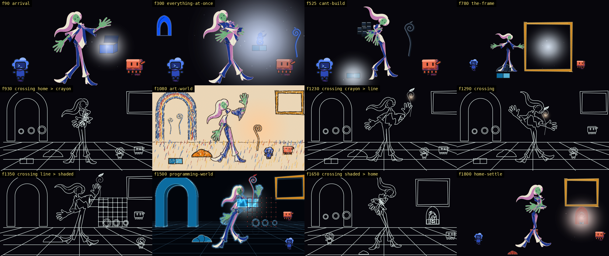
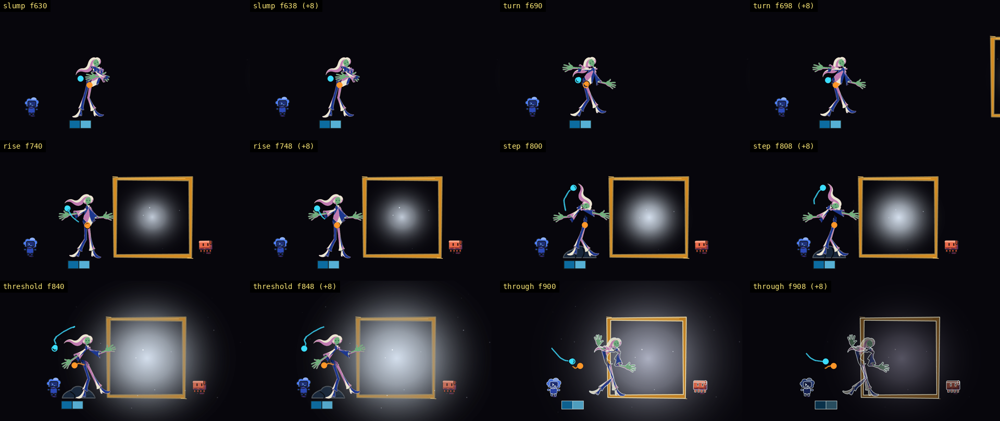

# Animatic 10: the film reads story point by story point (2026-10-20)

The owner has not watched this. It is the first animatic whose every story point passes the story probe: 28 of 28 (`pass: story - 28 of 28 story points pass`), with the four themes holding (`pass: theme - 4 theme invariants hold on the blocking and the story points`). It is also the run where the chain stopped at its render step: the seven-probe check reads 5 of 7 and the two it fails are named below with their causes. The video is `out/animatic-10.mp4` (65.0 s, 1950 frames, half size); the frames the probes read are `out/animatic-seq` (composed, 1280 x 720), `-seq-b` (every tenth frame again), `-fig-seq` (the human alone) and `-figline-seq` (the 142 line-world frames); the earlier frames are kept as `-pre10`.



<details><summary>Codes used below</summary>
sp-numbers are story points of `v3/screenplay.json`; p-numbers are proposals on the bible page (`v3/proposals/`); D-numbers are owner rulings (`v3/creative-spec.md`). "Stage pixels" are the 1280 x 720 picture. A "recipe" is the line of a story point's `measure` that a probe reads.
</details>

## What the viewer sees, story point by story point

| Story point | Frames | What the viewer sees | What was measured | Result |
| --- | --- | --- | --- | --- |
| sp-1.1 Settled | 0-59 | poster frame; one emitter; three silhouettes and a box | 'lid angle 0': lid stays where it is f0-53; 'cloak covers both hands': 3 finger-sized skin components on f0 (8 or more means both hands are drawn); 'emitter count 1': light.json holds 1 emitter(s) for beat 'arrival', the xsheet row f59 has one; 1 needed | pass |
| sp-1.2 Lift | 60-109 | the lid rises; two hands appear; the light widens a beat late | 'lid angle from 0 to open': lid moves 68 px; 'hands visible after, not before': 5 finger-sized skin components at f59, 16 at f109 (8 or more means the hands are drawn); 'light area grows after the lid, lag ≥ 4 frames': the lit area grows 10 % at f63, 8 frames after lid starts to move (f55); lag 4 needed | pass |
| sp-1.3 Swell | 110-185 | a bubble grows over 40 frames; two heads tilt toward it one after the other | 'bubble appears out of the box': bubble appears: f109 -> f179; 'gadget present inside': gadget inside bubble at f179; 'codex lean precedes clawd lean by 4': codex starts at f108, clawd at f112: 4 frames apart (4 needed) | pass |
| sp-2.1 Pop | 186-229 | the bubble vanishes; the whole field goes blue | 'bubble absent after': bubble disappears: f185 -> f229; 'field hue area jumps': 6.9 % of the picture is in the beat's hue (#0a51fb) at f185, 15.2 % at f229 (+120 %; at least +100 % and 2 points needed) | pass |
| sp-2.2 Flood | 230-329 | pieces arrive one after another around the trio; the human spins once | 'piece count rises from 0': stalk/arch/ring/patch/bead count is 0 at f229 and 2 at f329; 'arrivals staggered ≥ 3 frames until sp-2.3': on frames [232, 244]: the smallest gap is 12 (needs 3) | pass |
| sp-2.3 Too Much | 330-429 | the human gets smaller in the frame as the pieces get bigger; Clawd is displaced; Codex holds a piece | 'human silhouette height falls ≥ 15 %': figure height -16.3 % between f329 and f419 (falls by 15 % needed); 'clawd x moves ≥ 40 px': clawd moves 58 px; 'codex holds a prop': codex and ring are 0 px apart at their nearest (f334); within 8 px needed; '≥ 6 arrivals on one frame': 6 named arrival(s) on one frame at most (330: arch-2, bead, bead-2, patch, ring, ring-2); 6 needed on one frame (the blocking holds one actor per name: 10 named) | pass |
| sp-3.1 Reach | 430-499 | a hand closes on a stalk; the stalk returns to where it was | 'hand reaches stalk (contact)': human and stalk are 0 px apart at their nearest (f430, the human read as her hands); within 12 px needed; 'stalk returns to its start within 20 frames': 'stalk' leaves its start at f433 and is back at f445; 'no seam pulse': emitter colours 1 and strength spread 0.00 across f430-499 | pass |
| sp-3.2 Stack | 500-579 | three pieces go up, three come down | 'three props rise then fall': patch/patch-2/patch-3: peak count 3 (needs 3), 1 at f579; 'falls staggered 3': off frames [547, 550]: the smallest gap is 3 (needs 3); 'codex holds still': codex stays where it is f500-579 | pass |
| sp-3.3 Lost | 580-629 | grain up; the human low; Clawd exits | 'grain high': light.json grain is 'high' for beat 'cant-build' ('high' needed); 'human height at its lowest': the figure is 418 px tall at f629; the lowest height since the beat began (f420) is 418 px at f582; 'clawd absent from frame after': clawd offstage at f629 | pass |
| sp-4.1 Slump | 630-689 | stillness in the mess | 'hold 26': the longest hold the xsheet declares inside f630-689 is 26 frames (26 needed); 'no prop moves': frame stays where it is f630-689 | pass |
| sp-4.2 Turn | 690-739 | Clawd carries a lit rectangle in; the human turns | 'frame prop enters': frame appears: f689 -> f739; 'emitter sits inside the frame interior': emitter (787, 394) at f739, frame (590, 190, 400, 410) | pass |
| sp-4.3 Rise | 740-799 | a dark heap on the floor that was not there; a lighter figure | 'heap prop on the floor after, absent before': heap appears: f739 -> f799; 'figure silhouette changes garment': figure area -14.4 % between f739 and f799 (changes by 10 % needed); 'heap stays to 1950': heap persists at f799 | pass |
| sp-4.4 Step | 800-839 | a step; a small kick; the heap shifts a little | 'human x moves toward frame ≥ 60 px': human toward-frame: (333, 266) -> (395, 266); 'codex contact with heap': codex and heap are 0 px apart at their nearest (f812); within 8 px needed; 'heap displacement 4–12 px': heap moves 8 px | pass |
| sp-4.5 Threshold | 840-899 | contact with the frame; a heel tap | 'hand within 8 px of frame edge': the figure's rightmost ink is at x 595 on f840, the frame's left edge at x 590: 5 px apart (within 8 px needed); 'hold 24': the longest hold the xsheet declares inside f840-899 is 24 frames (24 needed) | pass |
| sp-4.6 Through | 900-939 | the figure crosses the frame's plane; the outside goes dark | 'human crosses frame x': the figure's centre is at x 454 on f840 and x 610 on f929, the frame's left edge at x 590; 'outside luminance falls ≥ 50 %': mean luminance outside the frame is 40.7 at f899 and 14.5 at f929 (-64 %; a fall of 50 % needed); "the field is paper by the crossing's end": world is 'crayon' at f965 ('crayon' needed) | pass |
| sp-5.1 Paper | 940-1009 | white paper; a crayon changes hands | 'field is paper': world is 'crayon' at f1009, the colour key's kit is 'crayon'; "the crayon passes from Clawd's hand to the human's": 'crayon' is 0 px from clawd at f940 and 2 px from human at f1009 (within 8 px of clawd first, then of human) | pass |
| sp-5.2 Draw | 1010-1109 | three lines appear one after another in the air | 'three stroke props appear in order': stroke-1/stroke-2/stroke-3 count is 0 at f1009 and 3 at f1109; 'each stroke staggered ≥ 6': on frames [1010, 1018, 1030]: the smallest gap is 8 (needs 6) | pass |
| sp-5.3 Real | 1110-1199 | line becomes fill; a leaf opens; Codex steadies it | 'stroke props replaced by a stalk prop': stalk appears: f1109 -> f1199; 'codex contact with stalk': codex and stalk are 0 px apart at their nearest (f1110); within 8 px needed | pass |
| sp-5.4 Carry | 1200-1239 | the piece in hand; a turn to the edge | "stalk prop attached to the human's hand": human and stalk are 0 px apart at their nearest (f1200, the human read as her hands); within 12 px needed | pass |
| sp-6.1 Reduce | 1240-1299 | fills drain; only lines | "fill area falls ≥ 50 % from the reduce's start": 21.9 % of the picture is not the field colour at f1195, 10.4 % at f1299 (-53 %; a fall of 50 % needed) | pass |
| sp-6.2 Re-Route | 1300-1359 | lines rewire; Codex passes Clawd | 'codex x passes clawd x': codex passes: (925, 500) -> (1100, 540) | pass |
| sp-7.1 Grid | 1360-1439 | a dark grid with lit edges; a pointing arm | 'field shaded': world is 'shaded' at f1439, the colour key's kit is 'shaded' | pass |
| sp-7.2 Join | 1440-1519 | a piece set down; a pulse | 'stalk prop contact with the join': stalk and join are 3 px apart at their nearest (f1440); within 8 px needed; 'seam pulse': emitter #c5e4f0/0.3 at f1439, #c5e4f0/1.044 at f1519; 'join emitter lit after': the beat's emitter sits on "the join (empty, then lit), then the running bead, then the frame's interior"; the story point wants 'join' | pass |
| sp-7.3 Run | 1520-1619 | three rings light one after another | 'three gate props lit in order, staggered ≥ 8': the gates first change at [1520, 1534, 1546] | pass |
| sp-7.4 Return | 1620-1659 | the frame as a window; three figures cross it | 'frame prop present': frame present at f1649 | pass |
| sp-8.1 Stand | 1660-1759 | a built thing where the mess was; the heap still on the floor | 'structure prop present': structure present at f1759; 'gadget inside its bounds': gadget inside structure at f1759; 'heap prop still present': heap present at f1759; 'pieces outside the structure ≤ 2': 1 of stalk/arch/ring/patch/bead stand at f1759 (at most 2) | pass |
| sp-8.2 Settle | 1760-1859 | three figures come to rest; the frame leans | 'human height falls to seated': figure height -21.3 % between f1759 and f1859 (falls by 20 % needed); 'codex and clawd hold still': codex/clawd stay where they are f1760-1859; 'frame prop at rest against structure': frame and structure are 2 px apart at their nearest (f1760); within 8 px needed | pass |
| sp-8.3 Window | 1860-1949 | a held picture; the title | 'hold ≥ 60': the longest hold the xsheet declares inside f1860-1949 is 90 frames (60 needed); 'title mark visible': title present at f1949 | pass |

Two recipes read forms the director wrote and the probe did not yet read: sp-4.6's third line reads the field on frame 965 (the crossing's end) and sp-6.1's reads the ink share from frame 1195 (the reduce's start), and sp-5.1's reads the crayon's carrier changing from Clawd to the human. Each form has a control in `probe-story.py` (a pen that never leaves Clawd is refused, one that starts in the human's hand is refused, no hands drawn at its end is refused).

## Beat 4, the frame



## What changed to get here

- **The probes read the recipes.** `xsheet` `at` a frame, `picture` `from` a frame and `stage` `carried-by` (probe-story), `except_actors` (probe-theme: the three strokes of one drawing are one piece, not three joins), and a frame inside a crossing with no emitter row counts as fading (probe-eyetrace). Each has a control that trips (`out/animatic-10-chain-story.txt`, `out/animatic-10-theme.txt`, `out/animatic-10-eyetrace.txt`: the control line is each file's first line).
- **The line world has a lantern.** In the crossing the carried stalk's lines are lit (`Emitter.lit`; radius 60; ledger line for the beat; `v3/worlds/line.json` `radiance.on`), so the eye finds the piece: the 212 frames over of animatic 09's sp-6.x are gone.
- **The window's rim waits for the light.** In the shaded world the frame's rim is a quarter as bright until the light stands at it (as a gate is dim until the light reaches it), so the bead's run is not outshone by a window it has not yet reached.
- **The bead's glow keys.** 60 px while it runs between gates (a wider one lights the second gate with the first and breaks sp-7.3's order), 100 px while it rests at the third.
- **The plates are measured per shot (p023).** `npm run plates -- <shot>` draws that shot's own keys in the film rig; `measured` is on 27 of 27 keys of s02-cant-build, s02-the-frame, s03-scaffold and s04-settle: 22 accepted, 5 over the film bar by 0.06 to 0.78 (p031).

## Probes

Command lines are the render step's; every probe prints its control line first (`out/animatic-10-probe-all.txt`).

| Claim | Command | Result |
| --- | --- | --- |
| Every story point passes | `python3 scripts/animation/probe-story.py v3/screenplay.json --frames out/animatic-seq --figure-frames out/animatic-fig-seq` | `pass: story - 28 of 28 story points pass` |
| Four themes hold | `python3 scripts/animation/probe-theme.py` | `pass: theme - 4 theme invariants hold on the blocking and the story points` |
| Poses and keys contract | `python3 scripts/animation/probe-all.py --contract v3/poses v3/keys v3/charts` | `pass: probe-all --contract - 2 of 2 probe runs passed, 4 shot(s) skipped` |
| Blocking contract | `python3 scripts/animation/probe-blocking.py v3/timeline.json v3/blocking` | `pass: blocking-contract - 8 beats staged: actors placed, emitter inside the frame, a card cited, identity boxes apart, props apart` |
| Seven animatic probes | `python3 scripts/animation/probe-all.py out/animatic-seq ...` | `FAIL: probe-all - 5 of 7 probes passed`: twos, hold band, screen time, loop closure and determinism pass; eye trace and colour fail |
| Eye trace | `python3 scripts/animation/probe-eyetrace.py out/animatic-seq ...` | 1504 frames measured, 20 over 3 % (1508-1511, 1516-1519, 1532-1537, 1540-1541, 1552-1555), p032 |
| Colour | `python3 scripts/animation/probe-colour.py ...` through probe-all | radiance hue 96 frames about 1 deg outside the pair on 1428-1515; the 1615-1685 crossing's hue path read on frames runs the other way round the wheel, p033 |

## Where the chain stopped

The chain `animation_animatic` (drive `evidence/drive-5AI5jX`, mailbox `mailbox/animatic-10`, payload `workflow-payloads/254-drive-animation_animatic-10.json`) passed its first three steps with every gate PASSED in the engine; the fourth step's gate (`probe-all.py`) fails on the two probes above. The gate lines of each step are quoted below as the engine printed them.


## Gate lines, verbatim from the engine

### Step 1, timeline (`mailbox/animatic-10/02-step.md`)

```
### Animation Timeline Contract — PASSED

**Command:** `python3 scripts/animation/probe-timeline.py v3/timeline.json`
**Exit Code:** 0
**Duration:** 238ms

### Animation Story Contract — PASSED

**Command:** `python3 scripts/animation/probe-screenplay.py v3/screenplay.json`
**Exit Code:** 0
**Duration:** 133ms

### Animation Story Contract — PASSED

**Command:** `python3 scripts/animation/probe-theme.py v3/screenplay.json`
**Exit Code:** 0
**Duration:** 525ms
```

### Step 2, blocking (`04-step.md`)

```
### Animation Blocking Contract — PASSED

**Command:** `python3 scripts/animation/probe-blocking.py v3/timeline.json v3/blocking`
**Exit Code:** 0
**Duration:** 586ms

### Animation Vocabulary — PASSED

**Command:** `python3 scripts/animation/probe-vocabulary.py v3/vocabulary.json --overrides v3/vocabulary-overrides.json`
**Exit Code:** 0
**Duration:** 92ms

### Animation Story — PASSED

**Command:** `python3 scripts/animation/probe-screenplay.py v3/screenplay.json`
**Exit Code:** 0
**Duration:** 119ms

### Animation Story — PASSED

**Command:** `python3 scripts/animation/probe-theme.py v3/screenplay.json`
**Exit Code:** 0
**Duration:** 503ms

### Animation Story — PASSED

**Command:** `python3 scripts/animation/probe-story.py v3/screenplay.json --frames out/animatic-seq --figure-frames out/animatic-fig-seq`
**Exit Code:** 0
**Duration:** 76159ms
```

### Step 3, light (`06-step.md`)

```
### Animation Colour Script — PASSED

**Command:** `python3 scripts/animation/probe-colour.py --contract v3/light.json --timeline v3/timeline.json`
**Exit Code:** 0
**Duration:** 209ms
```

### Step 4, render, second attempt (`09-step.md`)

```
### Animation Animatic Probes — FAILED

**Command:** `python3 scripts/animation/probe-all.py out/animatic-seq --timeline v3/timeline.json --xsheet v3/xsheet.json --second-frames out/animatic-seq-b --subset --figure-frames out/animatic-fig-seq --figure-line-frames out/animatic-figline-seq`
**Exit Code:** 1
**Duration:** 442588ms

```
[...truncated...]
, 4.6, 'join'), (1510, 4.6, 'join'), (1511, 4.6, 'join'), (1516, 5.8, 'join'), (1517, 5.8, 'join'), (1518, 11.1, 'join'), (1519, 11.1, 'join'), (1532, 10.2, 'prop'), (1533, 9.8, 'prop'), (1534, 22.3, 'prop'), (1535, 21.9, 'prop')]
    FAIL: eye-trace - 1 of 3 checks failed: target within tolerance
loop-closure · pass · control: synthetic closed outline closed=True (height 1.000, share 1.000); 4 px band erased across the shins (row 127) closed=False (height 0.744, share 0.588) flips
colour-continuity · FAIL · control: a crossing whose frames pass through a tan -> FAIL (crossing 100-105: the dominant colour dips at frame 101 (value 0.55 under the floor 0.83); 2 of 5 frames read dip); through a grey -> FAIL (crossing 100-105: the dominant colour dips at frame 101 (chroma 0.00 under the lower endpoint's 0.82); 3 of 5 frames read dip); a hue walk between the same ends that holds both floors -> pass
    FAIL radiance hue per frame: the light's own hue sits inside the beat's pair on 1464 of 1560 frames where it is drawn and readable (376 drawn but unreadable: the brightest region outside the fixed fills is not on the emitter, or has no chroma to read a hue from); off the pair on 96: [(1428, 190, [214, 205]), (1429, 190, [214, 205]), (1430, 190, [214, 205]), (1431, 190, [214, 205]), (1432, 189, [214, 205]), (1433, 189, [214, 205]), (1434, 189, [214, 205]), (1435, 189, [214, 205])] (frame, hue, pair hues)
    FAIL crossing hue path: crossing 1615-1685 detours: sample 7 (39 deg) sits 153 deg behind the start
    FAIL: colour-continuity - 2 of 4 checks failed: radiance hue per frame, crossing hue path
determinism · pass · control: two writes of the same frame -> pass; 1 pixel 1 level off (rasteriser noise) -> pass; 40 pixels 1 level off (noise) -> pass; 60 pixels 40 levels off -> FAIL (60 beyond 2 levels, allowance 5); every pixel 3 levels off -> FAIL (57600 beyond 2 levels); 1 pixel 40 levels off -> tolerated (inside the allowance of 5)
FAIL: probe-all - 5 of 7 probes passed
```
```

The fourth step's first attempt read the same failure (`08-step.md`, 454 579 ms); both were answered with an honest FAIL verdict (`08-reply.md`), and the driver was stopped at attempt 2 of 2 (`status.json`: step 9, not done) rather than skipping the gate. The evidence step, where the story, vocabulary and bible gates run again and the findings are filed, was not reached: the bible gate ran in the chain only where it is attached (it is attached to the evidence step), so it did not run in this chain; `npm run bible` passes by hand (`pass: bible f0193cccacbf covers 1950 frames in 10 tracks (406 items), 33 proposal(s) sit inside their beats, 56 ruling(s) mirrored, and the page shows this bible`).

## What is placeholder

Beats 5 to 8 have no layout sheet (their staging derives from the story points and the world contracts); the five key plates over the bar (p031); the trio's crossing of the window at sp-7.4 is not staged (p030).

## Questions for the owner (each with a default)

1. May the shaded world's pale edges (the human's rim, the kit blocks, the arch) dim with their distance from the light, as the frame's rim and the gates already do? Default yes: the light leads composition (D91). It would clear most of the eye trace's 20 frames (p032).
2. Which way round the colour wheel does the shaded-to-home light path go: up through violet as compiled, or down through green as the frames read? Default the frames' way, because it is what the viewer sees (p033).
3. Is sp-7.4's line "three figures cross the window's x" still the story, or is it "the light goes into the window" (p030)? Default the second, which the film stages.
