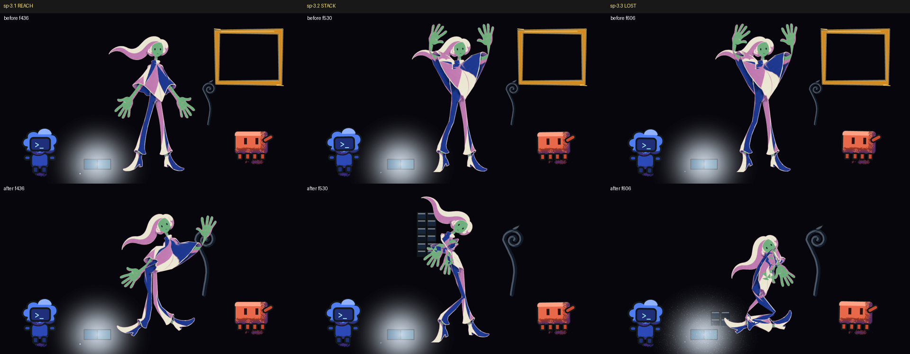

# Beat 3 restaged and acting on its three story points, the frame out of beats 1-3 (2026-10-19)

The owner has not watched this. It is the second slice of plan row 9.6 (`plans/animation-scaffold-2026-10-14.md`): beat 3 (cant-build, frames 420-629) now stages the three story points of `v3/screenplay.json`, sp-3.1 REACH, sp-3.2 STACK and sp-3.3 LOST, so that `probe-story.py` passes all three, and the gold frame no longer hangs at the top right of beats 1-3 (p021). The renders, probes and strips below were made by hand with the commands the chain's gates run, and each is labelled as such. The frame sequences are `out/animatic-07-draft-seq` (composed, 1950 frames at 1280 x 720), `-fig-seq` (the human alone), `-figline-seq` and `-seq-b` (every tenth frame again); the half-size video is `out/animatic-07-draft.mp4`. The earlier drafts are kept.

Codes used below

D-numbers are owner rulings (`v3/creative-spec.md`); p-numbers are proposals on the bible page (`v3/proposals/`); sp-numbers are story points of `v3/screenplay.json`. A "key" is a drawing the human holds; a "hold" is a drawing left on screen; "stage pixels" are the 1280 x 720 picture. The strip shows frames 436, 530 and 606, each inside its story point.

## What the viewer sees now

- **Before the reach, 420.** She stands in the mess the flood left, arms down, a tall dark stalk beside her on the right and Clawd beyond it. The gold frame that used to hang above Clawd is gone, from the first frame of the film.
- **Reach, 430.** She pulls back a little (422), then the right arm goes out and the hand closes on the stalk's curl on 430-432. The stalk is pushed 20 px toward her and slides back to where it was on 449, 17 frames after the contact. The dial's light on the floor does not change: one colour, one strength, one place.
- **Stack, 500.** Both hands come up together at her chest and three patches rise beside her on 500, 508 and 516, one on top of the next. The stack stands to 534-541, then collapses: the top two drop out of the bottom of the picture (off the stage on 547 and 550, three frames apart) and the bottom one falls to the floor and stays, with a bounce of 8 px. Codex, at frame left, does not move and keeps one drawing of his boil from 500 to 547.
- **Lost, 580.** She sinks to the floor and folds forward over her knees, the lowest she is in the film so far (418 px tall; the tallest key of the beat is 636 px on 556, the reach 519 px, and the settle into the seat on 578 is 423 px). The lamp's glow takes more and more speckle from 570 to 604, so the dial is lost in the grain. Clawd leans toward her on 594 and walks out of the picture on the right, and is out of it from 626 to the cut.

## The three story points, before and after (`probe-story.py`)

Before is `out/animatic-07-draft-story-before-s02.txt`: the same probe (with the measure recipes of the screenplay) on the frames of animatic 06 and the blocking, key sheets and pose sheets of the commit that draft was made from; after is the same command on the new frames (`out/animatic-07-draft-story.txt`).

| Story point | Before | After |
| --- | --- | --- |
| sp-3.1 REACH | FAIL: `no key or pose carries storyPoint sp-3.1`; `'stalk' stays at (880, 470) the whole window` | pass: `key 'reach' at f432`; `human and stalk are 0 px apart at their nearest (f430, the human read as her hands); within 12 px needed`; `'stalk' leaves its start at f433 and is back at f445`; `emitter colours 1 and strength spread 0.00 across f430-499` |
| sp-3.2 STACK | FAIL: `no key or pose carries storyPoint sp-3.2`; `'patch' is not in the blocking at f579`; `peak count 0 (needs 3)`; `0 prop(s) off` | pass: `key 'stack' at f500`; `'patch' present, 1358 px change within 150 px of (480, 600)`; `peak count 3 (needs 3), 1 at f579`; `off frames [547, 550]: the smallest gap is 3`; `codex stays where it is f500-579` |
| sp-3.3 LOST | FAIL: `no key or pose carries storyPoint sp-3.3`; `clawd is at (940, 470) on stage at f629`; `the figure is 628 px tall at f629; the lowest height since the beat began (f420) is 571 px` | pass: `key 'sit' at f580`; `clawd offstage: (940, 470) -> (1330, 470)`; `the figure is 418 px tall at f629; the lowest height since the beat began (f420) is 418 px at f582` |

The whole film reads `FAIL: story - 19 of 29 checks failed`, down from 22 on the same probe over animatic 06's frames, and the 19 are the story points outside beat 3 that failed before.

## How each part was made

**1. The frame leaves beats 1-3 (p021, th-frame-portal).** `blocking.frame` is optional now (`src/library/animation/blocking.ts`; `PropsLayer` and the shaded world draw it only when the beat has one), and the arrival, everything-at-once and cant-build files carry none. The frame of beat 4 is still carried in by Clawd from 690 (its box stands off the picture until then, as before), so beat 4 is not touched; `probe-theme.py` reads it as `th-frame-portal (portal): the frame is on no frame before sp-4.2 (f690) and on every frame from f740 to f1949`. Control for the change: the same frames 0-629 rendered from the committed tree (`git archive` of the commit the draft was made from, a copy of the tree) against the new ones, `out/animatic-07-draft-step1-compare.txt`: every frame differs, 22 221 pixels at most on frame 137, which is the frame's own rectangle; 215 240 pixels over the 630 frames (1.7 % of what changed, at most 2 585 on one frame, 0.3 % of the picture) lie outside it, 80 % of them within 3 px of an edge in Codex's, Clawd's and the box's outlines and the bubble's, and the rest in the dither. So the change is the frame's pixels and a ring of outline and dither pixels on the other props; what moves those is not isolated (the light layer reads the frame as an occluder, or the layer's raster changes with one sprite fewer), and nothing moves position. `probe-story.py` on those frames gives the same result set for sp-1.1 to sp-2.3 as on the committed tree's (`out/b3/step1-story.txt` against `step1-story-head.txt`: pass on sp-1.3 and sp-2.2, and the same four lines the measure recipes fail on before the change: the hands drawn from frame 0, the lit area that does not grow after the lid, the field hue that does not jump, the shrink that is as tall as the joy), and the eye trace on 0-419 reads `0 frame(s) over 3 % of the width` on 418 frames, before and after.

**2. Beat 3 plays its own pose sheet.** Beat 4's sheet (`v3/poses/s02-the-frame.json`) is untouched: a `sit` key on 580 followed by `slump` on 630 would have put a move between them inside the cut, so beat 3 has its own shot, `s02-cant-build` (`v3/poses`, `v3/keys` and `v3/charts`, `blocking.poseShot`), in film frames: `ready` 420 (hold 2), `reach` 432, `stack` 500, `sit` 580, each from `solvePose` and `npm run plates`, each bound to its story point (`ready` to sp-3.1, because `probe-poses.py` asks every key to serve a story point of its beat). The moves are authored (`author-breakdowns.mjs`): four drawings from `ready` to `reach` (anticipation 422, passing 426 and 428, settle 430), five from `reach` to `stack` and from `stack` to `sit` (the anticipation held 12 frames, then three passing drawings at most 4 frames apart, then the settle two frames before the key). The three long holds (44, 56 and 50 frames) are declared; the home family's parts rig holds every pose (`strained` 0.0064 to 0.0356, `inverted` at most 0.0006). One new solver field was needed for the seat: `weight.sink` (0-0.5 of the leg's length, default 0) lowers the hips and bends both knees (`pose.ts`, `solvePose` only; `sit` is 0.38 with a bow of 0.12), because the spine alone does not get her down: the deepest spine of the film, the slump's, lowers a standing figure 5 % (613 px against the entry key's 646), and a seat with the hips sunk 0.3 and a bow of 0.2 strained the poncho 0.0678 against the mesh's limit of 0.06 and was refused. Plates: `plates-from-poses.mjs` now carries each key's `storyPoint` from the pose sheet to the key sheet (it dropped it, and the new story-point check of `probe-poses.py` reads both).

**3. REACH (430).** `ready` to `reach` in ten frames; the hand lands on the stalk's curl (`contacts`: human and stalk, frame 432). The stalk has `at` keys 430, 437 and 449 (880 -> 860 -> 880 px): it is nudged 20 px and is back at its start 17 frames after the contact (the recipe allows 20). The stalk is drawn at 0.7 of its old scale so that the arm reaches its top.

**4. STACK (500).** Three patch props (`patch`, `patch-2`, `patch-3`, one drawing, the names the screenplay's recipes use; the actor tables carry them) rise on `at` keys from the floor on 500, 508 and 516 to the stack at the hands (x 520) and stand there. Then the fall: each sags 8 px for two frames (the settle, with no hold in the air) and drops; `patch-3` leaves the stage on 547 and `patch-2` on 550, at the picture's bottom edge, and `patch` lands on the floor with a bounce and stays, which is what `rises-then-falls` (peak 3, 1 on 579), `stagger` on `off` (gap 3) and `stack.collapsed` (`patch` present) can all hold at once (p022). Codex has `hold: {from: 500, to: 548}`: `PropsLayer` draws him as the frame the hold starts on, so one boil variant stands for the whole stack and its fall (`out/animatic-07-draft-beat3-measures.txt`: 1 distinct drawing of him on the 17 sampled frames of 506-538, 18 distinct on the 86 sampled outside the hold).

**5. LOST (580).** `sit` holds from 580 to the cut. Clawd has keys 580-626 (940 -> 926 -> 1330): he leans toward her on 594 and leaves; his pigments read 5 266-5 394 px on 560-612 and 0 px from 620. The grain is a blocking field now, `grain: [{frame, amount}]` (0.05 on 570, 0.4 on 604): `grainAt` reads it, the animatic's `emitter.grain` carries it to `Radiance`, which draws the speckle at that alpha and in proportion more of it above the settled 0.05, inside the lamp's glow; every other beat keeps its constant 0.05 (`light.json`'s `grain: high` is a label the probe reads and nothing drew before).

## What else moved

`compare-renders.py` of animatic 07's frames against the commit's own (the same frames rendered from a copy of the committed tree): beat 3 differs, and beats 1-2 differ by the frame's pixels (above). On 17 sampled frames from 630 to 1949 the committed tree's render and this one differ by 0 pixels, once by 38 (frame 1300, rasteriser noise). Against animatic 06 and 05 draft 2, whose frames are older than the commit, `out/animatic-07-draft-vs-06.txt` reads `1950 frames in both; 270 identical; differing runs (first-last, most pixels): 0-629 (163787), 900-1949 (10653)` and `-vs-05-draft2.txt` reads `1950 frames in both; 1318 identical; differing runs (first-last, most pixels): 0-629 (163787), 709 (98), 713 (102)`; the differences from 06 after 900 and from 05 draft 2 on 709 and 713 are in the committed tree's own render too (0 px between it and this one on those frames: the earlier drafts were made before the last edits of other workers), not in this change. The sample is `out/animatic-07-draft-vs-committed-tree-sample.txt`.

## Gates (by hand, on these frames)

| Gate | Result |
| --- | --- |
| `probe-story.py` | sp-3.1, sp-3.2, sp-3.3 pass (above); sp-1.1 to sp-2.3 read as they did on the committed tree's frames; the film `FAIL: story - 19 of 29 checks failed` (22 of 29 on animatic 06's frames, same probe) |
| `probe-eyetrace.py` on shot s02 (420-929) and s01 (0-419) | `pass: eye-trace - the brightest region outside the fixed roles sits within 3 % of its story point's target on all 368 measured frames (142 skipped)` and `... on all 418 measured frames (2 skipped)`; animatic 06's frames read the same 368 and 0 over |
| `probe-blocking.py` | `pass: blocking-contract - 8 beats staged: actors placed, emitter inside the frame, a card cited, identity boxes apart, props apart` |
| `probe-poses.py --shot s02-cant-build` | `pass: poses - 1 shot(s) (keys joints): keys, line of action, twinning, weight, breakdowns, secondaries, holds, timing shape, lead arm and story point all as declared` |
| `probe-all.py --contract v3/poses v3/keys v3/charts` | `FAIL: probe-all --contract - 1 of 2 probe runs passed, 2 shot(s) skipped`: 8 of 63 pose checks, all on four s01 keys with no story point (`grip`, `brace`, `joy-c`, `flinch`), which the story-point check added to `probe-poses.py` by the probe work refuses; with the s02 sheets alone (`out/animatic-07-draft-contract-s02-only.txt`) `pass: probe-all --contract - 2 of 2 probe runs passed, 1 shot(s) skipped` |
| `probe-followthrough.py` on `npm run played-joints -- s02-the-frame` | `pass: followthrough - s02-the-frame: 2 secondaries, 19 checks: each trails its primary by its material's lag, settles after it and answers a step as declared`; the dump's 360 rows are the committed tree's own |
| `probe-all.py ... --shot s02-cant-build-frame` (420-929, all seven probes) | `pass: probe-all - 7 of 7 probes passed` (a first render of the sheet read `hold-band` FAIL: two anticipation drawings held 6 frames, 476-481 and 556-561, under the band's 11; they are held 12 now) |
| `probe-all.py` on the film | `FAIL: probe-all - 5 of 7 probes passed`: the eye trace (230 frames over 3 %, the first on 1382) and the colour pair (1612-1613 and the crossing at 1615-1685) fail in beats 5-8, as before; twos, hold band, screen time, loop closure and determinism pass |
| `probe-props.py` | `pass: props-drawn - 19 props named by the blocking are all on their beats' frames` |
| `measure-staging.py` over 630-930 | `pass: staging - 0 fault(s) over 300 frames` |
| `probe-theme.py` | `th-frame-portal (portal): the frame is on no frame before sp-4.2 (f690) and on every frame from f740 to f1949`, `th-glass`, `th-one-join` pass; `th-light-leads` fails on beats 5-8's targets |
| `npm run typecheck` | exit 0 |
| `npm run bible` | `pass: bible e7e71bef2622 covers 1950 frames in 10 tracks (390 items), 23 proposal(s) sit inside their beats, 56 ruling(s) mirrored, and the page shows this bible` |

The measure lines are also read off the frames and the blocking by `out/b3/measure-beat3.py` (`out/animatic-07-draft-beat3-measures.txt`), each with a control (the stalk's path, one colour and one strength of light, the patches on stage by frame, Codex's pigment masks inside and outside the hold, Clawd's pigment pixels, the figure layer's height).

## What is open

- **p022** (finding): the recipes read a fall as an `off` frame, so two patches leave the stage and one lands; "three come down, each a settle" is drawn that way.
- **p023** (finding): `npm run plates` renders `KeyFilmS01` whatever shot it is given, so the plate-versus-film measure and `measured` do not exist for `s02-cant-build` (nor for `s02-the-frame`); the plates and the key sheets are written before that step and `probe-poses.py` reads them.
- The seat is a crouch: the home family's mesh holds `sit` (the hips sink 0.38 of the leg, the spine folds 0.12), but the boots swing out and the legs read as splayed; a real seat on the floor wants its own plate family.
- Clawd leans and leaves; he has no gaze, so "looks at the human" is a lean of 14 px.
- Codex's wince is a held drawing, not a smaller one: the recipe `codex holds still` forbids a move, and a boil variant is the renderer's, no layer records it.
- The stalk is a placeholder spiral at a larger scale than beat 2's (0.7 against 0.6, and facing the other way); it glides from beat 2's place over the last 24 frames of beat 2, as before.
