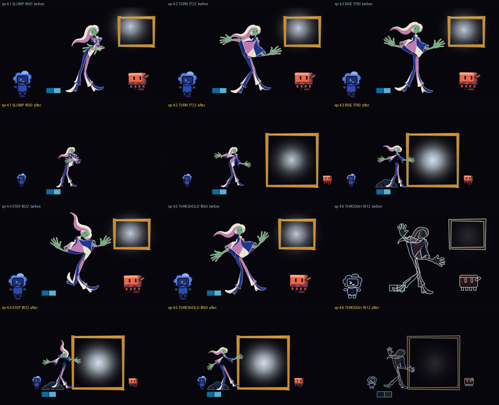

# Beat 4 restaged wide, and acting on its six story points (2026-10-19)

The owner has not watched this. It is the first half of plan row 9.5 (`plans/animation-scaffold-2026-10-14.md`): beat 4, the frame, now stages D101's wide picture and plays its six story points, so that `probe-story.py` passes `sp-4.1` to `sp-4.6`. The chain run (animatic 05) is the second half and has not been made; the renders, probes and strips below were made by hand with the commands the chain's gates run, and each is labelled as such. Every other beat is the same picture as animatic 04's (see "What else moved").



The video is `out/animatic-05-draft.mp4` (65.0 s, 1950 frames at 30 fps, half size, one watched preview at concurrency 4); the frames the probes read are `out/animatic-05-draft-seq` (composed), `-seq-b` (every tenth frame again), `-fig-seq` (the human alone) and `-figline-seq` (the line-world frames), all at 1280 x 720.

<details><summary>Codes used below</summary>
D-numbers are owner rulings (`v3/creative-spec.md`); p-numbers are proposals on the bible page (`v3/proposals/`); sp-numbers are story points of `v3/screenplay.json`. A "hold" is a drawing left on screen. "Stage pixels" are the 1280 x 720 picture.
</details>

## What the viewer sees now

- **Slump, 630.** The picture cuts wide. A small bowed figure stands left of centre on a dark floor, her kit blocks at her feet, Codex small to her left. Nothing else is there: no frame, no Clawd, no light. The 60 frames are still.
- **Turn, 690.** A lit rectangle slides in from the right edge, large, carried by Clawd, who trails behind it and stops at its right side on 738 (the light in its interior travels with it, so no glow is ever left behind). As it comes, her head turns toward it first and her shoulders follow eight frames later.
- **Rise, 740.** She straightens with her arms wide. On 760, the frame the rise hold ends, the heavy poncho is gone from her (a lighter figure) and a dark heap of cloth lies on the floor around her feet. The heap stays.
- **Step, 800.** Codex walks the 150 px from the left to the heap and, on 812, its foot meets the heap's edge and the heap shifts 8 px. That is the gag.
- **Threshold, 840.** One hand on the frame's left edge, the heel tapped as the pose sheet draws it.
- **Through, 900.** The crossing begins; the frame is the large lit shape everything else dims around. The cut out of the beat is on 930, in the middle of the line phase.

What the picture is made of: the frame is 400 x 410 at (590, 190) with its base on the floor line her feet stand on (it was 280 x 230 at the top right); the human is drawn at 0.34 of the scale she was (0.58), Codex at 0.9 (1.8), Clawd at 0.75 (1.5). The picture is wide on purpose (D101, p013): the field narrows to the lit frame (D91).

## The six story points, before and after (`probe-story.py`)

Before is `out/animatic-04-story.txt`; after is `out/animatic-05-draft-story.txt`, the same command on the restaged frames.

| Story point | Before | After |
| --- | --- | --- |
| sp-4.1 SLUMP | pass | pass |
| sp-4.2 TURN | FAIL: `clawd is (940, 470) at f689 and (940, 470) at f739: it does not enter inside the story point`, and `world: ... nothing differs` | pass: `clawd onstage: (1700, 499) -> (1002, 499)`, `emitter (787, 394) at f739, frame (590, 190, 400, 410)`, `records: clawd moves 698 px` |
| sp-4.3 RISE | FAIL: `figure area -1.4 %`, `'heap' is not in the blocking at f799` | pass: `figure area -14.4 % between f739 and f799`, `'heap' appears, 1857 px change within 150 px of (436, 602)` |
| sp-4.4 STEP | FAIL: `codex moves 0 px toward the frame` | pass: `codex toward-frame: (110, 474) -> (262, 474)`, `records: codex moves 152 px` |
| sp-4.5 THRESHOLD | pass | pass |
| sp-4.6 THROUGH | pass | pass |

`pass: story` for the six; the whole film reads `FAIL: story - 21 of 29 checks failed`, down from 24, and the 21 are the story points outside beat 4 that failed before (their lines differ from animatic 04's only where the heap now shows in a record).

## How each part was made

**1. Blocking reads `on`, `off` and position keys.** `src/library/animation/blocking.ts` gained `resolveBlocking(blocking, frame)`, which `blockingAt` runs on every frame: a prop with `on` and `off` is on stage only between them; Codex, Clawd, the frame and any prop with `at` keys stand where the keys put them (base before the first key, smooth between keys, the last key after). Two lines beyond what the row asked for, both so that the light is never left behind: `frame.carriedBy: "clawd"` (the frame travels with Clawd's offset from his last key) and `emitter.follows: "frame"`. `cutIn` and `cutOut` say a beat is entered or left by a cut: without them beat 4's new scale would ease in over the last second of beat 3 and Codex and the frame would shrink on screen. `probe-blocking.py` reads the same fields (its documentation and control are in the README) and has a new `time` check; its control now also refuses a prop that comes on after its beat ends, one that goes off before it comes on, a position key outside its beat, a prop that comes on over another, a heap that moves further than its contact declares and a heap that lands on another frame than the cloak drops, and accepts two props at one place that are never on stage together:

```
control: ... a prop on after its beat has ended -> FAIL (props and positions timed inside their beat); a prop that goes off before it comes on -> FAIL (props and positions timed inside their beat); a position key outside its beat -> FAIL (props and positions timed inside their beat); a prop that comes on over another -> FAIL (props apart); a heap that a contact says moves 4 to 12 px and moves 20 -> FAIL (props apart); a heap that lands on another frame than the cloak drops -> FAIL (props and positions timed inside their beat); ... clean fixture, ... and a heap that comes on the frame the cloak drops -> pass (0 failures)
```

Seven edits of the real file each fail and the unedited file passes (`out/animatic-05-draft-blocking-mutations.txt`): the heap moved under the frame, the human's contact with the frame removed, the heap's `on` after the beat, the heap's `on` before the pose sheet's `dropsAt`, a 20 px shift against the contact's 4 to 12, Codex stopping short of the heap, and a Clawd key outside the beat.

**2. Turn (sp-4.2).** Clawd's base `x` is 1700, off the stage, with keys on 690 and 738; the frame is carried by him, so it is off the stage until about 700 and arrives with him. The head turning first is a change to the pose sheet's breakdowns: `scripts/animation/lead-breakdowns.py` redraws the head and neck of the slump -> turn move about the torso so that the angle from the torso to the head reaches its final value when the body is 0.6 of the way. Its own measure reads the move before and after:

```
before  the chain's turn reaches 90 % on frame 688, the body's on frame 688: the chain is 0 frames ahead
after   the chain's turn reaches 90 % on frame 680, the body's on frame 688: the chain is 8 frames ahead
```

The pose gate and the follow-through gate still pass on the edited sheet (`pass: probe-all --contract - 2 of 2 probe runs passed, 1 shot(s) skipped`), and the joints-only in-betweens (arcs, spacing, overlap) pass on the played joints.

**3. Rise (sp-4.3).** The heap is a new placeholder prop in `src/library/props/Heap.tsx`, named `heap` in the blocking, `on: 760`, in beat 4 and again in the home settle. The cloak of the pose sheet is the rig's `poncho` part (its `dropsAt` is 760): from that frame the human is drawn as the parts rig without the poncho (`animaticPlan.garmentAt`; the same parts rig the key plates are built from, in the order each key's lead and weight give it). `probe-story` reads the figure layer's area fall by 14.4 % (it needed 10 %). This is the one place a decision is left open: see p016 below.

**4. Step (sp-4.4).** Codex has keys on 788 and 812 (110 -> 262); the contact is declared in the blocking on 812 with the heap shifting by 4 to 12 px (it shifts 8 on 812 -> 822), and `probe-blocking.py` measures it.

**5. Wide staging (D101).** `scripts/animation/measure-staging.py` (new; control: animatic 04's first render, where it names 19 frames of cut feet in 725-759) on the restaged frames:

```
 630 fig (432, 294, 624, 604) codex (128, 506, 197, 551) clawd None props out of picture: ['frame']
 720 fig (367, 294, 654, 603) codex (125, 506, 194, 551) clawd (1247, 523, 1280, 559) props out of picture: none
 840 fig (313, 275, 595, 605) codex (241, 505, 310, 550) clawd (988, 523, 1052, 559) props out of picture: none
 929 fig (400, 293, 640, 596) codex crossing clawd crossing props out of picture: none
span 630-929: figure ink within 2.0 px of an edge on 0 frame(s); codex seen on stage from frame 630
pass: staging - 0 fault(s) over 300 frames
```

The lowest ink row of the figure is 609 of 719 (animatic 04's cut it from 733 to 906). The frame is listed as outside the picture on 630-689 because it has not come in yet (sp-4.1: nothing moves).

## What else moved

`python3 scripts/animation/compare-renders.py out/animatic-seq out/animatic-05-draft-seq` (control first: a frame against itself reads identical, against a copy with a 30 px square painted over it different) reads:

```
1950 frames in both; 1382 identical; differing runs (first-last, most pixels): 630-929 (362900), 1682-1949 (1930)
largest difference: 362900 px on frame 879
```

Beat 4, and the home settle from 1682 on, where the heap now lies under the figure at the bottom of the picture (it is half the scale there, 1930 px at most). The art, crossing and programming worlds carry no heap: the heap is a home prop.

## Gates (by hand, on the restaged frames)

| Gate | Result |
| --- | --- |
| `probe-story.py` | six of six in beat 4 pass (above) |
| `probe-blocking.py v3/timeline.json v3/blocking` | `pass: blocking-contract - 8 beats staged: actors placed, emitter inside the frame, a card cited, identity boxes apart, props apart` |
| `probe-all.py --contract v3/poses v3/keys v3/charts` | `pass: probe-all --contract - 2 of 2 probe runs passed, 1 shot(s) skipped` |
| `probe-all.py out/animatic-05-draft-seq ...` | twos, hold band (`pass: hold-band - 34 holds in the band or declared, 12 moves of 3-6 drawings, 15 pops, 7 intentional long holds listed`, the same counts as before), screen time, loop closure and determinism pass; eye trace and colour continuity stop with an input error (below) |
| `probe-props.py` | `pass: props-drawn - 9 props named by the blocking are all on their beats' frames` |
| `npm run bible` | `pass: bible ... covers 1950 frames in 10 tracks ...` (the last line is in the handoff) |

Eye trace and colour continuity refuse to run: `input error: blocking actor 'heap' has no native size in probe_common.PROP_NATIVE`. `probe_common.py` belongs to the light work and was not touched; the one entry it wants is `"heap": ((84, 64), (168, 66))`. With that entry added in memory by a three-line wrapper that then runs the probe (no edit of the file), the eye trace reads 94 of beat 4's 300 frames over 3 % (it read 270 before, p011): 690-738 against the frame's final box while the frame travels, and scattered 4 to 8 % frames at 740-813 and 888-899; colour continuity reads two beat-4 frames off the pair (712 and 718, hue 230 against 214/205).

## What is open

- **p015** (finding): three measure lines of the screenplay name the human (sp-4.4 "human x moves toward frame >= 60 px", sp-4.5 "hand within 8 px", sp-4.6 "human crosses frame x"); the probe reads Codex, and the human has no travel in the pose sheet or the blocking.
- **p016** (owner-ask, default `hold`): the cloak is the Swoop's own poncho; the heavy Cloak of D69 has no asset. From 900 the contour worlds draw the one-piece mesh, which still has its poncho.
- Clawd is drawn with one raised arm, to the right of the frame he carries; "holding the frame up with both arms" is not in the picture.
- `npm run typecheck` reports two type errors in `Root.tsx` and `animaticPlan.ts` (the layout's `cameraPose.span` read as `number[]`); they come from `92617ae7` and are not touched here.
- The emitter is on from 630 (C18 hands off 2 frames after the dial of beat 3) and sits where the frame will be; it is off the stage until the frame comes in, because it follows the frame.
