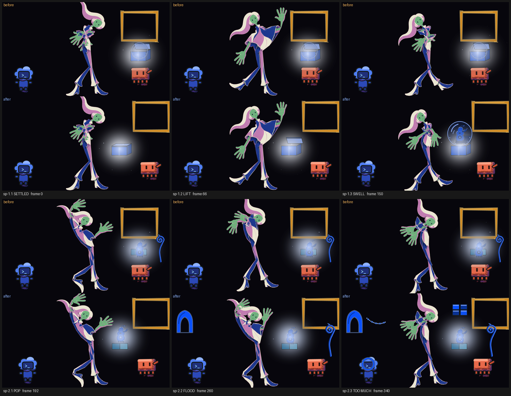
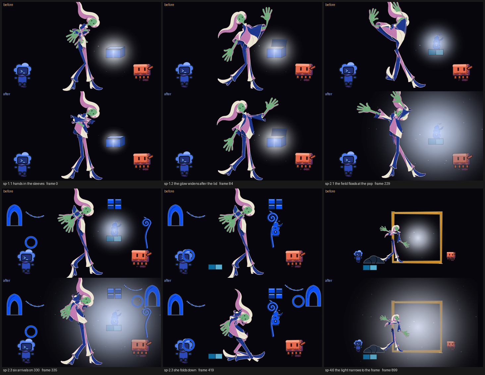

# Beats 1 and 2 restaged and acting on their six story points (2026-10-19)

The owner has not watched this. It is the first slice of plan row 9.6 (`plans/animation-scaffold-2026-10-14.md`): the arrival (frames 0-180) and everything-at-once (180-420) now stage the six story points of `v3/screenplay.json`, sp-1.1 to sp-2.3, so that `probe-story.py` passes all six and the eye trace holds on the whole shot. The renders, probes and strips below were made by hand with the commands the chain's gates run, and each is labelled as such. The frame sequences are `out/animatic-06-draft-seq` (composed, 1950 frames at 1280 x 720), `-fig-seq` (the human alone), `-figline-seq` and `-seq-b` (every tenth frame again); the half-size video was not rendered, because the box was at load 60 with another worker's render beside it and the render could not finish (see "What is open").

Codes used below

D-numbers are owner rulings (`v3/creative-spec.md`); p-numbers are proposals on the bible page (`v3/proposals/`); sp-numbers are story points of `v3/screenplay.json`. A "key" is a drawing the human holds; a "hold" is a drawing left on screen; "stage pixels" are the 1280 x 720 picture. The strip shows frames 0, 66, 150, 192, 260 and 340, each inside its story point.

## What the viewer sees now

- **Settled, 0.** A closed box stands close beside her (it stood far to her right and was drawn half open). One light, at the box's seam. Codex far left, Clawd right, both still.
- **Lift, 60.** Her lifting key lands on 60, and the lid goes with it: shut until 54, 24 degrees open on 60, wide open (105 degrees) by 72. The lid is a prop now, with position keys, so it opens on the frames its keys say.
- **Swell, 110.** A glass bubble comes out of the open box on 110 and swells over the next 40 frames (a radius of 19 px on 110, 56 on 130, 93 on 150) while it rises; the gadget is inside it from 138. Codex starts to lean in on 106 (a step toward the box), Clawd four frames later, on 110. Her `awe` key lands on 110.
- **Pop, 186.** The bubble is gone on 190 (inside the story point's 186-229) and the gadget drops onto the kit's blocks by 196. Her `joy-a` key lands on 190.
- **Flood, 230.** The pieces arrive one after another: the stalk on 232 and the arch on 244, twelve frames apart, so the count goes from 0 to 2 by 329. She turns: her hips flip half a turn from 190 to 228 and half a turn again from 228 to 266, one full spin, then fold in (flinch, 300).
- **Too much, 330.** Her `shrink` key lands on 330. The ring, the patch (four blocks) and the bead (fifteen beads) all arrive on 330; the ring comes down into Codex's hands by 338; a stalk shoves Clawd 58 px to the left between 334 and 346. The brightest place in the picture is the gadget's lamp, which now stands between her and Clawd, so the eye finds the trio on 230-329 and her on 330-419.

## The six story points, before and after (`probe-story.py`)

Before is `out/animatic-05-draft-story.txt` (the render the previous slice left); after is `out/animatic-06-draft-story.txt`, the same command on the new frames.

| Story point | Before | After |
| --- | --- | --- |
| sp-1.1 SETTLED | pass | pass |
| sp-1.2 LIFT | FAIL: `key 'lift' is bound but at f66, 6 frames from the story point`; `'box' ... nothing outside the figure changes within 150 px of it (21 px against 600)`; `world: ... nothing differs` | pass: `key 'lift' at f60`; `'box' present, 6175 px change within 150 px of (895, 450)`; `props layer 6487 px` |
| sp-1.3 SWELL | FAIL: `key 'awe' is bound but at f104, 6 frames` | pass: `key 'awe' at f110`; `'gadget' appears, 8196 px change within 150 px of (905, 312)`; `records: box goes, bubble appears, gadget appears, lid goes, codex moves 24 px, clawd moves 22 px` |
| sp-2.1 POP | FAIL: `'bubble' is already gone before the story point (not in the blocking at f185)`; `world: ... nothing differs` | pass: `'bubble' disappears, 2552 px change within 150 px of (905, 285)` |
| sp-2.2 FLOOD | FAIL: `stalk/arch/ring/patch/bead count is 1 at f229 and 1 at f329`; `world: ... nothing differs` | pass: `count 0 -> 2`; `records: arch appears, stalk appears` |
| sp-2.3 TOO MUCH | FAIL: `key 'shrink' is bound but at f272, 58 frames from the story point` | pass: `key 'shrink' at f330` (and see the next section for what `human.small` really reads) |

The whole film reads `FAIL: story - 16 of 29 checks failed`, down from 21, and the 16 are the story points outside beats 1 and 2 that failed before.

**The eye trace, on 0-419** (`probe-eyetrace.py ... --shot s01-arrival-overwhelm`, with the five table rows below added in memory): before, `190 frame(s) over 3 % of the width` on 230-419 (7.6 % to 17.0 % off, worst at 418); after, `0 frame(s) over 3 % of the width`, 418 frames measured (`{'emitter': 228, 'human': 90, 'trio': 100}`), worst 1.2 % at frame 55. The light moved, not the eye line: the lamp stood about 100 px from the nearest of the three cast crops; the box, bubble, gadget and lamp now stand 145 px nearer the human, between her crop and Clawd's: 25 px from hers and 61 px from Clawd's.

## How each part was made

**Her keys moved to the story points' frames.** `lift` 66 to 60, `awe` 104 to 110, `shrink` 272 to 330 (prefer moving the key, the row said, and none of the three story points moved). Everything that holds her drawings moved with them, in the pose sheet, the key sheet and the chart (`out/b12/retime.py` reads the originals in `out/b12/orig` and writes all three): the moves between keys keep 3 to 6 drawings of at most 4 frames each, the authored in-betweens keep their joints (their key hashes did not change), and `grip` moved to 38 so the lift has its 6 frames. Two keys were added so she has something to do between the spin of 190-248 and the fold of 330: `joy-c` (266, a copy of `joy-a`'s drawing, which closes the spin) and `flinch` (300, a copy of `brace`'s drawing, the first tightening); the three new moves are authored with `author-breakdowns.mjs`. `probe-poses` and `probe-all --contract` pass on the new sheet. The two copies have no plates of their own (their key-sheet entries say so); `npm run plates` would build them.

**The staging.** `out/b12/stage.py` writes the two blocking files from the originals. The box, its lid, the bubble and the gadget stand at x 895 to 905 (they stood at 1040): that is the one move that turns the eye trace green, and it also brings the box to her reach, which on 66 and 110 now meets it (it stopped 75 px short on 66). Clawd stands at 1010 (988 after he leans), the frame's rectangle moved to the top right corner so the bubble clears it, and the kit's blocks and the join moved with the box.

**New props, drawn from their keys.** `src/library/worlds/actors.tsx` draws five more actors: `lid`, `arch`, `ring`, `patch` and `bead` (the last four are the pieces the gadget projects, built from the shapes `props/Pieces.tsx` already had, plus a two-by-two `PatchPiece`). A placement has no scale and no angle, so two props follow their position keys: the lid's anchor is the middle of its front edge, and the angle it is drawn open at is the one whose front edge stands at that height above the closed box (`lidAngleAtFrontY` in `props/Box.tsx`); the bubble's drawn size is a fifth of its `scale` where its centre is at the box's mouth and the whole `scale` from 87 px above. The gadget is drawn under the bubble now, so it reads as inside it.

**The props gate.** `render-props.mjs` rendered every actor on the middle frame of its beat, so a prop that comes on later in the beat (the bubble, the ring) was compared with itself and would have failed `probe-props`. It now renders such a prop on the middle of its time on stage (`<beat>--at-<actor>.png`) and writes `stills.json` with the frame of every still; `probe-props.py` refuses a with and a without still of two frames (a pair of two frames differs by a whole picture whether or not the prop is drawn: the first version of the fallback passed the planted missing still for exactly that reason).

## What the measure lines say, each against the file or the picture

`out/b12/measure.py out/animatic-06-draft-fig-seq` reads them:

| Measure line | Reading | Met |
| --- | --- | --- |
| sp-1.1 lid angle 0; emitter count 1 | lid angle 0.0 degrees on f0; one emitter in the beat | yes |
| sp-1.2 lid from 0 to open; key on the story point's frame | 0 degrees to 105 between 54 and 72; key on 60 | yes |
| sp-1.2 hands visible after, not before | both hands are drawn on f0 | no (p017) |
| sp-1.2 light area grows 4 frames or more after the lid | the glow is one constant size | no (p019) |
| sp-1.3 bubble grows over 40 frames; gadget inside | radius 19 to 93 px over 110-150; gadget on at 138 | yes |
| sp-1.3 Codex's lean precedes Clawd's by 4 | first move on 108 and 112 (keys 106 and 110) | yes |
| sp-2.1 bubble absent after the pop; one smear frame | gone on 190; no smear drawn | partly |
| sp-2.1 field hue area jumps | no change in the glow's size | no (p019) |
| sp-2.2 piece count from 0, staggered 3 or more | 0 on 229, 2 by 329, twelve frames apart | yes |
| sp-2.2 human turns 90 degrees or more | hips turn 180 degrees from 190 to 228 and 180 from 228 to 266 | yes |
| sp-2.2 eye on the trio | 0 of 100 trio frames over 3 % | yes |
| sp-2.3 shrink key on 330 | on 330 | yes |
| sp-2.3 6 arrivals or more on one frame | 3 named props on 330 (about 20 drawn pieces) | no (p018) |
| sp-2.3 Clawd moves 40 px or more | 58 px (keys 334-346) | yes |
| sp-2.3 Codex holds a prop | the ring is in his hands from 338 (contact declared on 338) | yes |
| sp-2.3 human height falls 15 % or more | 720 px on 329 and on 419; `human.small` reads -20.7 % only because beat 3's figure is 571 px on 420 | no (p020) |
| sp-2.3 eye on the human | 0 of 90 human frames over 3 % | yes |

## Gates (by hand, on these frames)

| Gate | Result |
| --- | --- |
| `probe-story.py` | six of six in beats 1 and 2 pass (above); the film `FAIL: story - 16 of 29 checks failed` |
| `probe-eyetrace.py` on 0-419 | `pass: eye-trace - the brightest region outside the fixed roles sits within 3 % of its story point's target on all 418 measured frames (2 skipped)`, with the five rows below; as the tables stand, `input error: blocking actor 'lid' has no native size in probe_common.PROP_NATIVE` |
| `probe-blocking.py` | `pass: blocking-contract - 8 beats staged: actors placed, emitter inside the frame, a card cited, identity boxes apart, props apart` with the rows; as the tables stand, `FAIL: blocking-contract - 2 of 8 checks failed: props apart, actor tables` |
| `probe-all.py --contract v3/poses v3/keys v3/charts` | `pass: probe-all --contract - 2 of 2 probe runs passed, 1 shot(s) skipped` |
| `probe-all.py` on the shot s01, with the rows | `pass: probe-all - 7 of 7 probes passed` |
| `probe-all.py` on the film | `ERROR` as the tables stand (eye trace and colour stop on `lid`); with the rows `FAIL: probe-all - 4 of 7 probes passed`, all four failures in beats 3-8 (the eye trace on frame 690 and the later beats' targets, the colour pair at 1612-1685, the loop probe on the line-phase frames from 919, which differ from animatic 05's because the beat-4 worker's swoop mesh is drawn there now) |
| `probe-props.py` | `pass: props-drawn - 16 props named by the blocking are all on their beats' frames`; its control, the ring's own still removed, reads `FAIL ... actor 'ring' is compared across two frames (everything-at-once.png is frame 300, everything-at-once--no-ring.png is frame 375)` |
| `npm run bible` | `pass: bible c26df999dc84 covers 1950 frames in 10 tracks (386 items), 20 proposal(s) sit inside their beats, 56 ruling(s) mirrored, and the page shows this bible` |

## What is open

- **The five table rows.** `probe_common.PROP_NATIVE` and `probe-blocking.PROP_EXTENT` belong to the beat-4 worker and need one row each for `lid`, `arch`, `ring`, `patch` and `bead` (`out/b12/table-rows.txt` has the text; `out/b12/with_tables.py` and `out/b12/shim/sitecustomize.py` add them in memory, which is how every "with the rows" line above was made). Until they are in, the eye trace, the colour probe and the blocking contract stop on the first of the five names.
- **p017** (finding): the hands are drawn from frame 0; nothing in the blocking or the sheets can put a sleeve over them.
- **p018** (finding): `blocking.actors` holds one actor per kind and `pieces.count` lists five, so six arrivals on one frame cannot be named.
- **p019** (finding): the animatic's light is one constant emitter per beat; the seam cannot widen after the lid and the field cannot jump at the pop. It needs a light key track.
- **p020** (finding): the shrink drawing is as tall as the joy drawings and the figure's scale cannot be keyed.
- The chart's other actors (`box.lid`, `bubble.size`, `gadget.rise`, `codex.lean`, `clawd.push`, `pieces`, `pulses`) still carry the old timing of the shot render (`ShotS01`: lid cracks at 44, pop at 180, pieces from 186); only the human's keys were retimed there, so a shot render of s01 would play the new human against the old props.
- Placement keys have no `scale`: the lid's angle and the bubble's size are read from `y`. A `scale` on `PlacementKey` (blocking.ts, the beat-4 worker's file) would let both say what they mean.
- The half-size video `out/animatic-06-draft.mp4` was not rendered (the render was stopped at 1159 of 1950 frames at load 60); frames 979-1299 of the composed sequence come from a second render because a shard of the first died on a page timeout.

## Beats 1 to 4 now meet every line of their story points that staging can meet (2026-10-19, second pass of row 9.6)

The owner has not watched this. The first pass of this study (above) left four measure lines of beats 1 and 2 open as findings (p017 to p020), and beat 4 two. This pass draws what those lines read: hands that are hidden in the sleeves until the lift, a glow whose size has keys, a figure that folds down inside the beat, and six named arrivals on frame 330. The draft is `out/animatic-08-draft.mp4` (65 s, half size, 1950 frames) with `out/animatic-08-draft-seq` (composed), `-fig-seq`, `-figline-seq` and `-seq-b`; the earlier drafts are kept. Renders, probes and the strip were made by hand with the commands the chain's gates run.

Codes used below

p-numbers are proposals on the bible page (`v3/proposals/`); sp-numbers are story points of `v3/screenplay.json`. A "key" is a drawing the human holds; "stage pixels" are the 1280 x 720 picture; the "figure layer" is the human alone on a flat field (`Animatic65Figure`). The strip shows frames 0, 84, 229, 335, 419 and 899.

### What the viewer sees now

- **Settled, 0 to 59.** Her hands are not drawn: the arms end at the wrist in the cloak. The seam of the box is a small glow (150 px across).
- **Lift, 60.** The lid starts up on 54; on 60 her hands appear with the lift, and from 58 the seam widens to 260 px, so the light follows the lid by about eight frames and then spills.
- **Pop, 186.** Inside the bubble the gadget's light is small (150 px). When the bubble goes the light floods to 700 px by 205: the picture goes blue around the gadget, and stays so through the flood and the overwhelm.
- **Too much, 330.** Six pieces arrive on the one frame (ring, patch and bead as before, and a second arch, ring and bead). Her `shrink` drawing holds 20 frames, then she sinks to the floor by 364 (knees bent, hips down, back over them) and holds it to the cut: 704 px tall on 329, 589 on 419.
- **Step through, 800 to 929.** The frame's light wells up as she nears it (260 to 700 px over 800-870), holds as she stands at its edge, and narrows to the frame by 918 as she steps through. The mean brightness outside the frame goes from 40.7 on 899 to 14.3 on 929.

### The lines, before and after (`probe-story.py`)

Before is `out/animatic-07-draft-story.txt`; after is `out/animatic-08-draft-story.txt`.

| Line | Before | After |
| --- | --- | --- |
| sp-1.1 cloak covers both hands | `17 finger-sized skin components on f0 (8 or more means both hands are drawn)` | `3 finger-sized skin components on f0` |
| sp-1.2 hands visible after, not before | `14 finger-sized skin components at f59, 15 at f109` | `5 finger-sized skin components at f59, 16 at f109` |
| sp-1.2 light area grows after the lid, lag 4 or more | `the lit area ... is 54966 px when lid starts to move (f55) and never exceeds 54966 px (+0.0 %) by f109` | `the lit area grows 10 % at f63, 8 frames after lid starts to move (f55); lag 4 needed` |
| sp-2.1 field hue area jumps | `6.6 % ... at f185, 5.8 % at f229 (-13 %)` | `6.9 % ... at f185, 15.2 % at f229 (+120 %; at least +100 % and 2 points needed)` |
| sp-2.3 silhouette height falls 15 % or more | `figure height +0.0 % between f329 and f419` | `figure height -16.3 % between f329 and f419` |
| sp-2.3 6 arrivals on one frame | `3 named arrival(s) on one frame at most (330: bead, patch, ring)` | `6 named arrival(s) on one frame at most (330: arch-2, bead, bead-2, patch, ring, ring-2)` |
| sp-4.6 outside luminance falls 50 % or more | `12.3 at f899 and 14.3 at f929 (+16 %)` | `40.7 at f899 and 14.3 at f929 (-65 %)` |
| sp-4.3 heap stays to 1950 | `gone at f934` | unchanged (p024) |
| sp-4.6 next frame's field is paper | `'home>crayon/line' at f930` | unchanged (p025) |

Thirteen of the fifteen story points of beats 1 to 4 pass; sp-4.3 and sp-4.6 each fail on one line that staging in beats 1 to 4 cannot meet. The film reads `FAIL: story - 7 of 29 checks failed`, down from 19, and the other five (sp-5.1, 6.1, 7.3, 8.2, 8.3) are the scaffold beats another slice is building.

### How each part was made

**The hands (p017).** A pose sheet may now say `covers: [{parts, until, why}]` (`PartCover`, `src/library/animation/pose.ts`). s01's sheet covers `handL` and `handR` until 60. The animatic draws a shot as the parts rig wherever the shot has a pose sheet (`poseSheets` in `animaticPlan.ts`, which holds s01's now), and the draw order leaves a covered part out on every frame before `until`, as it leaves the poncho out from `dropsAt`. So s01 is the parts rig from its first frame, which draws her legs and arms differently from the one-piece mesh on every figure frame of beats 1 and 2 (the keys' own `render.rig` already said `parts` and each holds: strain at most 0.0575 against the limit of 0.06). The forearms end bare while the hands are covered: a stub, not a sleeve; a sleeve is a drawn part.

**The glow (p019).** `emitter.at` (`GlowKey`, `glowAt` in `src/library/animation/blocking.ts`): `{frame, radius?, strength?}`, each field smooth between the keys that carry it. `animaticPlan` hands the result to the emitter the worlds already draw (`Radiance` took a radius). Arrival: 150 px to 58, 260 by 84. Everything-at-once: 150 px to 186, 700 by 205. The frame: 260 to 700 over 800-870, held to 899, 260 by 918. A radius of 430 was tried first for the pop and read +14 % on the hue share (the glow's core is near white, which the hue measure does not count), so the flood needed 700 (+120 %). The strength key is in the schema and unused here. The eye trace holds on the whole of 0-929 with the wider light.

**Six arrivals (p018).** The hyphen names of `patch-2` carry on: `arch-2`, `ring-2` and `bead-2` (`actors.tsx`, `probe_common.PROP_NATIVE`, `probe-blocking.PROP_EXTENT`), each placed apart from every other prop and from the cast, `on: 330` in v3/blocking/everything-at-once.json.

**The fold (p020).** One new key, `fold` (364, hold 56, `weight.sink` 0.46, bow 0.2, bound to sp-2.3), after the `shrink` drawing, which holds 20 frames instead of 90; four authored drawings between them (350, 354, 358, 362). `weight.sink` 0.3 read -8.5 % and 0.42 -14.3 %, so 0.46 (-16.5 % on the figure layer) is the least that meets 15 % with a margin; at 0.5 the boots splay sideways, and at 0.46 they still do. `npm run solve-poses` and `npm run plates` built the key (all eleven plates pass `measure-keys.py`; `joy-c` and `flinch` have plates of their own now). `KeyFilmS01` was a literal nine frames and measured only the first eight keys of the sheet; it follows the sheet now (`KEY_FILM_FRAMES`), and `film_compare.py` reads `element-<k>.png` unpadded, which a render of ten frames or more does not write, so the padded names were copied to the plain ones by hand before `measure-keys.py` ran.

**The four unbound keys.** `grip` (38) serves sp-1.1, `brace` (154) sp-1.3, `joy-c` (266) and `flinch` (300) sp-2.2, each the story point whose span holds its frame (`probe-poses.py` asks for a story point of the key's beat). `probe-all --contract` reads `2 of 2 probe runs passed`.

**The two lines left.** sp-4.3 `heap stays to 1950` reads the blocking of beats 5 to 8, which name no heap (p024). sp-4.6 `next frame's field is paper` reads frame 930, which the 70-frame crossing (895-965) puts in the middle of its line phase (p025).

### Gates (by hand, on animatic 08 draft)

| Gate | Result |
| --- | --- |
| `probe-story.py` | beats 1 to 4: 13 of 15 story points pass; `FAIL: story - 7 of 29 checks failed: s02/sp-4.3, s02/sp-4.6, s03/sp-5.1, s03/sp-6.1, s03/sp-7.3, s04/sp-8.2, s04/sp-8.3` |
| `probe-eyetrace.py` s01 (0-419) and s02 (420-929) | `pass: eye-trace - ... on all 418 measured frames (2 skipped)` and `... on all 368 measured frames (142 skipped)` |
| `probe-blocking.py` | `pass: blocking-contract - 8 beats staged: actors placed, emitter inside the frame, a card cited, identity boxes apart, props apart` |
| `probe-all.py --contract` | `pass: probe-all --contract - 2 of 2 probe runs passed, 4 shot(s) skipped` |
| `probe-all.py` on s01 and on s02 | `FAIL: probe-all - 6 of 7 probes passed` each: only determinism fails, on frames 920 and later, which belong to the crossing into the crayon world another slice is editing while this render ran (three renders of frame 930 made at 21:20, 21:31 and 21:56 differ by 6 723 to 15 194 pixels from one another; `probe-determinism.py` on s01 alone reads `pass: determinism - 42 frames`) |
| `probe-all.py` on the film | `FAIL: probe-all - 3 of 7 probes passed`: hold band (a 56-frame hold at 900-955 and two figure changes on 930 and 1650 with no row), eye trace (302 frames in the scaffold beats), colour continuity (crossing 1615-1685) and determinism, all in beats 5 to 8 |
| `probe-props.py` | `FAIL: props-drawn - 1 of 1 checks failed` on beat art-world's `crayon` alone; with that one actor taken out of a copy of the blocking, `pass: props-drawn - 35 props named by the blocking are all on their beats' frames` |
| `probe-theme.py` | `th-glass`, `th-light-leads`, `th-frame-portal` pass; `th-one-join` fails on sp-5.2 (three stroke props) in the scaffold beats |
| `npm run bible` | `pass: bible f4d4edc86f46 covers 1950 frames in 10 tracks (397 items), 25 proposal(s) sit inside their beats, 56 ruling(s) mirrored, and the page shows this bible` |

### What is open

- **p017 to p020** are met by the staging above; their proposals are still `open` for the planner to close with a ruling.
- **p024** and **p025** (findings): sp-4.3's heap needs a `heap` actor in the four later blocking files and a drawing of it in the crayon, line and shaded worlds; sp-4.6's world line reads a frame the crossing has not finished.
- Her forearms end bare before the lift; the fold's legs splay as the beat 3 seat's do (a crouch wants its own plate family).
- `npm run plates` rebuilt every plate of s01 and renumbered them (K8 is `joy-c` now, K10 `shrink`, K11 `fold`); `assets/human/keys/s01-arrival-overwhelm/K8.png` and its public copy differ from the committed file for that reason.
- The glow of 700 px puts a blue wash over the whole picture from 205 to 419 and 870 to 899; whether that is the Turrell flood the beat names or too much is the owner's to see.
