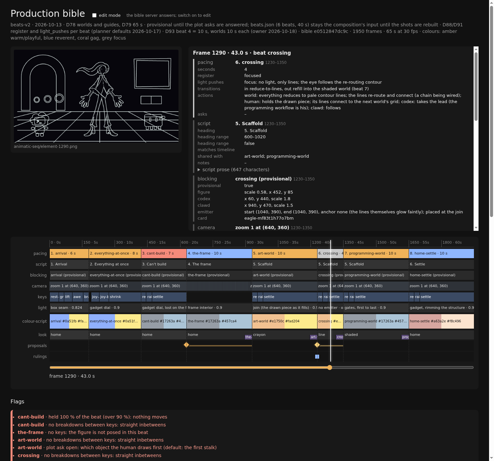
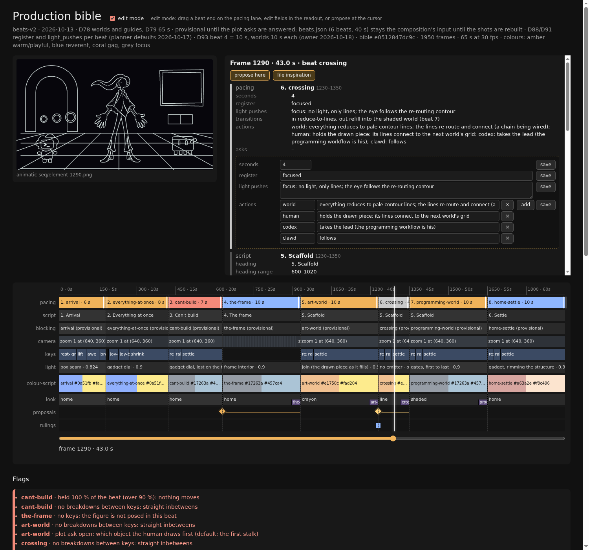
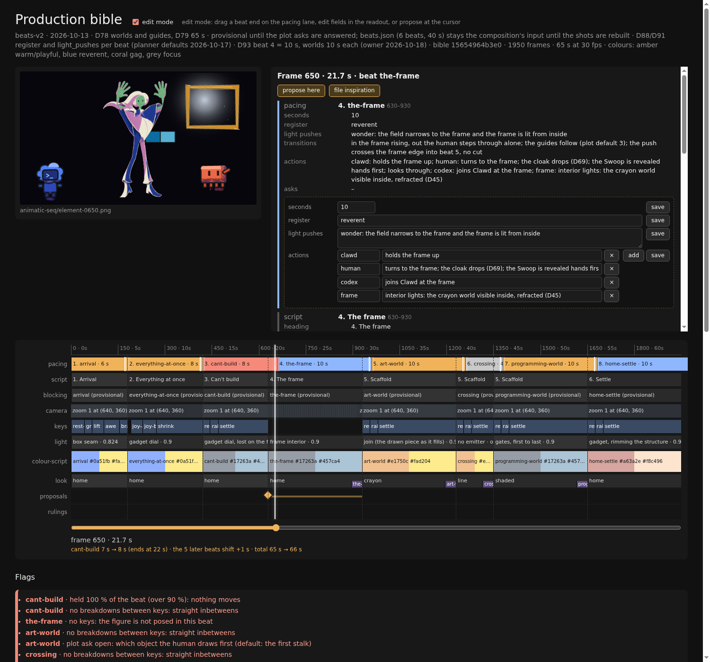
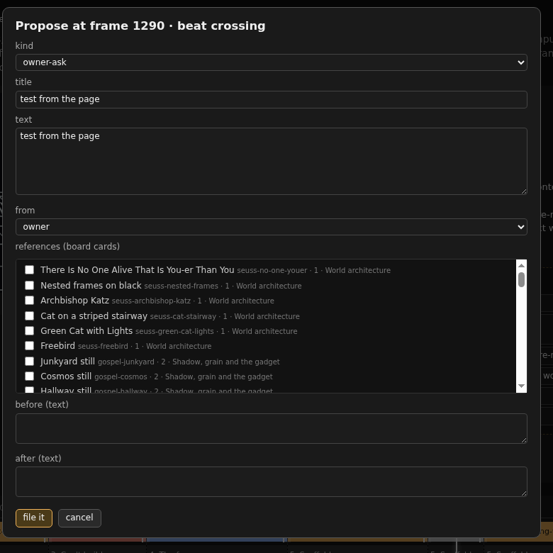
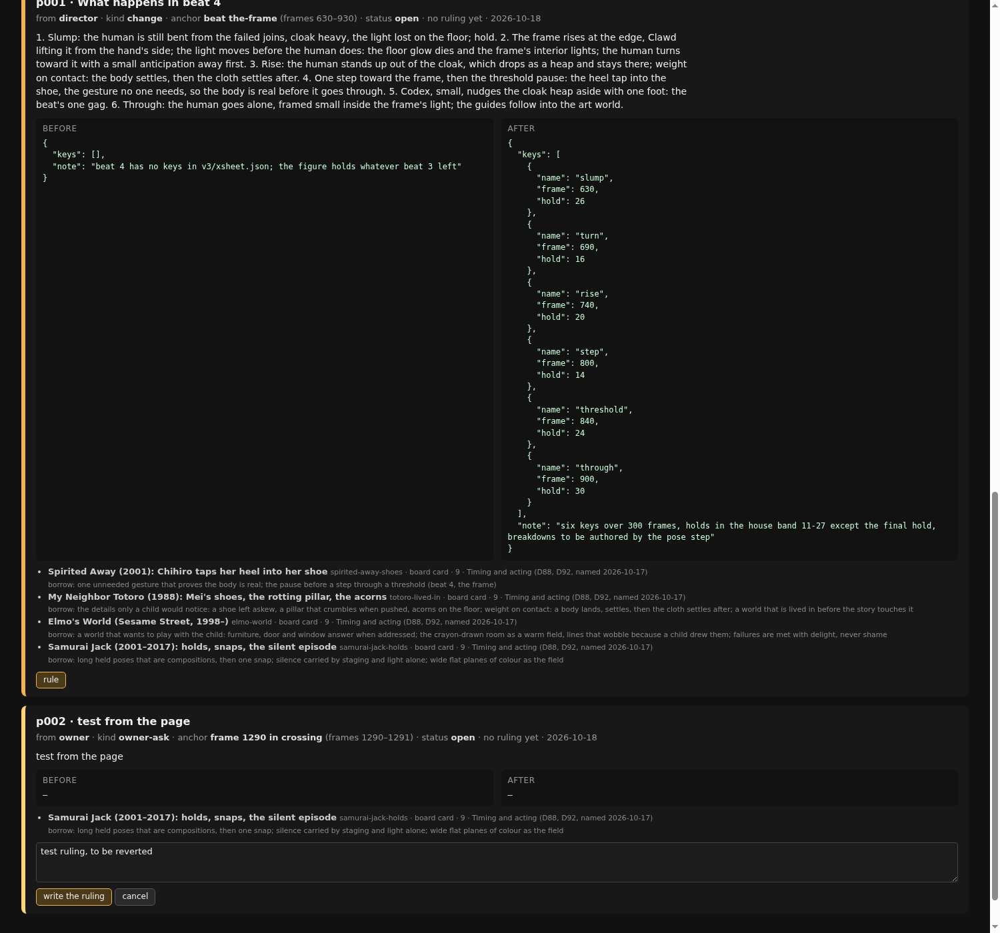
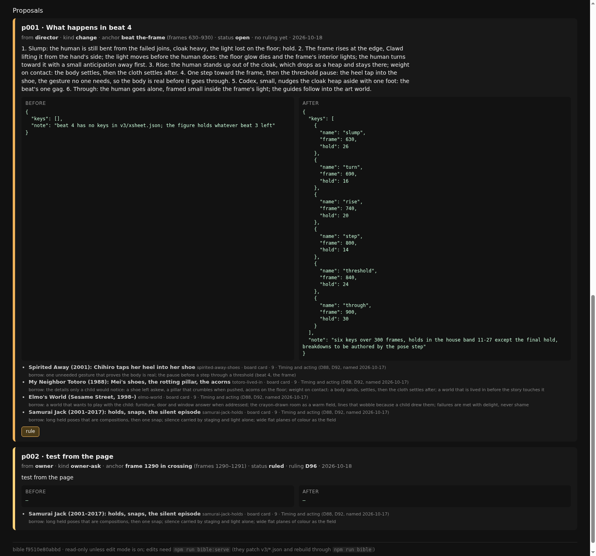
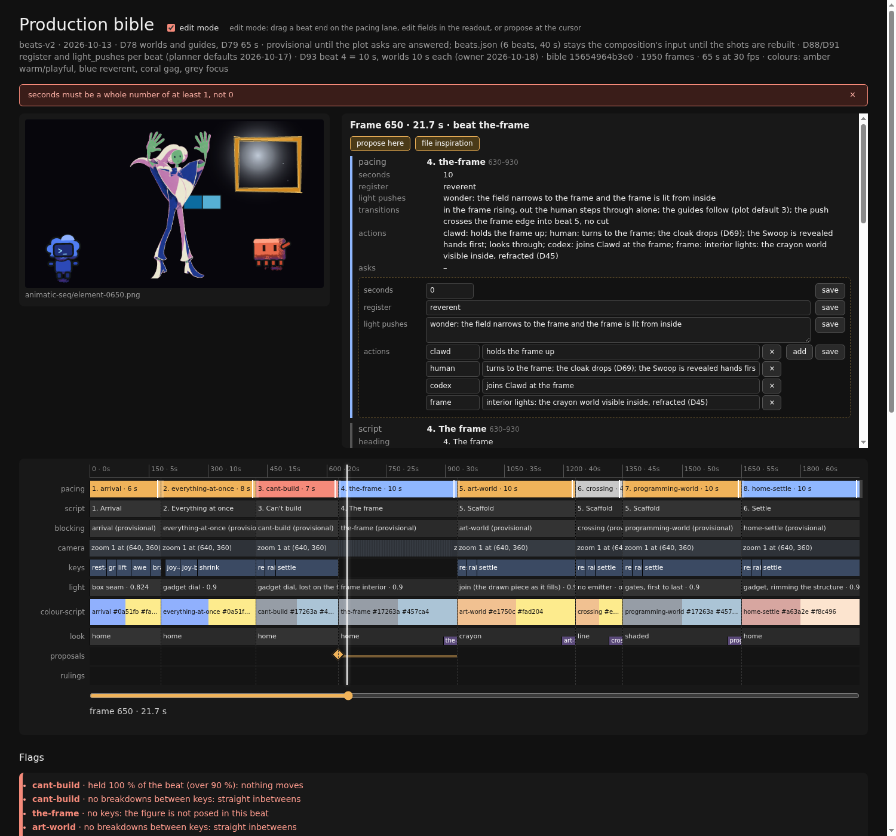

# The production bible (2026-10-18): one page to read the film and to change it

Open it with `npm run bible:serve` from `media/showcase`, then `http://127.0.0.1:8765/`. Everything on the page is built from the JSON files under `v3/` by `npm run bible`; the page never holds anything the files do not.

## Reading

- Drag the cursor on the axis, or click a lane. The readout lists every lane at that frame: pacing, script, blocking, camera, keys, light, colour script, look, proposals and rulings, with the animatic frame beside it.
- Flags, in coral under the lanes, are what the compiler found: a beat with no keys, a beat held for over ninety percent of its length, keys with no breakdowns, a plot ask still open, a stale sheet.
- The footer carries the bible's hash. The probe refuses a page whose hash is not the file's.

## Editing

Switch on **edit mode** in the header. It only enables when the server answers.

- **Beat length:** drag a beat's end on the pacing lane. Later beats shift as you drag; release to save.

  

- **Fields:** seconds, register, what the light pushes, and the action list, each with its own save.
- **Propose here** and **file inspiration** open a card at the cursor: kind, title, text, references ticked from the board, before and after, and a link for an inspiration. An inspiration also queues into the Eagle library.

  

- **Rule:** an open proposal card has a rule box. The ruling is appended to the creative spec with the next D-number and the proposal closes.

   

Every save patches one file and rebuilds through the same command and probe as the chain. A save the probe refuses is undone and the refusal is shown as written.

## What the chains do with it

The animatic and shot chains end by running the bible probe as a gate. The evidence step files each review finding as a proposal on the beat it concerns; the muse's sheet step files each direction as an inspiration. Receipts: `chain-bible-wiring-2026-10-18.md`.

## Still JSON-only

- The camera track, blocking positions, the light script's emitter path and the key sheets are read on the page and edited in their files.
- The script's beat prose is read on the page; the chain's writeback rule owns its ranges.
- Filing an inspiration from a library item rather than a link.

Codes used above

D-numbers are rulings in `v3/creative-spec.md`; the probe is `scripts/animation/probe-bible.py`; proposals live in `v3/proposals/`; the rulings mirror is `v3/rulings.json`. Plan rows 7.2–7.9 in `plans/animation-scaffold-2026-10-14.md`.

