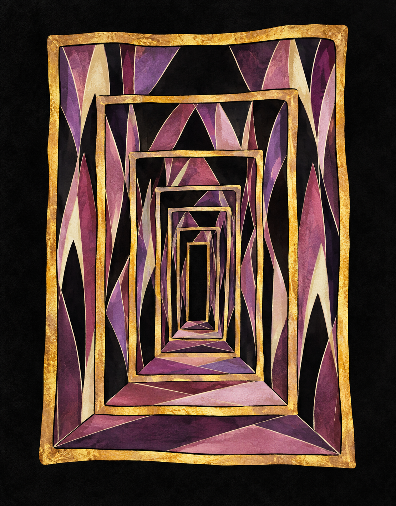

# Study drawing-source-01 · the drawing source, proven

2026-10-13 · positive control for D65. Hand-coded SVG (sheets 11, 14, 15) is the failing control.

## Changed
- `v3/studies/drawing-source-01.png` · 1110x1417 · 2,737,565 bytes · sha256 02b040b8dc50d25f… · copied unchanged from `~/.codex/generated_images/01a1342a-dd3d-7ec0-9295-8e5e85b2f77c/exec-734d2672-5417-41ff-b50b-c753ecf6bfe8.png`.

## Request (exact)
`codex exec --skip-git-repo-check -C /tmp/imggen-probe -i v3/references/seuss-nested-frames.png -i v3/references/seuss-archbishop-katz.jpg -- "<prompt>"`; the tool call Codex reported: prompt "Use case: stylized-concept. Draw a small test illustration: a single hand-drawn nested-frame doorway on a black field, mauve and gold, with pale thin contour lines. Use reference image 1 for the irregular nested rectangular doorway frames and reference image 2 for the elongated angular shapes and mauve palette. Keep the composition simple, one doorway only. No text, lettering, signature, or watermark." with `referenced_image_paths` = both attached files, `transparent_background: false`. First attempt with the prompt before the `-i` flags read stdin instead; the `--` separator is required.

## Grades
- C7 TASTE — the receding frames read as depth and as someplace else; whether the painted texture is too rich for the flat five-role world is the owner's call.
- C8 HOLDS — Seuss grammar: turned receding frames, pale contours, the archbishop's elongated mauve/cream shapes — beats beat4-glass-02 (grey boxes).
- C2 FAILS by design — a raster, not role fills; role quantization in the cutout step is the fix (D65).
- C12 UNPROVEN — generation is not deterministic; the source is pinned by sha256 instead.

## Owner
1. TASTE — accept this texture level (painted, gold leaf) for props and interiors, or quantize everything to flat five-role fills and re-add stipple? Default: quantize characters, keep interiors painted.

## Next
- `imagegen` script tool on the sheet step; `scripts/cutout.py`; `Puppet.tsx`; then re-muse the human as a parts sheet from board images.
