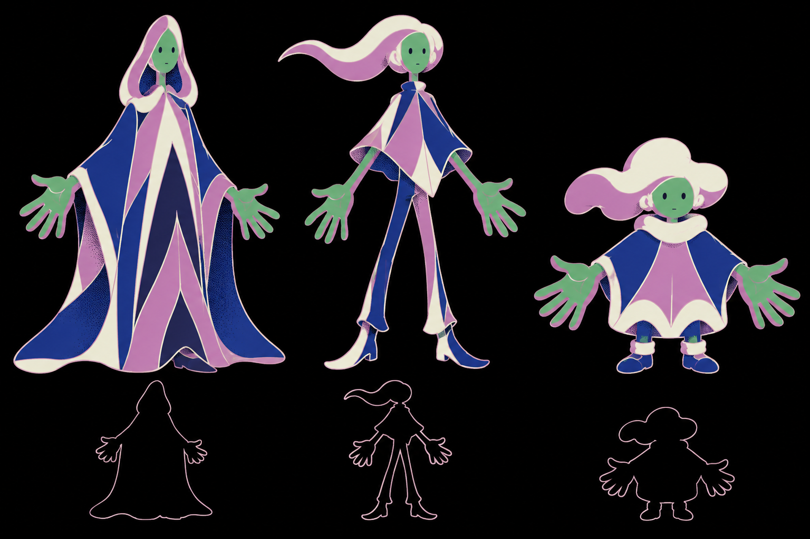

# Study human-gen-16 · human character sheet, first generated under D65/D66

2026-10-13 · generated through `scripts/imagegen/script.py` (the `imagegen` script tool now attached to `showcase_asset_sheet`, version 2) via `codex exec -i … -- prompt`. Clean slate; the three SVG sheets are the failing controls.

## Changed
- `v3/studies/human-gen-16.png` · 1536x1024 · 1,173,748 bytes · sha256 3322639f93b2e287… · copied unchanged from `/home/minipuft/.codex/generated_images/01a13434-2c3f-7193-9a98-16e278ab2b02/exec-e732973c-97b6-4da5-8534-11f05b6588b9.png`.
- `scripts/imagegen/script.py` (new, also installed canonically as the tool), `scripts/cutout.py` (new; positive control: three blobs → three parts, pass), prompt `showcase_asset_sheet` v2 with the tool and the generated-sheet template (payload 19, receipt `evidence/call-NR65oA`).

## Request (exact)
References attached, in order:
- `seuss-cat-stairway.jpg`
- `seuss-no-one-youer.jpg`
- `seuss-archbishop-katz.jpg`
- `midnight-gospel-junkyard.jpg`
- `codex-official-v4.webp`
- `style-board-2026-10-06.png`

Prompt:
> Character sheet for 'the human', a silent animated film in the style of these references: Dr. Seuss Midnight Paintings (swooping silhouettes, pale thin contour lines one step lighter than the fill, saturated flat fills on a pure black field) and The Midnight Gospel (flat shapes, thin colored outlines, stippled shadow gradients). Draw THREE different silhouette explorations of the same character side by side, each full-figure, standing, arms slightly out so the hands are clear. The character is a person whose hands are the important part: hands drawn large. Skin is exactly green #67b479 with a mauve #c885c2 shadow side; clothing uses only mauve, deep blue and cream (the Archbishop Katz palette). Five flat colors per figure, no gradients except stipple dots in shadows. Dot eyes, one small mouth stroke, no other facial detail. Left: a tall soft bell-shaped cloak with a rounded top. Middle: a diamond torso on long thin limbs, hair as one trailing swoop. Right: a compact rounded mass with stub legs and a lobed cap of hair, kin to the two small robot companions in the reference images (one blue with a cloud-shaped head, one coral block). Under each figure, a small solid black silhouette of it. Pure black background, no text, no labels, no frame.

Tool arguments Codex reported: {
  "raw": "{\n  \"prompt\": \"Use case: stylized-concept. Create a character sheet for 'the human', a silent animated film. Use all six supplied images as visual references: images 1–3 for Dr. Seuss Midnight Paintings' swooping silhouettes, pale thin contour lines one step lighter than the fill, saturated flat fills on a pure black field; image 3 especially for the Archbishop Katz clothing palette; image 4 for The Midnight Gospel's flat shapes, thin colored outlines and stippled shadow gradients; the LEFT half of reference image 5 (the original fifth attachment) for the blue companion's cloud-shaped head and compact proportions; the RIGHT half of reference image 5 (the original sixth attachment) for the overall color discipline, the coral block companion influence, and animation sensibility. THREE different silhouette explorations of the SAME human character side by side, full-figure standing, arms slightly out with both hands clearly separated from the body. Hands are the most important feature: draw them LARGE, expressive, clearly readable. Skin exactly green #67b479 with mauve #c885c2 on the shadow side. Clothing uses only mauve #c885c2, deep blue, and cream, from the Archbishop Katz palette. "
}

## Grades
- C19 HOLDS — three directions on one sheet, each from named board references; the sheet is the muse evidence — beats sheets 11/14/15.
- C1 HOLDS — skin reads as the green identity with the mauve shadow side; exact hex is enforced at the cutout step, not by the model.
- C3/C4 HOLDS — designed shadow shapes with stipple grading on every figure (3x crop of the left cloak).
- C8 HOLDS — pale contours one step lighter, swooping silhouettes, Archbishop Katz bands.
- C2 FAILS by design until cutout quantization (raster).
- C13/C14/C16 UNPROVEN — a still.

## Owner
1. Pick a direction: left Cloak (bell, hood), middle Swoop (diamond-shouldered, trailing hair, long legs), right Kin (compact, big cap, stub legs). Planner default: **middle Swoop**: the clearest hands and the most acting range; its silhouette reads at any size.
2. TASTE — the generated silhouettes came back as outlines, not solid; keep outlines as the 64 px test (default keep).

## Next
- Parts sheet for the pick (same references plus this sheet as reference 1): full figure plus separated head, torso, hands, hair, legs on black; cutout → `assets/human/parts.json`; `Puppet.tsx` driven by `lift` on twos.
