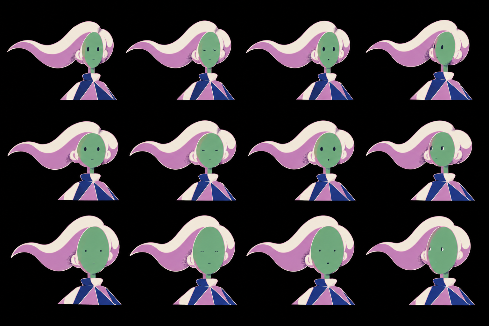

# Study human-gen-17-faces · face iteration grid for the Swoop

2026-10-13 · generated through the `imagegen` tool (`codex exec -i … -- prompt`), D65/D66/D69.

## Changed
- `v3/studies/human-gen-17-faces.png` · 1,138,316 bytes · sha256 52f2c0d2ee98cec1… · copied unchanged from `/home/minipuft/.codex/generated_images/01a1343b-d929-7160-a563-a68d47833c12/exec-7a1450ee-f45c-480d-8f3f-00b5ff71d473.png`.

## Request (exact)
References, in order:
- `human-gen-16.png`
- `x-chetas-20s.jpg`
- `codex-official-v4.webp`
- `seuss-cat-stairway.jpg`

Prompt:
> Face iteration sheet for the MIDDLE character of reference image 1 (the tall figure with the diamond-shouldered top, long thin legs and the trailing swoop of pale hair). Same style as reference 1: flat colors on a pure black field, pale thin contour lines one step lighter than the fill, skin exactly green #67b479 with a mauve #c885c2 shadow side, stippled shadow dots. Draw a 3 by 4 grid of head-and-shoulders only, all the same character, large (each head about one sixth of the image height). The three ROWS vary the face proportions: row 1 = small narrow oval head, eyes close together, mouth close under the eyes; row 2 = medium rounded head, eyes wide apart, mouth low; row 3 = large egg head with a tall forehead, eyes very wide apart and small, tiny mouth far below. The four COLUMNS are the animation states of each row: column 1 neutral looking at the viewer; column 2 eyes closed (a blink); column 3 mouth open in a small 'o'; column 4 eyes and head turned to look left. Features stay minimal: dot eyes, one short mouth stroke, no nose, no eyebrows unless a single tilted stroke. Hair is the same trailing swoop in every cell. Pure black background, no text, no labels, no grid lines.

## Grades
- C19 HOLDS — twelve cells, three proportion rows × four animation states, from the accepted sheet as reference 1.
- C14 HOLDS at still tier — blink, 'o' mouth and a look-left read in every row with dot eyes and one stroke; the puppet's face states are these four.
- C1 HOLDS — skin green with the mauve shadow side on every head.

## Owner
1. Pick the face row: row 1 narrow oval, eyes close, mouth near; row 2 rounded, eyes wide, mouth low; row 3 tall egg, eyes very wide and small, tiny mouth far below. Planner default: **row 2**, because blink and mouth read at the film's scale (the head is ~40 px in a wide shot) and the eye spacing leaves room for a look without the pupils touching the contour. Row 3 is the most Seuss but its mouth vanishes at 40 px.

## Next
- The picked row's four cells become the face parts (eyes open/closed, mouth closed/o, pupils center/left) of the puppet.
