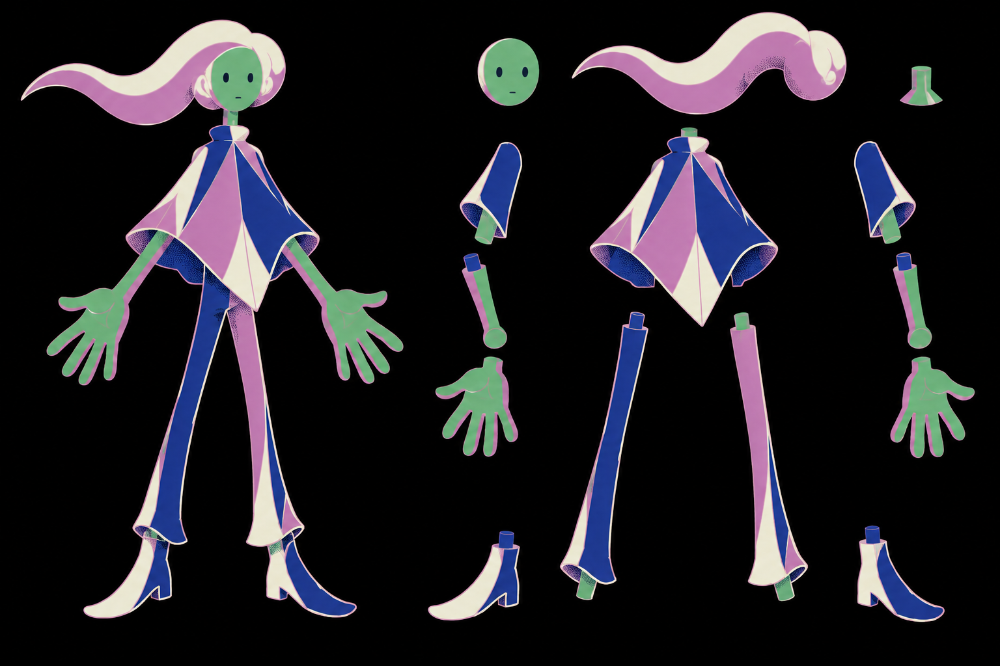

# Study human-gen-18-parts · parts sheet for the Swoop (cut-out rig input)

2026-10-13 · generated through the `imagegen` tool (`codex exec -i … -- prompt`), D65/D66/D69.

## Changed
- `v3/studies/human-gen-18-parts.png` · 1,018,290 bytes · sha256 53c504a04d8616d8… · copied unchanged from `/home/minipuft/.codex/generated_images/01a1343b-d932-7901-9c92-8cc9b954bd85/exec-194c17c2-c765-48ff-86d0-76089ee40fad.png`.

## Request (exact)
References, in order:
- `human-gen-16.png`
- `seuss-archbishop-katz.jpg`
- `midnight-gospel-junkyard.jpg`

Prompt:
> Parts sheet for the MIDDLE character of reference image 1 (the tall figure with the diamond-shouldered top, long thin legs, boots, and the trailing swoop of pale hair), for cut-out animation. Same style as reference 1: flat colors on a pure black field, pale thin contour lines one step lighter than the fill, skin exactly green #67b479 with mauve #c885c2 shadow side, stippled shadow dots, clothing only in mauve, deep blue and cream. Layout, all on one pure black sheet with clear black gaps between every piece: LEFT third = the full figure standing, arms slightly out, hands clearly visible, front view. RIGHT two thirds = the same figure's parts separated and laid out individually, each piece whole and not overlapping anything: the head (with face), the hair swoop by itself, the neck, the torso with the diamond-shouldered top, the left upper arm, the left forearm, the left hand open with fingers spread, the right upper arm, the right forearm, the right hand open, the left leg, the right leg, the two boots. Every part drawn complete, including the hidden overlap where it joins the next part. No text, no labels, no lines connecting parts.

## Grades
- C19 HOLDS — the accepted direction, generated as parts: head, hair, neck, torso, upper arms, forearms, hands, legs, boots, every piece whole with its overlap.
- D68 HOLDS — the plate cuts into movable layers (see `assets/human/parts.json`).
- C2 FAILS until quantization; C1 enforced at the cut.

## Owner
1. none; the rig map (which part is which, parent, pivot) is the planner's.

## Next
- `scripts/cutout.py --field black` → `assets/human/`; hand rig map; `Puppet.tsx` with `lift` on twos; first render through `showcase_shot`.
