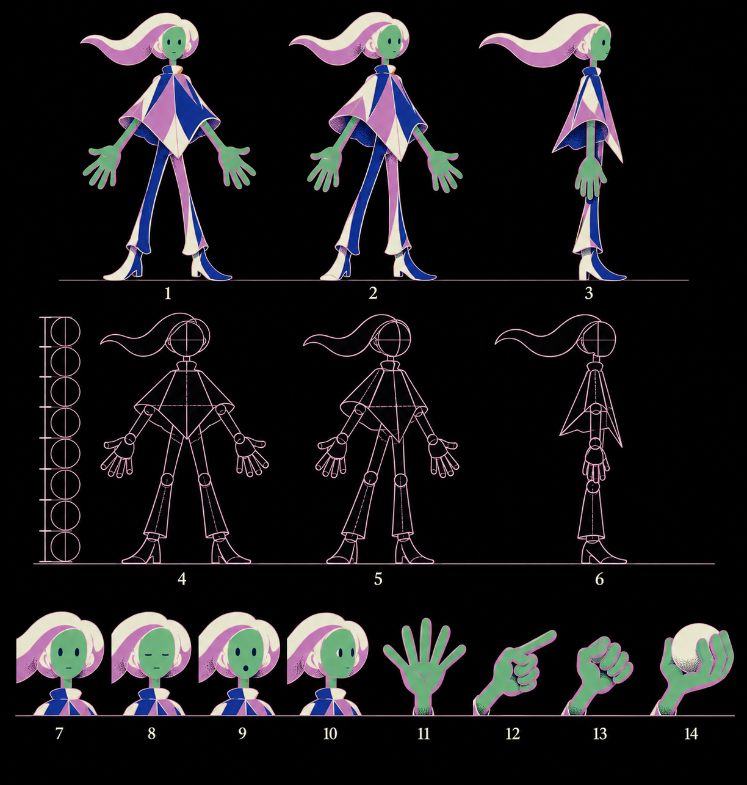

# human-model-01 · model sheet for the human (D72, first run of `showcase_model_sheet`)

2026-10-13 · prompt rendered on the isolated server (receipt `evidence/call-XB3Fat`, payload `workflow-payloads/28-model-sheet-human.json`); generated through the `imagegen` tool script (`codex exec -i …`, five references); measured with `scripts/model_measure.py`; contract written by `scripts/model_contract.py` to `assets/human/model.json`; still `human-model-01-sheet.png` from the new `ModelSheetHuman` composition. **Provisional until the owner approves from the still.**

## Views (row 1, measured)
| cell | view | height px | drift |
|---|---|---|---|
| 1 | front | 470 | |
| 2 | three-quarter | 471 | |
| 3 | side | 469 | |
Scale agreement: 0.4 % (≤ 5 % holds). Construction row: 411 / 408 / 408 px, 0.7 %. Proportion ruler on the sheet: 8 head units read by circle crossings (`ruler.heads`), head ≈ 50 px; by eye the ruler draws nine circles and the figure stands about 8.5 heads, so the ruler value is a lower bound, recorded as such.

## Clean-up measured
Contour 2.83 px (2 × median half-width of thin pale pixels) against a target of 3.92 px (1/120 of 470) → **28 % thin, C22 fails as written**. The approved plate `human-gen-16-swoop.png` measures the same 2.83 px at a 680 px figure (1/240). The sheet reproduced the plate's line faithfully; it is the written standard that does not match the owner's approved plate. Taper and closure: present by inspection (tapered tips on hair and poncho, every shape closed). Not regenerated: regenerating for a standard the approved pick itself fails would move the line away from the pick.

## Identity
Skin green with the mauve shadow side, Katz blue / garment mauve / cream poncho and trousers, navy boots, one trailing swoop, dot eyes, one mouth stroke: held across all three views and the four expression heads (7 neutral, 8 blink, 9 open mouth, 10 look). Hands row 11 open, 12 point, 13 grip, 14 hold, drawn large. Cell numbers in cream as asked; no other text.

## Sheet path · model.json · receipt
`v3/studies/human-model-01.png` (sha256 c6175dec…) · `assets/human/model.json` (sheet copy `assets/human/model-01.png`, mirrored under `public/assets/human/`) · `evidence/call-XB3Fat` + `/tmp/imagegen-model.out.json` copied below.

## Rejected generations
None; one generation.

## Concerns
1. **C22 contour standard vs the approved plate**: 1/120 of figure height is twice the line the owner picked. Owner ruling needed: re-base the clean-up standard to the plate's measured ratio (1/240 ± 20 %), or regenerate the pick at a heavier line. Default: re-base (the pick is the identity).
2. Heads from the ruler are a lower bound (8 vs ~8.5 by eye); the construction row's circles are the sheet's own claim, and the number only matters as a ratio the key sheets are compared against, so it is recorded with its method.
3. Side view (cell 3) narrows the poncho to a wedge and loses the second hand; acceptable for a turnaround, but a key sheet needing a side pose must cite cell 3 explicitly.

## Owner
1. Approve the sheet as the identity contract (default: approve; flips `provisional` to false).
2. C22 re-base to 1/240 ± 20 % (default: yes).
