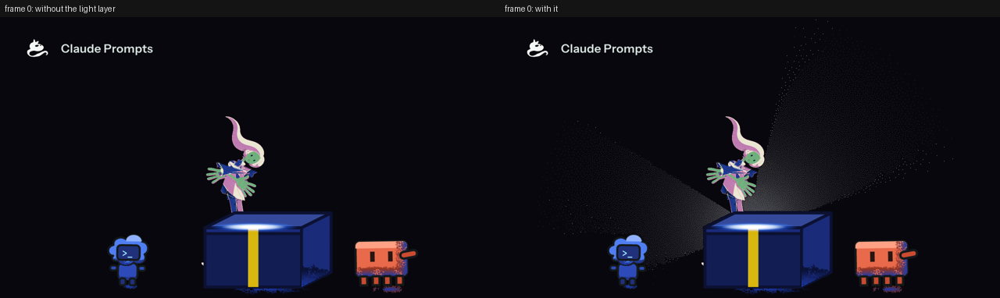
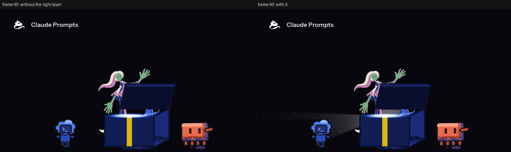
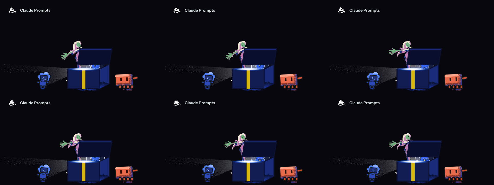
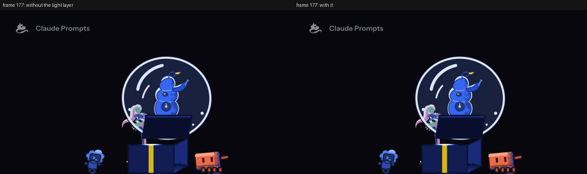
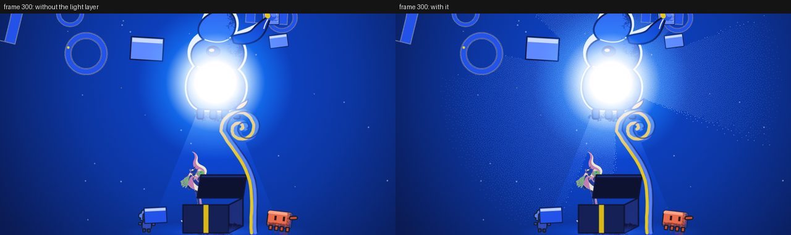
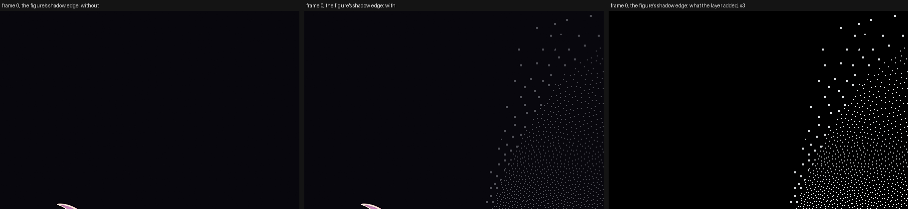
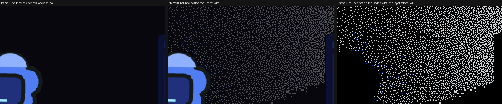
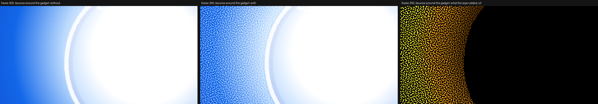
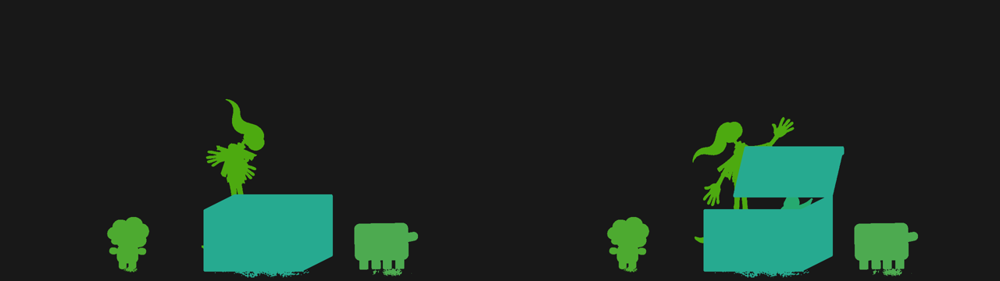
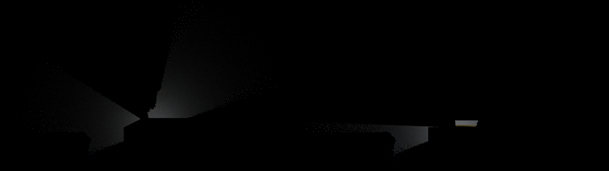

# light-01 · the light as a signed-distance layer (row 8.6, D98)

2026-10-19 · shot `s01-arrival-overwhelm`, frames 0-420, the arrival and the flood. Provisional: the owner has ruled the layer (D98) and none of its numbers. Plain words first; codes are in the collapsed lines.

<details><summary>Codes used below</summary>
D98 adopts the light as one cached signed-distance shader layer; D47 and D48 make shadows drawn shapes of stipple, never ramps; D45 is the glass; D74 one hue pair and one emitter per shot; C1 the identity pigments never grade; C29 the eye finds the emitter. p005 and p006 are the proposals this study files. "Without the layer" means the same cached drawings composed with the layer's two left out (`scripts/animation/compose-without-light-sdf.py`).
</details>

## What the viewer sees

The lamp now lights the black field, and what stands in its way casts a shadow. Before, the light was a glow at the seam and nothing else: the figure, the Codex and the box shadowed nothing. Now the field around the lamp is dusted with fine dots of its own pale blue, dense at the lamp and thinning with distance until none is left, and every solid thing between the lamp and the field leaves a wedge with no dots behind it, its edge drawn in coarser dots. Nothing is a smooth gradient: every pixel is a dot or it is the field.



- **Frame 0 (the closed box).** The lamp sits in the box's seam. The human standing on the box blocks the light going up: two wedges of dots spread to her left and right, and above her head there is a dark wedge no light reaches. The Codex (left) and Clawd (right) shade the ground behind them. The box lets its light out of its own seam, so it casts no shadow over its top.
- **Frame 90 (the lid up).** The lid is a solid above the seam, so the light escapes only through the slit: one long fan to the left, past the Codex, and nothing to the right.



- **Frames 102-107, a strip.** The fan keeps its shape from frame to frame because the light is on ones and the stipple is fixed to the screen; the dots do not shimmer.



- **Frame 177, the last frame of the seam.** The camera has widened and the lamp is almost out (the seam's intensity falls to nothing at 178). Frames 178-181 carry no emitter (the handoff from the seam to the dial), so the layer draws nothing there: frame 179, which the brief names, is a frame without light by the chart.



- **Frame 300 (the flood).** The dial is the lamp; the gadget is the lamp's own body and lets the light out. Rings, panels and stalks cast wedge shadows over the blue; the dots are the same pale colour over the flood.



### How the dots fall off

The density of dots is the inverse square of the distance from the lamp, `1 / (1 + (d / r0)^2)`, less its value at the reach so it arrives at nothing there, with r0 half and the reach 2.2 times the radius of the lamp's own core (`R = (90 + 330 x intensity) x zoom`, the radius the existing `light` layer draws). `v3/light.json` declares no radius or reach of its own. There is no floor: the first version held a density of 0.08 out to its reach and drew a flat dust the eye trace read as a second light. Measured on frame 0, the share of pixels that are dots in the wedge up and to the right of the lamp, in 40 px rings from the lamp (the figure's shadow takes some of the nearest rings):

| ring from the lamp (px) | 40 | 80 | 120 | 160 | 200 | 240 | 280 | 320 | 360 | 400 | 440 | 480 | 520 | 560+ |
| --- | --- | --- | --- | --- | --- | --- | --- | --- | --- | --- | --- | --- | --- | --- |
| dots | 0.46 | 0.58 | 0.43 | 0.30 | 0.22 | 0.15 | 0.11 | 0.08 | 0.06 | 0.04 | 0.03 | 0.02 | 0.01 | 0 |

### Where the shadow falls, close up

The shadow's own edge is drawn in dots of the class's size (stipple-2: 2 px), the weighted edge of D47; inside the lit area the dots are 1 px.



### What the bounce warms

A lit edge gives a little of its material's albedo back to the pixels within 48 px, in the pair colour nearest the role's hue: blue for the box, the Codex and the kit, the accent yellow for the human and for Clawd (their hues are nearer it than the blue). It is weak by design (albedo 0.15-0.3, drawn at half the pair colour and always under the direct dots) and on a black field it reads as a few blue and yellow dots along the edges that face the lamp.




### How the layer reads the picture

The mask is drawn from the same projections as the figure and the props, each group flat in its material's code colour; the layer alone is dots on transparency.




## The eye trace: what was wrong and what was done

Two causes were behind the eye trace failing on this shot.

1. **The measurement.** `v3/roles.json` listed the settled palette only. The shot's own fills (`s01Turrell`: the kit, gadget and box role maps, the outline, the stipple's cool tint), the box's tape (the accent at 0.85 over the box, a yellow no hex names: (215, 183, 16)) and the title lockup (the white mark, drawn (245, 247, 246), and its text, fading out over frames 150-210) were in no role, and were brighter than the lamp. They are in the file now (`scripts/animation/compile-roles.mjs` writes them into `kit` and `gadget`; the mark's neighbourhood is centred 16 levels under its colour because a sphere around pure white would take the lamp's own white core with it; the tape and the accent are listed lit by the lamp at three strengths; the title fades at four). Unlit, the stock probe went from 9 of 10 failing strip frames at 56.7 % to 1 of 10 (frame 177, where the lamp is nearly out and the brightest thing left is the coral edge of Clawd's base); on all 416 frames with a lamp, 27 fail unlit with the file as it is now. (A first version that listed pure white for the mark masked the lamp's own white core and failed every flood frame; hence the mark's offset neighbourhood.)
2. **The look.** The dots were a flat dust (density floor 0.08, one level), which a one-sided lamp skews. The density is now the falling curve above.

What is still outside 3 % of the width, frame by frame (probe-eyetrace's own offset on the frame as drawn, the worst in each run):

```
without [(94, 95, 4.5), (109, 111, 3.7), (114, 115, 3.4), (176, 177, 22.2), (185, 186, 5.1), (189, 190, 4.1), (197, 197, 3.2), (199, 201, 4.0), (210, 211, 3.3), (224, 231, 4.6)]
with [(94, 97, 4.5), (109, 111, 3.1), (114, 115, 3.1), (176, 177, 22.2), (183, 215, 7.5), (220, 231, 6.4)]
```

- **94-97, 109-115 (3.1-4.5 %), without and with.** The seam's thin core is partly masked by the pale roles (kit.light, gadget.light), whose neighbourhood is also the lamp's halo colour: the centroid slides along the line. Not the layer's: without it 94-95, 109-111 and 114-115 fail at 3.4-4.5 %. The layer moves 96-97 from 2.3 to 3.3 %.
- **176-177 (8.2 and 22.2 %), without and with.** The seam is going out; what is brightest is not the lamp.
- **183-231, the flood rising (up to 7.5 %), with the layer; without it 185-186, 189-190, 197, 199-201, 210-211 and 224-231 (3.2-5.1 %).** The lamp has just arrived, the title is fading over the blue and the cone to the trio is a pale unmasked wedge below the lamp; the layer's dots brighten the pale area below the lamp more than above it and pull the centroid 1-3 points further. This is the part the layer owns: 29 frames are inside 3 % without the layer and outside it with.
- A tighter volume (r0 0.35 and reach 1.5 times the core) did not help (frame 96: 3.7 %, 200: 5.8 %, against 3.3 % and 6.1 %), so the numbers stay.

## The probes, verbatim

Every command ran from `media/showcase` on the render of `npm run render -- s01-arrival-overwhelm` recorded in `out/s01-arrival-overwhelm/render-manifest.json`; the files are under `out/light-01/`. The whole run is `out/light-01/proof.sh`.

### probe-light.py (row 8.6's occlusion control), all 416 frames with a lamp

```
$ python3 scripts/animation/probe-light.py out/s01-arrival-overwhelm-seq --light v3/light.json --timeline v3/timeline.json --materials v3/materials.json --xsheet out/s01-arrival-overwhelm-xsheet.json --manifest out/s01-arrival-overwhelm/render-manifest.json --base-frames out/light-01/base-seq
control: a solid between the emitter and the far field with its stipple shadow darkens the far side by 90 % (margin 50 %); the same frame with no block 25 % -> not darkened; the block with its shadow missing 25 % -> not darkened, so the probe would FAIL it; a stipple penumbra reads two-peaked (17.8 % at the dot level, 0.0 % between (at most 10 %), field 5, dots 203); a ramp shadow -> refused (0.0 % at the dot level, 55.3 % between (at most 10 %), field 112, dots 203); a bounce at luma 224 against dots at 208 -> refused, one at 107 inside the pair -> accepted, one off the pair's hues (100 % outside +-15 degrees) -> refused
  frames 420; measured 416 with an emitter at full strength, skipped 4; solid materials body, box, cloth, hair, line, paper; fixed fills from v3/roles.json
  ok   measured something: 416 frames carry an emitter
  ok   far side darker: 372 frames with a measurable solid; median darkening over them 100 % (lowest 100 %, highest 100 %) against a margin of 50 %
  ok   shadows are stipple: 162 penumbra bands with dots in them read on black-field frames (41 more held no dots: wholly in shadow or past the reach, not informative); every one holds two levels and nothing between (at most 10 % between)
  ok   bounce inside the pair and under the dots: 318 frames carry bounce dots; all inside the pair's hues and under the direct dots
  FAIL eye trace holds: 416 frames, probe-eyetrace's own offset (the brightest 0.5 % outside the fixed fills of v3/roles.json against the emitter) on the frame as drawn: 360 within 3 % of the width with the layer, 389 without it; worst 22.2 % at frame 177 with the layer, 22.2 % without; 56 over, 29 of them inside the limit without the layer; first (frame, with %, without %) [(94, 4.5, 4.5), (95, 4.5, 4.5), (96, 3.3, 2.3), (97, 3.3, 2.3), (109, 3.1, 3.7), (110, 3.1, 3.7), (111, 3.1, 3.3), (114, 3.1, 3.4), (115, 3.1, 3.4), (176, 8.2, 8.2)]
FAIL: light - 1 of 5 checks failed: eye trace holds
probe-light exit 1
```

Four of five checks pass: the control trips, a solid occluder darkens the far side on every measured frame (100 %, lowest 100 %), the penumbra is two levels on every black-field frame, and the bounce stays inside the pair and under the dots. The eye trace is the one that fails (above).

### probe-eyetrace.py, the stock probe, on every frame with a lamp, without and with the layer

```
$ python3 scripts/animation/probe-eyetrace.py out/light-01/base-seq --timeline v3/timeline.json --xsheet out/s01-arrival-overwhelm-xsheet.json
control: bright blob 10 % of the width off the emitter -> FAIL (offset 10.0 % > 3 %); blob on the emitter -> pass (0.0 %); identity, garment and kit-contour patches brighter than the blob are ignored (read unmasked they would put the offset at 46 %); the same blob against an emitter projected through a camera that moved 140 stage px -> FAIL (10.9 %), so the camera is read; 120 lone white specks, brighter than the blob and a share of the 0.5 % ranked, are not a region: offset 2.2 % blurred, 8.7 % unblurred
  frames 420; masked 67 fixed colours everywhere and the human cutout's 82 inside its crop, from v3/roles.json; measured 416; skipped (no emitter in the xsheet row) 4; skipped (emitter drawn below strength 1, a crossing) 0; worst offset 22.2 % at frame 177
  ok   measured something: 416 frames carry an emitter
  FAIL emitter within tolerance: 27 frame(s) over 3 % of the width: [(94, 4.5), (95, 4.5), (109, 3.7), (110, 3.7), (111, 3.3), (114, 3.4), (115, 3.4), (176, 8.2), (177, 22.2), (185, 4.7), (186, 5.1), (189, 3.9)]
FAIL: eye-trace - 1 of 2 checks failed: emitter within tolerance
exit 1

$ python3 scripts/animation/probe-eyetrace.py out/s01-arrival-overwhelm-seq --timeline v3/timeline.json --xsheet out/s01-arrival-overwhelm-xsheet.json
control: bright blob 10 % of the width off the emitter -> FAIL (offset 10.0 % > 3 %); blob on the emitter -> pass (0.0 %); identity, garment and kit-contour patches brighter than the blob are ignored (read unmasked they would put the offset at 46 %); the same blob against an emitter projected through a camera that moved 140 stage px -> FAIL (10.9 %), so the camera is read; 120 lone white specks, brighter than the blob and a share of the 0.5 % ranked, are not a region: offset 2.2 % blurred, 8.7 % unblurred
  frames 420; masked 67 fixed colours everywhere and the human cutout's 82 inside its crop, from v3/roles.json; measured 416; skipped (no emitter in the xsheet row) 4; skipped (emitter drawn below strength 1, a crossing) 0; worst offset 22.2 % at frame 177
  ok   measured something: 416 frames carry an emitter
  FAIL emitter within tolerance: 56 frame(s) over 3 % of the width: [(94, 4.5), (95, 4.5), (96, 3.3), (97, 3.3), (109, 3.1), (110, 3.1), (111, 3.1), (114, 3.1), (115, 3.1), (176, 8.2), (177, 22.2), (183, 4.6)]
FAIL: eye-trace - 1 of 2 checks failed: emitter within tolerance
exit 1
```

On the strip (frames 0, 90, 102-107, 177, 179, 300):

```
$ python3 scripts/animation/probe-eyetrace.py out/light-01/proof-base ...   (without)
  ok   measured something: 10 frames carry an emitter
  FAIL emitter within tolerance: 1 frame(s) over 3 % of the width: [(177, 22.2)]
FAIL: eye-trace - 1 of 2 checks failed: emitter within tolerance
exit 1
$ python3 scripts/animation/probe-eyetrace.py out/light-01/proof-seq ...    (with)
  ok   measured something: 10 frames carry an emitter
  FAIL emitter within tolerance: 1 frame(s) over 3 % of the width: [(177, 22.2)]
FAIL: eye-trace - 1 of 2 checks failed: emitter within tolerance
exit 1
```

### probe-colour.py on the strip

```
$ python3 scripts/animation/probe-colour.py out/light-01/proof-seq --timeline v3/timeline.json --contract v3/light.json --xsheet out/s01-arrival-overwhelm-xsheet.json
control: magenta patch off both pairs -> FAIL (frame 5: 576 of 15376 saturated pixels outside); hue detour through green across a crossing -> FAIL (crossing 14-34 detours: sample 1 (205 deg) sits 16 deg behind the start); clean sequence with identity, garment and kit-accent patches (all saturated, all off the pair) -> pass; a pale blue glow on the emitter reads 221 deg -> inside the blue pair, the same glow in pale green reads 144 deg -> off it, a frame with no glow reads nothing
control: a crossing whose frames pass through a tan -> FAIL (crossing 100-105: the dominant colour dips at frame 101 (value 0.55 under the floor 0.83); 2 of 5 frames read dip); through a grey -> FAIL (crossing 100-105: the dominant colour dips at frame 101 (chroma 0.00 under the lower endpoint's 0.82); 3 of 5 frames read dip); a hue walk between the same ends that holds both floors -> pass
  frames 11; masked 67 fixed colours from v3/roles.json; skipped (no pair for the beat, or under 30 saturated pixels) 11; crossing windows [(895, 965), (1195, 1265), (1315, 1385), (1615, 1685)]
  ok   radiance hue per frame: the light's own hue sits inside the beat's pair on 8 of 8 frames where it is drawn and readable (2 drawn but unreadable: the brightest region outside the fixed fills is not on the emitter, or has no chroma to read a hue from)
  ok   saturated pixels inside the pair: 0 of 0 measured frame(s) (11 had under 30 saturated pixels left outside the fixed fills and their blends, or no pair) with saturated pixels outside the pair +-15 deg
  ok   crossing hue path: 0 of 4 crossings measured on frames move monotonically between pairs; 4 left too few measurable frames at one end (2 are needed in its first third and 2 in its last, and a frame needs 30 saturated pixels outside the fixed fills and their blends; the line world in the middle has none by design): [(895, 965, '0 in the first third, 0 in the last'), (1195, 1265, '0 in the first third, 0 in the last'), (1315, 1385, '0 in the first third, 0 in the last'), (1615, 1685, '0 in the first third, 0 in the last')]; only the light contract's path covers those (probe-colour.py --contract)
  ok   crossing value and chroma held: 0 of 4 crossings hold value and chroma on their dominant colour: ; 4 with under 3 frames read: [(895, 965, 0), (1195, 1265, 0), (1315, 1385, 0), (1615, 1685, 0)]
pass: colour-continuity - all measured frames sit inside their beat's hue pair; 0 of 4 crossings measured on frames run without a detour (11 frames skipped)
exit 0
```

### probe-render-manifest.py

```
$ python3 scripts/animation/probe-render-manifest.py out/s01-arrival-overwhelm/render-manifest.json
control: clean fixture -> passes; a camera value edited after the render -> refused, names camera only; the staging edited after the render -> refused, names figure and props, and light-sdf through the figure it reads, not camera; the light layer removed -> refused, names light; a layer whose inputsHash is not its inputs' hash -> refused, names world; a confirm frame over tolerance -> refused, names the frame and light; a cacheKey that is not the hash of the drawing inputs -> refused, names figure; a plan that leaves out a magnified frame it had room for -> refused, names the frames left out; a plan frame the browser never drew -> refused, names frame 3; a plan that counts candidates the rows do not hold -> refused, names the count; a backend edited after the render -> refused, names light-sdf; a light layer with no backend recorded -> refused, names light-sdf; a layer input that is not the layer's cacheKey -> refused, names light-sdf; a confirm block with no plan -> refused, names the missing plan; a composed frame deleted -> refused, names the missing frames
  ok   s01-arrival-overwhelm: 420 frames, layers figure, props, world, light, light-sdf, camera all current by inputs hash, 40 of 40 confirm frames inside the tolerance
pass: render-manifest - 1 manifest(s) current: every layer's inputs hash to what the render recorded, every composed frame is on disk, every confirm frame is inside the tolerance
exit 0
```

The layer's entry (`layers["light-sdf"]`): inputs `src/library/light/sdfShaders.ts`, `v3/light.json`, `v3/materials.json`, `v3/charts/...`, `v3/layouts/...#staging`, `v3/blocking/*`, `v3/timeline.json`, `code:1a96e39beca8b22b`, `layer:figure`, `layer:props` and `backend:name`; 486 drawings (228 occluder masks, 258 light); inputsHash = cacheKey `9d0e36b87fff...`; the backend, at the top of the manifest and on the layer:

```
{
 "userAgent": "Mozilla/5.0 (X11; Linux x86_64) AppleWebKit/537.36 (KHTML, like Gecko) HeadlessChrome/149.0.7790.0 Safari/537.36",
 "renderer": "ANGLE (Google, Vulkan 1.3.0 (SwiftShader Device (Subzero) (0x0000C0DE)), SwiftShader driver)",
 "vendor": "Google Inc. (Google)",
 "version": "WebGL 2.0 (OpenGL ES 3.0 Chromium)",
 "floatTargets": true,
 "name": "Mozilla/5.0 (X11; Linux x86_64) AppleWebKit/537.36 (KHTML, like Gecko) HeadlessChrome/149.0.7790.0 Safari/537.36 | ANGLE (Google, Vulkan 1.3.0 (SwiftShader Device (Subzero) (0x0000C0DE)), SwiftShader driver)"
}
```

### Determinism: two sharded renders of the strip, byte-identical

`render-shards.mjs` over the whole-frame composition `ShotS01` (the layer drawn in the browser from the served mask), frames 102-107, 2 shards at concurrency 1, run twice:

```
$ node scripts/animation/render-shards.mjs ShotS01 out/light-01/shards-a --shards 2 --frames 102-107 --props out/light-01/strip-props.json --gl=swangle
$ node scripts/animation/render-shards.mjs ShotS01 out/light-01/shards-b --shards 2 --frames 102-107 --props out/light-01/strip-props.json --gl=swangle
$ python3 scripts/animation/probe-determinism.py out/light-01/shards-a out/light-01/shards-b --bytes
control: two writes of the same frame -> pass; one altered pixel -> FAIL (frame [0] differs)
  ok   same frame list: 6 frames in a, 6 in b
  ok   byte-identical: 6 of 6 common frames identical
pass: determinism - 6 frames, sha256 identical across both renders
exit 0
$ python3 scripts/animation/probe-determinism.py out/s01-arrival-overwhelm-seq out/light-01/shards-a --subset
control: two writes of the same frame -> pass; 1 pixel 1 level off (rasteriser noise) -> pass; 40 pixels 1 level off (noise) -> pass; 60 pixels 40 levels off -> FAIL (60 beyond 2 levels, allowance 5); every pixel 3 levels off -> FAIL (57600 beyond 2 levels); 1 pixel 40 levels off -> tolerated (inside the allowance of 5)
  ok   same frame list: 420 frames in a, 6 in b
  6 of 6 common frames differ at all; 6 of those inside the tolerance (at most 0 pixels beyond 2 levels, 2 levels the largest difference)
  ok   identical within tolerance: 6 of 6 common frames match within 2 levels on all but 0.01 % of the pixels
pass: determinism - 6 frames, within 2 levels on all but 0.01 % of the pixels across both renders
exit 0
```

The second is the cache's own parity: the frames composed from cached drawings against the browser's whole frames, within the 2-level tolerance. `npm run render` confirms 40 frames the same way, the layer in both: `confirm: 40 of 40 frames inside the tolerance`.

### The bible

```
$ npm run bible
  ok   proposal rulings exist in the spec: 8 ruling name(s) on proposals, each a ruling in the spec
  ok   materials in range: the bible carries 8 materials as the file declares them, each in range with its intent word and the cross-rules holding
pass: bible 660989c2c47b covers 1950 frames in 10 tracks (381 items), 6 proposal(s) sit inside their beats, 53 ruling(s) mirrored, and the page shows this bible
```

### The glass reads its material (D45)

The frame interior's index of refraction is `1 + 0.75 x refraction` and its base roughness `1.25 x diffusion`, read from `glass` in `v3/materials.json` (0.6 and 0.4 give the constants it had, 1.45 and 0.5). Beat 4's frame 90 rendered before and after the edit, and once more with diffusion planted at +0.2 as the control:

```
$ cmp out/light-01/glass-before-f090.png out/light-01/glass-after-final-f090.png && echo "glass cmp: byte-identical"
glass cmp: byte-identical
$ sha256sum out/light-01/glass-before-f090.png out/light-01/glass-after-final-f090.png
899d4f38fe341a1ab4770ee6f6de8ff824d7f8dd8ef8eb29c6550c5571e880a6  out/light-01/glass-before-f090.png
899d4f38fe341a1ab4770ee6f6de8ff824d7f8dd8ef8eb29c6550c5571e880a6  out/light-01/glass-after-final-f090.png
$ cmp out/light-01/glass-before-f090.png out/light-01/glass-control-f090.png
out/light-01/glass-before-f090.png out/light-01/glass-control-f090.png differ: byte 55, line 3
```

Rendered twice before the edit the frame is identical too, so the cmp is a real test. The glass frame does not read `v3/poses/s01-arrival-overwhelm.json`, whose cloth lines the planner has since removed.

## What it costs

Render time per drawing, from the render reports (`out/light-01/baseline-render-report.json` before, `out/s01-arrival-overwhelm/render-report.json` after), on a box shared with other sessions (load average 18 before, 25 after, so read these as orders of magnitude):

| | before | after |
| --- | --- | --- |
| the lamp's core and grain (`light`, 148 drawings) | 8.5 s, 0.057 s each, 20 ms per frame of the shot | unchanged code, drawn in the same run |
| occluder masks (`light-sdf`, 228 drawings) | none | 29.1 s, 0.128 s each |
| the light itself (`light-sdf`, 258 drawings) | none | 70.3 s, 0.273 s each |
| the layer per frame of the shot (420) | 20 ms | 237 ms |
| a cold `npm run render` | 109 s (730 drawings, load 18) | 211 s (1216 drawings, backend probe 2.7 s, confirm 24 s, load 25) |
| warm, nothing changed | 1.6 s | a few seconds longer: the backend is probed on every run |

The jump flood is 11 passes at 1280 x 720; the march is at most 64 steps per pixel (24 for the bounce).

## Choices I took (filed as proposals p005 and p006)

The rulings name the layer, not its numbers, so the contract's first values are in `src/library/light/sdf.ts`: shadow `k` 4, 12 and 48 for stipple-1, -2 and -3; stipple dots 1, 2 and 3 px in the shadow's edge; the bounce at gain 1.0 over 48 px drawn at 0.5 of the pair colour; the inverse-square volume of the lamp's core radius (above); the dots at 0.6 of the emitter's level; the owner seat 140 px. p005 still names the first version's radii and floor (110 + 140 x intensity, 380 + 320 x intensity, 0.08) and is out of date on them; the numbers here are the ones the study measured. The materials file has no character, so the cast is `body` and the props `box` (p006). Both proposals are on the bible page for you to rule.

## What is left

- **The eye trace still fails on 56 of 416 frames with the layer (27 without).** Detail above. What would close it: the lamp's halo colours are the pale roles' colours (kit.light, gadget.light), so masking the roles masks part of the lamp; either the probe masks by region as well as colour, or the pale roles are retired from the mask once the shot's palette is complete.
- **The class scale is not yet visible.** Every solid on s01 is stipple-2, so soft, medium and hard shadows are exercised only by the probe's planted frames and the shader's constants.
- **The cloak and the hair** are one figure to the light (`body`); a per-part split needs the parts rig to draw per material (p006).
- **Beat 4, frame 700.** The animatic (`Animatic65`) draws no passes, so the light layer is wired for `s01-arrival-overwhelm` only (`SHOTS` in `render-manifest.mjs`); frame 700 was not rendered.
- **The full cascade trial** (radiance cascades proper) and **the world beats** (the art and programming worlds' paper and line materials: stipple-3 and `none`) are untouched.
- The glass reads its material's numbers, not the light buffer ("glass reads the same buffer" in p003).
