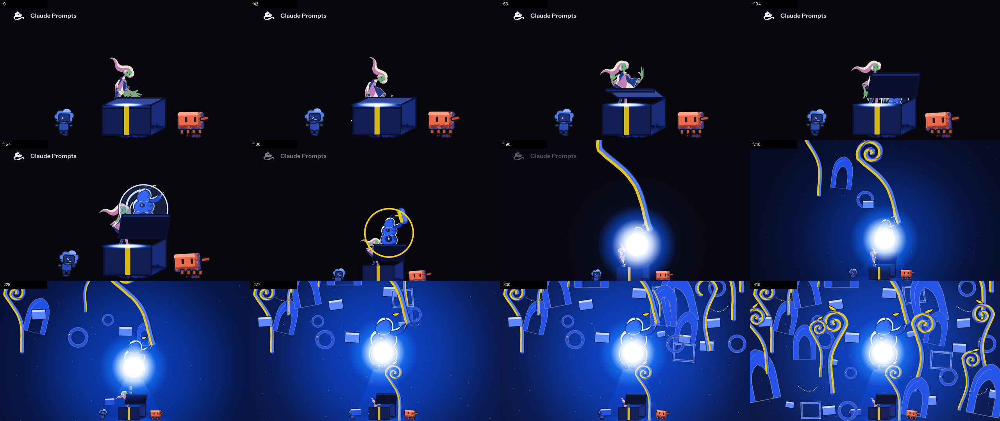
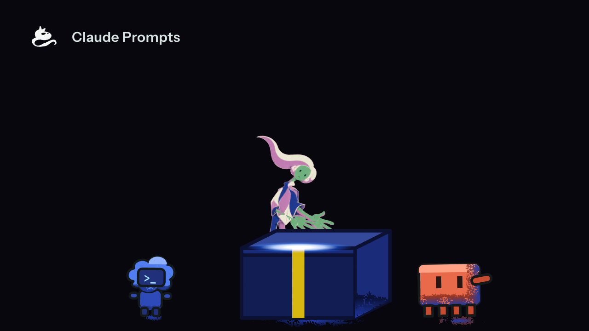
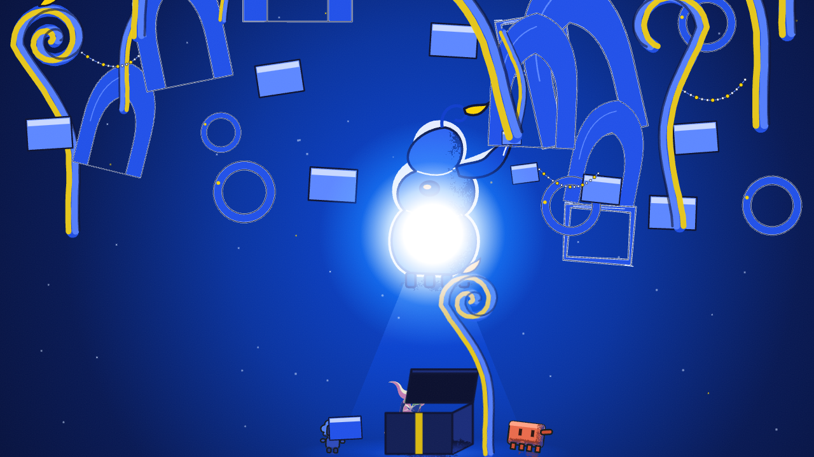

# s01-01 · the film's intro, first demo (arrival and everything at once)

2026-10-14 · shot `s01-arrival-overwhelm`, frames 0-420 of the 65 s ledger (beats `arrival` 0-180 and `everything-at-once` 180-420; `v3/timeline.json` wins over `shots.json`'s older 0-330). Run through `showcase_shot` on the isolated server: receipts `evidence/drive-FcXUmh` (chain-showcase_shot#1, mailbox `mailbox/s01-01`), generations under `evidence/s01/`. Graded against `v3/rubric.md` v1.8. **Everything here is provisional; the owner has approved none of it.**

[](s01-01/s01-01.mp4)

<details><summary>Codes used below</summary>
C-numbers are rubric rows (`v3/rubric.md`); D-numbers are rulings (`v3/creative-spec.md`); K1-K8 are the human's eight key drawings; the layout sheet is the cinematography sheet (D77). Plain words first; the codes are there so a grade can be traced.
</details>

## What the viewer sees (per beat, one line)

- **Beat 1, arrival (frames 0-180).** The poster at frame 0: Codex, the human and Clawd around a plain dark-blue box on the black field with the project mark top-left and one hairline of blue light on the lid; then the human grips and lifts the lid, it swings open, a glass bubble swells out of the box with the gadget inside, the two companions lean in, and from frame 150 the camera starts to pull back and up.
- **Beat 2, everything at once (180-420).** The bubble pops on frame 180 (a yellow ring), the gadget's dial lights two frames later and a Turrell-blue flood follows; the camera finishes its widen at frame 210; a first stalk curls up and out of the gadget, then fifty pieces (stalks, pointed arches, rings, blocks, frames, beaded strings) leave the gadget three to five frames apart and land across a field that ends completely full; the human bursts into joy, turns it the other way, then folds up small; Codex catches a block, a stalk pushes Clawd.




## What is placeholder

- **Joints.** The 17 joints of every key were placed by eye on the key plates (the skeleton toolchain is not installed), registered by one similarity per key. Provisional.
- **Plates K2-K6** are second drawings drawn at 2.4 x the model sheet's pixel size; their scale (1.245 plate px per rig px) is assumed from the upright keys, not measured per key.
- **Props** are hand-coded SVG (box, bubble, gadget, stalk, arch, ring, block, frame, bead string); none has a muse sheet. The first stalk's draw-on, the flood, the lamp, the motes and the grain are hand-coded in the composition.
- **Codex and Clawd** lean by their own part transforms (a head turning about its neck, a body tipping over its legs): a hinge-jointed cutout, not drawn variants, and neither has a model sheet.
- **The 50 pieces** come from a seeded layout in `scripts/s01_chart.py`; their landing places are not staged.
- **Blocking and light** files are another worker's and were only read; this shot stands its own staging (`v3/layouts/s01-arrival-overwhelm.json` `staging`) and proposes the difference: `s01-01/s01-blocking-proposal.diff`. Light is drawn here from the chart's tracks, not from `v3/light.json`.
- **The widen** ends at zoom 0.425 as the sheet draws it; at that size the human is about 100 px tall and the face 12 x 5 px.

## Probes (every line)

The task's command, on the film's own timeline and the shot's exposure sheet (`out/s01-xsheet.json`, written by `scripts/s01-xsheet.mjs`; the global sheet covers 1950 frames):

```
python3 scripts/animation/probe-all.py out/s01-seq --timeline v3/timeline.json --xsheet out/s01-xsheet.json --second-frames out/s01-seq-b --subset --json out/s01-probes.json
twos-ones · FAIL · control: change on frame 7 -> FAIL (odd-frame figure changes at [7]); changes on even frames only with the camera moving every frame -> pass (0 odd-frame changes, 7 even-frame changes, camera moved on 24 odd frames)
    FAIL odd-frame changes: 15 odd frame(s) where the figure changed (tolerance 0): [39, 41, 43, 45, 49, 55, 133, 153, 155, 157, 175, 177, 181, 183, 185]
    FAIL: twos-ones - 1 of 2 checks failed: odd-frame changes
hold-band · FAIL · control: 40-frame hold -> FAIL (hold of 40 frames at 0-39 is over 27 and no key declares it); 16-frame hold, 4-drawing move -> pass (2 holds, move of 4); 40-frame hold declared by key 'K1' -> pass and listed; 1-drawing move -> FAIL
    FAIL move drawings: move from the hold ending 25 to the hold starting 43 uses 7 drawing(s), not 3-6; move from the hold ending 129 to the hold starting 155 uses 9 drawing(s), not 3-6; move from the hold ending 176 to the hold starting 190 uses 10 drawing(s), not 3-6
    FAIL: hold-band - 1 of 3 checks failed: move drawings
screen-time · FAIL · control: beat 'b' shifted 3 frames against the same xsheet -> FAIL (beat 'a' ends at frame 30 in the xsheet, 33 in the timeline); unshifted -> pass (0 problems)
    FAIL beat extents: the xsheet has 420 rows for a 1950-frame timeline; beat 'cant-build': no xsheet row names it; beat 'the-frame': no xsheet row names it; beat 'art-world': no xsheet row names it; beat 'crossing': no xsheet row names it; beat 'programming-world': no xsheet row names it; beat 'home-settle': no xsheet row names it
    FAIL rendered frames: 420 frames rendered for a 1950-frame timeline
    FAIL: screen-time - 2 of 2 checks failed: beat extents, rendered frames
eye-trace · FAIL · control: bright blob 10 % of the width off the emitter -> FAIL (offset 10.0 % > 3 %); blob on the emitter -> pass (0.0 %); identity patch brighter than the blob is ignored (read as bright it would put the offset at 54 %)
    FAIL emitter within tolerance: 178 frame(s) over 3 % of the width: [(0, 26.7), (1, 26.7), (2, 26.7), (3, 26.7), (4, 26.7), (5, 26.7), (6, 26.7), (7, 26.7), (8, 26.7), (9, 26.7), (10, 26.7), (11, 26.7)]
    FAIL: eye-trace - 1 of 2 checks failed: emitter within tolerance
loop-closure · FAIL · control: synthetic closed outline closed=True (height 1.000, share 1.000); 4 px band erased across the shins (row 127) closed=False (height 0.744, share 0.588) flips
    FAIL line phases present: 0 line-phase frames - none, so closure was never measured
    FAIL: loop-closure - 1 of 1 checks failed: line phases present
colour-continuity · FAIL · control: magenta patch off both pairs -> FAIL (frame 5: 576 of 15376 saturated pixels outside); hue detour through green across a crossing -> FAIL (crossing 14-34 detours: sample 1 (205 deg) sits 16 deg behind the start); clean sequence with an identity-pigment patch -> pass
    FAIL hue pair per frame: 190 frame(s) with saturated pixels outside the pair +-15 deg: [(0, 10850, 68122), (1, 10850, 68122), (2, 10850, 68122), (3, 10850, 68122), (4, 10850, 68122), (5, 10850, 68122), (6, 10850, 68122), (7, 10850, 68122)] (frame, outside, saturated)
    FAIL: colour-continuity - 1 of 2 checks failed: hue pair per frame
determinism · FAIL · control: one altered pixel -> FAIL (frame [0] differs); two writes of the same frame -> pass (1 frame, 0 differ)
    FAIL byte-identical: 26 of 42 common frames identical; differ at [170, 180, 200, 210, 220, 230, 240, 250, 260, 280, 290, 300, 330, 370, 380, 410]
    FAIL: determinism - 1 of 2 checks failed: byte-identical
FAIL: probe-all - 0 of 7 probes passed
```

The same probes on the shot's own two-beat timeline (`out/s01-probe/timeline.json`, beats 1-2, 420 frames; copies of `shots.json` and `light.json` beside it):

```
twos-ones · FAIL · control: change on frame 7 -> FAIL (odd-frame figure changes at [7]); changes on even frames only with the camera moving every frame -> pass (0 odd-frame changes, 7 even-frame changes, camera moved on 24 odd frames)
    FAIL odd-frame changes: 15 odd frame(s) where the figure changed (tolerance 0): [39, 41, 43, 45, 49, 55, 133, 153, 155, 157, 175, 177, 181, 183, 185]
    FAIL: twos-ones - 1 of 2 checks failed: odd-frame changes
hold-band · FAIL · control: 40-frame hold -> FAIL (hold of 40 frames at 0-39 is over 27 and no key declares it); 16-frame hold, 4-drawing move -> pass (2 holds, move of 4); 40-frame hold declared by key 'K1' -> pass and listed; 1-drawing move -> FAIL
    FAIL move drawings: move from the hold ending 25 to the hold starting 43 uses 7 drawing(s), not 3-6; move from the hold ending 129 to the hold starting 155 uses 9 drawing(s), not 3-6; move from the hold ending 176 to the hold starting 190 uses 10 drawing(s), not 3-6
    FAIL: hold-band - 1 of 3 checks failed: move drawings
screen-time · pass · control: beat 'b' shifted 3 frames against the same xsheet -> FAIL (beat 'a' ends at frame 30 in the xsheet, 33 in the timeline); unshifted -> pass (0 problems)
eye-trace · FAIL · control: bright blob 10 % of the width off the emitter -> FAIL (offset 10.0 % > 3 %); blob on the emitter -> pass (0.0 %); identity patch brighter than the blob is ignored (read as bright it would put the offset at 54 %)
    FAIL emitter within tolerance: 178 frame(s) over 3 % of the width: [(0, 26.7), (1, 26.7), (2, 26.7), (3, 26.7), (4, 26.7), (5, 26.7), (6, 26.7), (7, 26.7), (8, 26.7), (9, 26.7), (10, 26.7), (11, 26.7)]
    FAIL: eye-trace - 1 of 2 checks failed: emitter within tolerance
loop-closure · FAIL · control: synthetic closed outline closed=True (height 1.000, share 1.000); 4 px band erased across the shins (row 127) closed=False (height 0.744, share 0.588) flips
    FAIL line phases present: 0 line-phase frames - none, so closure was never measured
    FAIL: loop-closure - 1 of 1 checks failed: line phases present
colour-continuity · FAIL · control: magenta patch off both pairs -> FAIL (frame 5: 576 of 15376 saturated pixels outside); hue detour through green across a crossing -> FAIL (crossing 14-34 detours: sample 1 (205 deg) sits 16 deg behind the start); clean sequence with an identity-pigment patch -> pass
    FAIL hue pair per frame: 190 frame(s) with saturated pixels outside the pair +-15 deg: [(0, 10850, 68122), (1, 10850, 68122), (2, 10850, 68122), (3, 10850, 68122), (4, 10850, 68122), (5, 10850, 68122), (6, 10850, 68122), (7, 10850, 68122)] (frame, outside, saturated)
    FAIL: colour-continuity - 1 of 2 checks failed: hue pair per frame
determinism · FAIL · control: one altered pixel -> FAIL (frame [0] differs); two writes of the same frame -> pass (1 frame, 0 differ)
    FAIL byte-identical: 26 of 42 common frames identical; differ at [170, 180, 200, 210, 220, 230, 240, 250, 260, 280, 290, 300, 330, 370, 380, 410]
    FAIL: determinism - 1 of 2 checks failed: byte-identical
FAIL: probe-all - 1 of 7 probes passed
```

The twos and hold probes on the **figure-only pass** (`ShotS01Figure`: the human under the camera on black, so the light and the props are not in the figure's crop):

```
control: change on frame 7 -> FAIL (odd-frame figure changes at [7]); changes on even frames only with the camera moving every frame -> pass (0 odd-frame changes, 7 even-frame changes, camera moved on 24 odd frames)
  frames 420 (0..419); camera inverted from xsheet; crossing windows exempt: []
  FAIL odd-frame changes: 1 odd frame(s) where the figure changed (tolerance 0): [209]
  ok   figure moves: 42 even-frame figure changes
FAIL: twos-ones - 1 of 2 checks failed: odd-frame changes
control: 40-frame hold -> FAIL (hold of 40 frames at 0-39 is over 27 and no key declares it); 16-frame hold, 4-drawing move -> pass (2 holds, move of 4); 40-frame hold declared by key 'K1' -> pass and listed; 1-drawing move -> FAIL
  frames 420; holds found 8 (lengths [16, 20, 22, 24, 26, 148]); moves 7 (drawings per move [4, 4, 3, 6, 6, 4, 6]); pops 0; boil changes (no key row within 1 frame, not counted as drawings) 3
  ok   hold band: all 8 holds inside 11-27 or declared
  ok   move drawings: all 7 moves use 3-6 drawings
  ok   pops: 0 key-to-key change(s) with no drawing between
  intentional long hold: key 'shrink' frames 272.. (148 frames, declared 148)
pass: hold-band - 8 holds in the band or declared, 7 moves of 3-6 drawings, 0 pops, 1 intentional long holds listed
```

```
positive control: intact frame 0 = 1 component(s), same frame with a 4 px band erased across the shins (row 562) = 3
frames: 420; field colour (7, 6, 12); blobs under 12 px ignored
8-connected: min 1, max 1, frames != 1: none
4-connected: min 1, max 1, frames != 1: none
```

| name | result | what the control showed |
| --- | --- | --- |
| twos and ones, full frames | FAIL, 15 odd frames | the control (a figure change on frame 7) fails, a clean twos sequence with the camera moving every frame passes |
| twos and ones, figure only | FAIL, 1 odd frame of 420 (209), 42 even-frame figure changes | the same control |
| hold band, full frames | FAIL, three moves of 7, 9, 10 drawings | a 40-frame hold fails, a declared one passes |
| hold band, figure only | pass: 8 holds, 7 moves of 3-6 drawings, 0 pops, 'shrink' declared 148 frames | the same control |
| screen time, film timeline | FAIL (420 rows for 1950 frames) | shifted beat fails |
| screen time, shot timeline | pass | shifted beat fails |
| eye trace | FAIL, 178 frames (0-177); the other 238 frames sit within 0.2 % of the width | a blob 10 % off fails |
| loop closure | FAIL, "0 line-phase frames": the shot has no line world | a band erased across the shins opens the loop |
| colour pair | FAIL, 190 frames | a magenta patch fails; a hue detour fails |
| determinism | FAIL, 26 of 42 frames byte-identical | one altered pixel fails |

## Grades

Evidence tier in brackets. Criteria not touched are omitted.

- **C1 HOLDS** [still, sampled pixel] cluster mean of Clawd's coral on frames 0 / 120 / 200 / 300 / 419 is (231,105,75) / (231,105,75) / (228,106,80) / (230,107,77) / (230,109,80) against #e8694a; Codex's blue (80,125,238) on frame 0 and (73,120,242) on frame 120 (later frames drown in the blue field: no measure). The flood is drawn under the assets and only the lamp's core draws over them. `out/s01-measure.json`.
- **C2 HOLDS** [file check] `rg "#[0-9a-fA-F]{6}" src/library/props/Pieces.tsx Bubble.tsx Box.tsx` returns nothing: every fill is a role bound by `s01Turrell` in `tokens.ts`. The palette-change-touches-no-asset-file test was not run.
- **C3 FAILS** [3x crop viewed on frame 419] the new pieces have no form shadow and no cast shadow; only Codex, Clawd and the box carry the existing stipple. Next: shadows for the pieces.
- **C4 UNPROVEN** no 3x crop of a stippled shadow was graded; the stipple's cool tint is bound to the pair's blue (`--cool`), which `out/s01-measure.json` sees as the end of the off-pair pixels.
- **C5 HOLDS** [still] frames 0-150 read as one lit seam on a black field with nothing drawn where nothing matters; beat 2 is the ledger's flood and is not graded against it.
- **C6 HOLDS** [consecutive frames, exposure sheet] the emitter is the seam through frame 177 and the dial from 182, a 4-frame gap, never two at once (`out/s01-xsheet.json`).
- **C8 TASTE** [still] curling stalks, pointed arches, ring gates and a bead string read as the Seuss grammar on frame 419; there are no receding turned frames.
- **C9 UNPROVEN** grain is an overlay at most 8 % strong; no 3x crop of an outline under it was graded.
- **C11 TASTE** [3x crop on frame 154] inside the bubble the gadget reads as stacked lobes with a funnel; from frame 190 the lamp's white core covers its dial and belly.
- **C12 FAILS** [sha256 of two renders] 26 of 42 frames identical across the sequence render and the still render; the others differ by 1 level on 10-30 pixels. Same-pipeline pairs: two `remotion still` renders of frames 160 and 180 identical; two sequence renders of frames 150-199 identical on 46 of 50 (29 of 30 at concurrency 1). No wall-clock or unseeded random is in the shot; the rasteriser is not byte-stable. 
- **C13 HOLDS** [consecutive frames] the grain reseeds from three variants at 4 changes a second and the motes step on twos: on frames 210-420 the whole picture changes on 2.9 and 0.6 pixels on odd frames against 78,833 and 54,705 on even ones (`out/s01-whole-frame-parity.json`).
- **C14 FAILS** [strip, pose sheet] beat 1's lift and look-up read, the contact is behind the box and the rig bends K1 and K2 into shapes the plates do not have; beat 2's turn and fold do not read (the human is about 100 px tall from frame 210, K7 and K8 fold the mesh). Not graded in motion: the mp4 was not watched.
- **C15 HOLDS** [mid-morph stills 190, 200] the field goes from black through deep navy to blue with no grey.
- **C16 HOLDS** [consecutive frames] on the figure-only pass the figure changes on even frames only outside the widen (0 odd-frame changes), holds 16-26 frames with a 4-drawing gather, a fast 2-frame lift, overshoot (lid 1.07, bubble 1.55) and a 12-frame settle (lid).
- **C17 HOLDS** [chart + frames] pieces start 3, 4 or 5 frames apart (50 pieces, last start 382), Codex's lean 4 frames before Clawd's; several unrelated things also start inside frames 176-190 (the pop, the first stalk, the human's burst, the gadget's rise): the beat's own pile-up.
- **C18 HOLDS** [consecutive frames] pop ring 180, lamp core 182 (2 later), flood 184 (4 later); the ring decays over 12 frames.
- **C19 FAILS** box, bubble, gadget, stalk, arch, ring, string and patch have no muse sheet (`shots.json` inventory: `sheet_accepted` null); they are hand-coded SVG, the tool D65 names as wrong.
- **C20 FAILS** [key sheet over the model sheet] figure heights are within 4 % of the model's for every upright key (-2.8, -2.2, +0.2, -0.5, -3.8, -2.7, +3.0 %; K8 is a crouch); K2's right arm reaches 111 % of the model's arm, over the 105 % line. Heads were not measured (the detector's neck confuses it).
- **C21 FAILS** [silhouettes filled black, `out/s01-keys-silhouettes.png`] K1, K2, K3, K4, K6, K7 read; K5 reads weakly; K8 is one crouched lump with the covering hands lost.
- **C22 FAILS** [measured weight] the sheet keys hold (K1 1/125, K7 1/141 against the model's 1/142); the second drawings K2-K6 are 1/291-1/301, about twice as thin at the same figure height.
- **C23 HOLDS** [pose track] 33 of 33 breakdowns within 0.10 of their favour (largest +0.048), control 33 of 33 refused when every favour is shifted 0.25; the holds hold (probe-holds figure-only passes). Measured on the pose function, not on pixels.
- **C24 FAILS** [probe over frames] 190 frames have saturated pixels outside the pair; the probe masks only two identity colours. With every identity role masked, all remaining off-pair pixels (about 1,070 of 5,440 on frame 0) sit in Clawd's stipple shading.
- **C25 FAILS** [layout against frames] the move: zoom 0.425 against the sheet's 0.4251; the emitters: seam 2.07 % of the width from the sheet's, dial 0.09 %; the figure's height: the render stands the human at 48.6 % of the frame, the sheet's face-derived number is 78.1 % (it over-reads, see the contract); the 5 % clause fails as written.
- **C26 HOLDS** [exposure sheet] on the shot's own timeline; the film timeline fails by construction.
- **C27 FAILS** [figure-only frames] 1 odd frame of 420 (209, the last frame of the widen); full frames fail on 15 odd frames because the light shares the crop.
- **C28 HOLDS** [figure-only frames] 8 holds in the band or declared, 7 moves of 3-6 drawings, 0 pops; full frames fail for the same crop reason.
- **C29 FAILS** [frames] beat 1: the brightest pixels are the held mark and the human's cream hair, 23-28 % of the width from the seam on all 178 frames; beat 2 holds on all 238 frames.
- **C30 UNPROVEN** the shot has no crossing.

## Controls

- C1: beat4-still-01 (Clawd washed pink by additive light on top): here only the lamp's core is additive over the assets.
- C16, C23: beats45-08 (timed without a chart): this shot is timed from `v3/charts/s01-arrival-overwhelm.json`.
- C18: the control of `probe-colour.py` (a join as a fade): the ring, the lamp and the flood arrive as separate steps.
- C28: the probe's own control (a 40-frame hold).
- The probes' controls all tripped before they reported (lines above).

## Owner

1. TASTE (C11, C29) The lamp's white core must be large for the eye trace to hold in beat 2, and it hides the gadget's dial and belly. Keep it, or shrink it so the gadget reads and let the eye-trace probe fail there? Default: keep.
2. TASTE (D53) The poster shows the human as head and shoulders behind a hip-high box, as the layout sheet draws it. Lower the box or raise the human so the human reads first? Default: keep the layout.

## Next

- C3: add a form shadow and a cast shadow to the pieces.
- C12: add a tolerance to the determinism probe (max 2 levels on 0.01 % of pixels) and say which pipeline the second render used; remove the stipple filter's noise source if the tolerance is refused.
- C14: re-key K1, K2 (arms off the torso), K7, K8 and give the mesh limb layers; end the widen at 0.6 or enlarge the face marks (D70).
- C19: run a muse pass for the box, bubble, gadget and the pieces before the next shot.
- C20, C22: regenerate K2 with the model's arm length and every second drawing on a plate of the model sheet's pixel size, or resample to model scale before measuring.
- C21: K8 with the hands clear of the head, K5 with both hands outside the torso.
- C24: build the probe's identity mask from `tokens.ts` (all roles of both companions and the human's palette); bind Clawd's stipple pixels to the pair or declare them identity.
- C25: take the 5 % clause from the key sheet's rig height, not the layout image; measure the sheet's panel 2 with a method that survives a full field.
- C27, C28: render a figure-only layer for every shot and let the probes read it.
- C29: the poster's held mark is the brightest thing on screen: mask the title in the probe or measure local contrast against the surround.

## Gaps in the approach (what the chain, the probes and the rig could not do)

1. **The shot prompt's default `constraints` say "one locked camera"** (`server/resources/prompts/development/showcase_shot/prompt.yaml`) while D64 and this shot's layout widen; it reached all six steps. Fix: replace the default with "the camera follows the layout contract; one emitter at a time".
2. **The layout step's result does not reach the motion step**: the chain maps `context: shot` into `showcase_motion`, so its "Previous handoff" is the shot id (`showcase_shot/prompt.yaml` chainSteps). Fix: `context: previous_step_result`, or say in the motion prompt that the layout file is the only input.
3. **A timing chart drew seven documentation reminders** (api-documentation, creed-fidelity of the CloudySky repo, information-placement, product-positioning-fidelity, prose-hygiene, semantic-discoverability, plan-quality). Attesting five as not applicable took two refused calls (`reminders.not_applicable` wants objects `{id, reason}` and a reason without `;` or `)`): receipts `evidence/drive-FcXUmh/005-drive-step-03` and `006-drive-step-04`, accepted on `007-drive-step-05`. Fix: pin the inline gates on `showcase_motion`, `showcase_key_sheet` and `showcase_render_study` to the shot's own.
4. **`layout_measure.py` cannot measure this sheet**: the human merges with the box (84.5 %), the field's tower is taken for the figure (13.6 %), the emitter detector reads cyan (Codex's glyph at x 0.337). Written: `scripts/s01_layout_measure.py` (face-derived height, yellow dial centroid). Fix: fold into `layout_measure.py` with a hue argument.
5. **A layout sheet's figure height is not a number a generator controls**: asked for 50 % twice, drawn at about 95 % then 78 % (face-derived, over-reading a bent figure). `C25`'s 5 % clause can therefore not be met by a render. Fix: compare the start-to-end ratio (the zoom) to the layout and the absolute height to the key sheet.
6. **Regenerating a key on its own plate is not scale-neutral**: the second drawings are 2.4 x larger in pixels and the line stays about 4 px, so C22 fails by half (`out/s01-keys-measure.json`). Fix: ask for the model sheet's plate size, or let the cut resample to model scale before the contour is measured.
7. **`model_measure.py`'s contour proxy is quantised** (2.83 or 4.0 px) against a +-20 % tolerance. Fix: the skeleton-mean method in `scripts/s01_keys_measure.py`.
8. **The skeleton toolchain is not installed**, so joints are placed by eye (+-8 px of 470) and the limb test is one-sided. Fix: install it, or promote `scripts/s01_joints.py` (grid, overlay) into a placement tool with a numeric registration gate.
9. **The ARAP mesh cannot hold a limb in front of the torso, a stoop or arms over the head** (K1, K2, K5, K8 on `s01-01/s01-pose-sheet.png`): one mesh has no draw order. Fix: limb layers with a z per part, or key plates cut as sibling meshes (D73's own sentence).
10. **The mesh has no face states** (D70): the human cannot blink or open her mouth in the joy key. Fix: a face layer anchored on the head joint.
11. **The mesh cannot turn in depth**: "turns with joy" became two lean keys with the arms swapped.
12. **There is no smear primitive** for a move longer than a quarter of the figure's height: none is drawn on the joy burst.
13. **`Box.tsx`'s lid hinged on the front corner and swung across the front plane** (`v3/studies/beat1-12-f110.png`): added `hinge="back"`; the old default stays.
14. **`Radiance.tsx` reseeds its grain every frame** (`seeded(seed * 104729 + frame)`): shimmer (C13), and it changes the figure crop on every frame. This shot draws its own light; fix: reseed on twos from the boil variants, or retire the component.
15. **The twos and hold probes cannot separate the figure from the light**: the emitter sits inside the fixed figure crop (`probe_common.FIGURE_BOX`). Added `ShotS01Figure` (a `layers` prop); with it the hold probe passes. Fix: every composition takes `layers`, and the gate renders the figure-only pass.
16. **`probe-twos` flagged frame 209**, the last frame of a camera move: inverting the camera resamples the figure's raster. Fix: exempt the last frame of a move or compare at a tolerance.
17. **The screen-time, eye-trace and colour probes assume the film's timeline** (420 rows against 1950 fails by construction); `--partial` covers frames only. Fix: a `--range` that cuts the timeline, or per-shot timelines as this run used.
18. **`probe-loop` fails a shot with no line phase** ("0 line-phase frames"); it should report not applicable. 
19. **`probe-colour`'s identity mask holds two colours within 28 RGB** (#4f7df2, #e8694a): the companions' other roles, the human's skin and garment, and the stipple count as off-pair. Frame 0 reads 10,850 of 68,122 saturated pixels outside. Fix: build the mask from `tokens.ts`.
20. **`probe-eyetrace` cannot pass the poster**: a hairline seam cannot be the brightest 0.5 % of pixels against cream roles (lum 229) and the held white mark, and D53 requires the mark. Fix: measure local contrast, or mask the title.
21. **`probe-determinism` is a strict sha256 test** on a rasteriser that varies by 1-2 levels on a few pixels between two runs of the same pipeline.
22. **The emitter's coordinate space flipped under this run**: the global writer writes stage pixels and `probe-eyetrace` changed its default to `world` mid-session; the first exposure sheet here wrote screen pixels and gave 416 failures. The README now states stage pixels; the shot's writer follows it.
23. **No step blocks a shot on C19**: eleven of twelve inventory objects have no accepted muse sheet and the chain ran anyway.
24. **The key sheet's row 2 is not conditioned on the layout**: its dial sits at y 0.26-0.32 against the layout's 0.512. Fix: measure it and refuse, or drop row 2.
25. **`LayoutSheet` prints more rows than the 720 px frame holds** (panels, cards and receipt run off the bottom). Fix: two columns or a smaller type.
26. **Drawn companions lean by rotating their parts about pivots** (`Codex.tsx`, `Clawd.tsx`): the hinge-jointed cutout the rubric names as the anti-reference; neither has a model sheet (D63).
27. **Primitives hand-coded in the scene that should be tracks**: a stalk's draw-on (dash offset), the flood and the lamp, a piece's flight along a curve (now `pieceAt` in `chart.ts`), the pop ring.
28. **The driver numbers a refusal as a step**: two refused verdicts shifted the mailbox numbering by two (`mailbox/s01-01/03-error.md`, `04-step.md`, `05-step.md`). Fix: write the refusal as `NN-error.md` and keep the step number.

## Changed

Created: `src/library/animation/chart.ts`, `src/library/props/{Bubble,Pieces}.tsx`, `src/scenes/{ShotS01,shotS01Plan,PoseSheetS01}.ts(x)`, `scripts/s01_*.py`, `scripts/s01-*.mjs`, `v3/charts/s01-arrival-overwhelm.{json,md}`, `v3/layouts/s01-arrival-overwhelm.json`, `v3/keys/s01-arrival-overwhelm.{json,plate-joints.json}`, `assets/human/keys/s01-arrival-overwhelm/`, `assets/layouts/s01-layout-02.png`, `workflow-payloads/52-run-shot-s01.json`, `evidence/s01/`, this study. Edited: `src/library/animation/camera.ts` (`cameraPose` in `cameraFromLayout`), `src/library/props/Box.tsx` (`hinge`), `src/library/cast/{Codex,Clawd}.tsx` (`lean`, `catchArms`, `squash`), `src/library/tokens.ts` (`s01Turrell`), `src/scenes/LayoutSheet.tsx` (a camera row when the layout has one), `src/Root.tsx` (`LayoutSheetS01`, `PoseSheetS01`, `ShotS01`, `ShotS01Figure`), `v3/references/board.json` (card `eagle-m92nkizilu1cb` on section 8, written with `json.dump`: whole-file re-serialisation of a file I could not diff), `v3/shots.json` (`s01` frames and `measured`), `v3/script.md` (the two beats' ranges, dated). Not touched: `v3/blocking/*`, `v3/light.json`, `v3/xsheet.*`, `scripts/animation/xsheet.mjs`, `src/library/animation/light.ts` (hashes unchanged from the start of the run: `out/s01-baseline/inputs-start.sha256`).

Invariants: `npx tsc --noEmit` clean; `check:animation-boundary` 0 violations over 8 files; MeshProof frame 36, the four world sheets, ModelSheetHuman, LayoutSheetS02, the crossing at frame 60 and Animatic65 frame 0 byte-identical to `out/baseline/pre-*.png` and `out/s01-baseline/pre-Animatic65-f0.png`.

Artifact copies (unchanged from `out/`, sha256 prefixes in `s01-01/SHA256-PREFIXES.txt`): `v3/studies/s01-01/`.
