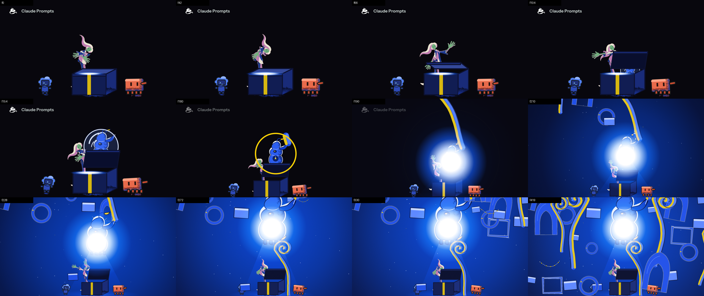
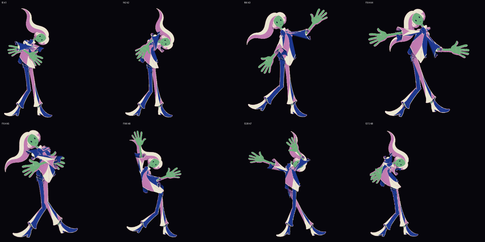

# s01-05 · the film's intro, run 5 (plates built from the solver, plate = film; the second pass through the chain)

2026-10-15 · shot `s01-arrival-overwhelm`, frames 0-420 (beats `arrival` 0-180 and `everything-at-once` 180-420 of `v3/timeline.json`). Run through `showcase_shot` (seven steps) on the isolated server: receipts `evidence/drive-P7TOpp` (chain-showcase_shot#1, mailbox `mailbox/s01-05`, payload `workflow-payloads/52-run-shot-s01.json`). Graded against `v3/rubric.md` v1.9. **Everything here is provisional; the owner has approved none of it, and no one has watched the mp4.** Run 2 is `v3/studies/s01-02.md`; its keys table and gate verdicts are compared below.

[](s01-05/s01-05.mp4)

<details><summary>Codes used below</summary>
C-numbers are rubric rows (`v3/rubric.md`), D-numbers rulings (`v3/creative-spec.md`), K1-K8 the eight keys (rest-on-lid, grip, lift, awe, brace, joy-a, joy-b, shrink). "Solved joints" are what `solvePose` draws for a key's declaration; "measured joints" are the joints registered on the plate (from the solver, by construction, since run 3). Plain words first.
</details>

## What the viewer sees (per beat, one line)

- **Beat 1, arrival (0-180).** A small human above a box (head, shoulders and hair; her body is behind it) tilts, raises one open hand, steps back with arms spread, draws her hands in while the bubble swells inside a ring; the camera widens from frame 150.
- **Beat 2, everything at once (180-420).** The ring, the white lamp and the flood arrive at 180-186; she is 20 to 29 percent of the frame high under the light, her face about 18 px; pieces and stalks fill the frame.



## What changed against run 2 (the point of this run)

Nothing on the contracts: the chain was driven on the current s01 files and left all four (`v3/poses`, `v3/keys`, `v3/charts`, `v3/layouts`) byte-identical to the copies taken before the drive (`cmp`), the plates and the figure-only sequence byte-identical to run 4's (420 of 420 frames). What differs from run 2 is the machinery (rows 6.8 and 6.9, D85), measured below.

| | run 2 | run 5 |
| --- | --- | --- |
| key plates | 8 generated drawings, scale estimated | 8 plates posed from the solved joints through the 16-part rig, model-sheet scale 0.4745, `source: solver` |
| keys under `--joints keys` | 13 of 30 checks failed, 6 of 8 keys rejected | 20 of 20 checks ok, 8 of 8 accepted |
| C20 worst limb | heights -1.3 to +11.8 %, limbs over 105 % on 5 keys | 0.0 % on all 8 (by construction, see gap 3) |
| C22 contour | K6 +21 % | +7 % to +16 %; the clean-up still fails on the torso (gap 4) |
| C31 spine | sign opposite on 6 of 8 | class and sign as declared on 8 of 8 (bow 0.062 to 0.142; S keys read 0.075 and 0.071) |
| pose gate | pass on solved joints, 9 checks | pass on solved joints, 20 ok lines |
| key gate | none existed | `animation-key-fit` exists; did not fire in the drive (gap 1); the same command run by hand: exit 0 |
| render gate | pass 3 of 3 after one failed run (16 of 17 inbetween checks) | pass 3 of 3 on the first run; did not fire in the drive (gap 1) |
| inbetweens | 57 items, 0 failed | 54 items, 0 failed (7 moves, 28 breakdowns) |

Keys table then (`v3/studies/s01-02/s01-keys-table.txt`): accepted 2 of 8 (rest-on-lid, shrink); grip weight over the wrong foot, lift, brace and joy-a read I, awe and joy-b read C not S, K4 twinned 0.84. Now (`s01-05/s01-05-keys-table.txt`), worst C20 0.0 %, C31 per key:

```
K1 rest-on-lid C 0.062 -1 tw 0.74 accepted     K5 brace   C 0.082 +1 tw 0.50 accepted
K2 grip        C 0.102 -1 tw 0.28 accepted     K6 joy-a   C 0.122 -1 tw 0.00 accepted
K3 lift        C 0.062 +1 tw 0.00 accepted     K7 joy-b   S 0.071 +1 tw 0.44 accepted
K4 awe         S 0.075 -1 tw 0.64 accepted     K8 shrink  C 0.142 -1 tw 0.00 accepted
```

## Probes (every gate line)

Pose step, `python3 scripts/animation/probe-poses.py v3/poses v3/keys v3/charts --joints solved` (exit 0, 20 ok lines):

```
pass: poses - 1 shot(s) (solved joints): keys, line of action, twinning, weight, breakdowns, secondaries, holds, timing shape and lead arm all as declared
```

Key step, `... --joints keys` (exit 0, run by hand, `s01-05/s01-05-probe-poses-keys.txt`):

```
pass: poses - 1 shot(s) (keys joints): keys, line of action, twinning, weight, breakdowns, secondaries, holds, timing shape and lead arm all as declared
```

Render step, `python3 scripts/animation/probe-all.py --shots v3/poses --frames-root out --joints-root out` (exit 0):

```
pass: probe-all --shots - 3 of 3 probe runs passed, 0 shot(s) skipped
```

Each of the three runs prints its own control first (`s01-05/s01-05-probe-all-shots.txt`): a change on frame 7 refused, a 40-frame hold refused, a zigzag refused. Twos: 106 even-frame changes, 0 odd; hold band: 8 holds in band, 1 declared long hold; inbetweens: arcs 21, spacing 7, overlap 11, moving holds 8, pixel ease 7, all ok. Determinism: frames 0 and 154 rendered twice, identical (b59133fc1e12733e, 451bd3aa6453b818) and equal to the sequence's own frames.

## Grades

Evidence tier in brackets. Criteria not touched are omitted.

- **C1 HOLDS** [still, sampled pixel] Clawd coral (232,106,75) on frames 0 and 154, (233,109,79) on 330 against #e8694a; Codex blue (80,126,241) on 0 and 154, (86,128,251) on 330 against #4f7df2. The human's skin is 162 px within 6 RGB on frame 0 and 0 px on 200 (under the flood), 13 px on 419.
- **C12 HOLDS** [sha256 of two renders] stills of frames 0 and 154 rendered twice are identical and equal the sequence frames.
- **C14 FAILS** [8 key stills at 2x, strip, a 3x crop of K5; mp4 not watched, I cannot watch it] reads: lift (K3: one open hand up, chin lifted) and awe (K4: arms spread, head tipped back). Does not read: grip (K2) is a hunch with a hand at the chin and the lid grip hidden behind the box; brace (K5) is two hands piled on the chest into one cluttered mass; joy-a (K6) is one hand up and one out, not "arms flung up and out"; joy-b (K7) hides half the face behind a raised hand; shrink (K8) shows the forearms at the left of the face, not crossed over the head. In the strip, frames 190-419, the figure is a small shape under the light and no turn or fold can be read.
- **C16 HOLDS** [consecutive frames, measured] twos on the figure (0 odd-frame changes, 106 even), holds in band, one anticipation (awe to brace, frame 130); no overshoot on the human in this sheet.
- **C18 HOLDS** [consecutive frames, measured] whole-frame change jumps at 180 (ring, 10.9 %), 182 (lamp, 11.9 %), 183-186 (flood, 12-13.7 %) and is 1.1 % by 190. The script's `lightLag` reads the ring and flood at 178 because the bubble's own blue passes its 4-level threshold two frames earlier (gap 6).
- **C20 HOLDS** [key table over model numbers] 8.00 heads and limb scales 1.00 (0.0 %) on every key; this cannot fail on a solver plate (gap 3).
- **C21 FAILS** [filled silhouettes, `s01-05-keys-silhouettes.png`] one component, solid share 0.27-0.38 on all 8; K1, K2, K3, K4, K6 and K7 read their gesture; K5 reads as a closed lump and K8's declared crossed forearms do not show in the silhouette.
- **C22 FAILS** [3x crop of K5 and K1, measured contour] contour +7 % to +16 % against the model sheet on all 8 (inside the 20 % band), but the torso is a pile of overlapping pieces with a soft smudged edge at the collar and no pale contour on several shapes (`s01-05-c22-crop-k5.png`, `s01-05-c22-crop-k1.png`).
- **C23 HOLDS** [joints dump against the sheet] 28 of 28 breakdown favours are played at their frames; rendered moves step on twos.
- **C25 FAILS** [layout against frames] the lamp lands at (696.5, 223.5) on frame 300 against the layout's (697.6, 223.9), 0.09 % of the width; zoom end 0.6. The 5 % figure-height clause is unmet as in run 2 (the sheet's face-derived 78.1 % against the render's 48.6 %). On frame 0 the brightest-pixel centroid is 29 % of the width from the seam (the box's white top), the exposure sheet's emitter 2.07 %.
- **C27 HOLDS** [figure-only frames] `probe-twos` pass, control tripped.
- **C28 HOLDS** [figure-only frames] `probe-holds --no-pops` pass, control tripped; moves of 3-6 drawings.
- **C31 HOLDS** [pose sheet + key sheet joints] `--joints keys` 20 ok lines; class and sign match on 8 of 8, root over the weight foot on 8 of 8.
- **C32 HOLDS** [joints dump + figure frames] 21 arc items, 7 spacing, 7 pixel-ease items, 0 failed.
- **C33 HOLDS** [joints dump + figure frames] 11 overlap items, 8 moving holds, 0 failed.
- **C24 UNPROVEN** the identity-complete colour measure puts 20 of 70 sampled frames over 2 % off-pair (worst frame 30 at 19.7 %); its mask counts the human's palette (gap 19 of run 1).
- C29, C30 not run (the gate runs twos, holds and inbetweens only).

## Controls

C31, C20 and C22 (weight) flipped from FAILS in run 2 to HOLDS or in band; their failing controls are `probe-poses --joints keys` (a straight spine declared S, mirrored limbs with no why), the C22 control (the plate's pale lines grown by 2 px reads 4.42 px, out of the 2.88-4.32 band) and `film_compare` (two parts' draw order swapped, named), all tripped in `s01-05-plates.log`. C16, C18, C27, C28, C32, C33 stayed HOLDS (controls in `s01-05-probe-all-shots.txt` and `s01-05-inbetweens.txt`). C14, C21, C22 (clean-up) and C25 did not flip.

## Owner

1. TASTE (C14) Is the pile-of-parts torso on grip, brace and joy-b acceptable for a first film cut, or do those three keys get a drawn plate each (a generator proposes it under the fit gate, row 6.9's fold)? Default: draw them, because the clean-up reads as unfinished at 3x.
2. TASTE (C14, D70) The figure is 18 px high with no readable face at the end of the shot. Keep it small and let the light win, or hold the camera closer on the figure at frame 272 (zoom 0.6 to 0.9)? Default: keep the layout.

## Next

- C14: watch the mp4; re-pose grip, brace, joy-a, joy-b and shrink so the declared gesture shows (hands to chest apart from the torso, arms up, forearms over the head) by giving `SILHOUETTE_ARMS` per-key targets.
- C21: shrink with the forearms outside the head silhouette; brace with the hands off the torso.
- C22: parts rig seam clean-up (a pale contour per part boundary, no soft edge), measured as a per-part contour run, not only the total weight.
- C25: take the 5 % clause from the key sheet's rig height, not the layout image (run 2 next item, still open); measure the frame-0 emitter at the lid seam, not the brightest pixels.

## Gaps in the approach (what the chain, the probes and the rig could not do)

1. **Two of the three inline gates did not fire in the drive.** After the pose reply the server returned a gate review with `Shell Verification Results` (05-step); after the key reply (06 to 07) and after the render reply (07 to 08) it returned the next step with no gate section and no verification (`mailbox/s01-05/07-step.md`, `08-step.md`, receipts `evidence/drive-P7TOpp/008-drive-step-06`, `009-drive-step-07`), although `showcase_shot` lists `animation-key-fit` on keys and `animation-inbetween-probes` on render. The run 2 mailbox shows the same absence for the render step. I ran both commands by hand (exit 0, lines above); the chain did not run them. I did not find the cause (the keys step is `delegated: true`; the render step is not). Fix: find why the inline gate section is missing on both and add a drive step that fails when a listed gate produced no verification.
2. **The chain is idempotent on these inputs.** Plates, keys sheet, keys table and the figure-only sequence came out byte-identical to run 4's; the run therefore proves the build is deterministic and the gate commands pass, not that a design changed. A before/after for design needs the pose sheet to move.
3. **C20 cannot fail on a solver plate.** The limb scales are the local triangle scale of a mesh posed by IK at rest bone length, so 1.00 is the construction. Fix: overlay the rendered film frame on the model sheet and measure the figure there.
4. **The tear metrics do not see a missing contour.** Inverted, strained and overlap are all under their limits (worst 0.68 %, 4.11 %, 0.12 %) while the torso at K1, K5 and K7 has ragged edges and shapes without a pale contour. Fix: a per-part contour presence measure.
5. **The silhouette kind does not give the gesture.** `solvePose` with `SILHOUETTE_ARMS` puts wrists at generic targets; brace's hands land on the torso and shrink's forearms do not cross over the head. Fix: a per-key gesture field (run 2 gap 4, still open).
6. **`s01_frames_measure.py` reads the first-response frame at a 4-level threshold**; the bubble's blue passes it two frames before the ring. Fix: measure the ring and the flood by their own hue.
7. **`s01_frames_measure.py` hardcodes `out/s01-seq` and `out/s01-fig-seq`** (run 1's directories); I ran it through a patched copy (`exec` with the directory names replaced) so the outputs are `out/s01-05-*`. Fix: take the directories as arguments.
8. **The human's face is not readable after frame 190** (skin 0 px at 200, face 18 px at 419), so C14 on beat 2 cannot be graded from stills.
9. **Key-sheet row 2 (the keys as frame thumbnails at the layout camera, C25) was not rendered**: no `KeySheet` composition exists in `src/Root.tsx` (only `PoseSheetS01` and `KeyFilmS01`). The keys prompt names it.
10. **`eagle_board.py apply` appends**: the ledger now counts 18 uses of a contract with 9 distinct key-card pairs, so a re-run doubles the use count. Fix: dedupe on (pick, to, note) or key the receipt.
11. **The key step is delegated by instruction**; this run did it inline and ended with the `HANDOFF RESULT` trailer (run 2 gap 10).
12. **The drive's refusal numbering** (run 1 gap 28) was not exercised: no gate refused anything.
13. **Documentation reminders** drew again on the motion step (seven) and the grade step; attested not applicable with `{id, reason}` objects, accepted on the first try.

## Changed

Edited: `v3/references/owner/picks.json` (nine `applied` entries, receipt `evidence/drive-P7TOpp`). Rewritten with identical bytes: `assets/human/keys/s01-arrival-overwhelm/` (K1-K8 plates, crops, `plates.json`), `public/assets/human/keys/s01-arrival-overwhelm/`, `v3/keys/s01-arrival-overwhelm.json`, `v3/poses/s01-arrival-overwhelm.json` (`solve-poses` rerun). Unchanged: `v3/charts/`, `v3/layouts/`. Created: `out/s01-05*`, `out/s01-arrival-overwhelm-figure-seq/` (regenerated, identical), `v3/studies/s01-05.md` and `v3/studies/s01-05/`.

Artifact copies (unchanged from `out/`, sha256 prefixes in `s01-05/SHA256-PREFIXES.txt`): `v3/studies/s01-05/`.
