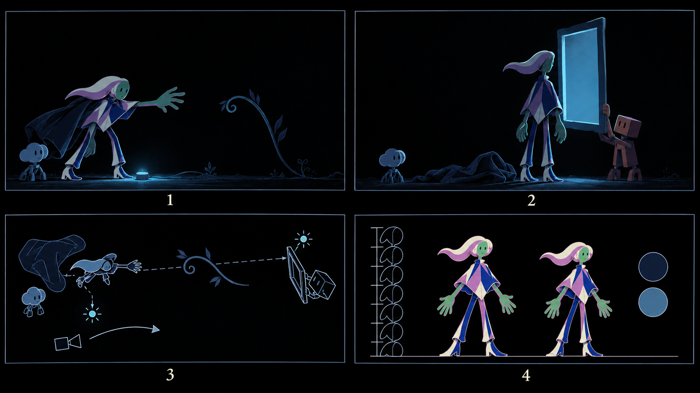

# s02-layout-01 · cinematography sheet for s02 "can't build the frame" (D77, first run of `showcase_layout_sheet`)

2026-10-13 · prompt rendered on the isolated server (receipt `evidence/call-CP9gtK`, payload 33); generated through the `imagegen` tool script with seven references (approved human model sheet, four Composition cards from the owner's library filed through /inspiration, the Styx-boat hue card, the nested-frames object card); measured with `scripts/layout_measure.py`; contract `v3/layouts/s02-cant-build-frame.json`; still `s02-layout-01-sheet.png` from the `LayoutSheetS02` composition. **Provisional until the owner approves from the still.**

## Camera
| | |
|---|---|
| start (f330) | medium on the human mid-reach, the stalk curling away right, the dial's small glow on the floor, Codex small at frame left |
| end (f600) | the raised frame at frame right held by Clawd, its interior the only light; the human in silhouette looking through it; the dropped cloak on the floor |
| move | pan right, led by the stalk sliding back along the ground toward Clawd, then the frame's left bar as it rises (D64); panel 3 draws the camera wedge, the arrow and the leading line through the stalk to the frame |

## Emitter · hue
Dial on the floor at (0.35, 0.89) of panel 1 → frame interior at (0.60, 0.48) of panel 2, measured as the brightest cyan pixels. One emitter per frame holds (C6). Hue: steel #17263a radiance with cyan #457ca4 accent, the D74 pair, and nothing else saturated: the skin and poncho pigments are tinted by the radiance in the frames (correct for a layout: the key plates keep their identity pigments and the radiance is composited under them, C1).

## Figure heights
| panel | measured | method |
|---|---|---|
| 1 | 63 % of frame height | tallest ink component: the human bent in the reach |
| 2 | unmeasured by script; by eye about 72 % standing | the tallest component (96 %) merges the human, the frame and Clawd where the hand touches the frame |
| 4 | scale strip: the two figures on one baseline beside an 8-unit head ruler, radiance and accent swatches | by inspection |
The prompt asked for 40 % and 35 %; the sheet drew a true medium shot at 63 % and ~72 %. The sheet's reading of "medium" is the one recorded: it is what the key sheet will be drawn at. The 40/35 figures were the planner's guess and are retired.

## Cards used (board-07 §8)
eagle-lxu2uuohr9v2c (corner of a cold room → panel 1 field), eagle-mfp3wx8x3lix2 (figure in a lit doorway → panel 2), eagle-mf83t1h77o7bm (converging lines → the leading line in panel 3), eagle-lyio3is7tokub (silhouette before a lit interior → panel 2), eagle-mtr8sl3r48no7 (Styx hue), seuss-nested-frames (the frame).

## Rejected generations
None; one generation.

## Concerns
1. Clawd is drawn as a boxy coral robot with a cube head and Codex as a cloud-head on legs: close to the identities but not the official plates; the key sheet must reference `assets/codex`/`assets/clawd` plates, not this sheet, for the companions.
2. The dropped cloak in panel 2 is a photographic cloth; the key plate draws it as five flat roles (D69 transition).
3. `layout_measure.py` cannot separate the human from a prop it touches; a second pass with the key plates registered (skeleton) will give the exact on-screen height for C25. Until then C25 uses panel 1 (63 %) and the by-eye 72 % for panel 2, marked as such.

## Owner
Approve the cinematography sheet as the s02 camera contract (default: approve; flips `provisional`).
