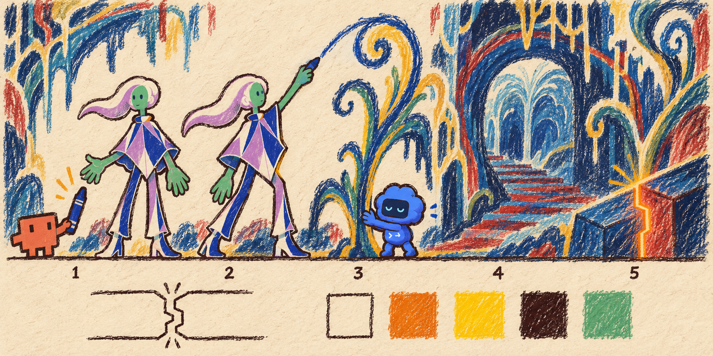
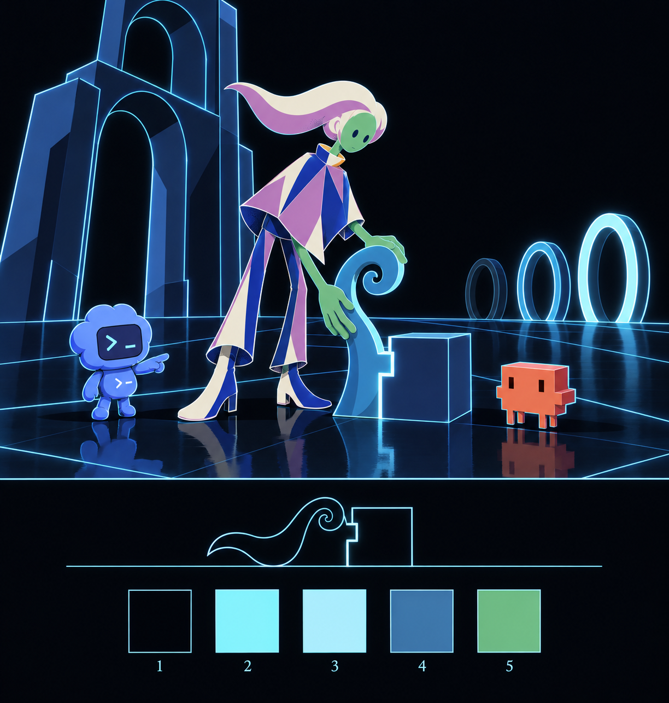

# world-sheets-01 · the art world (crayon) and the programming world (shaded), first run of `showcase_world_sheet` (D78)

2026-10-14 · prompts rendered on the isolated server (receipts `evidence/call-JtIpoH` crayon, `evidence/call-0DTIFE` shaded; payloads 36-*); generated through the `imagegen` tool script with five references each (the approved human model sheet, Clawd's official demo frame 0, Codex's official plate, one Seuss architecture card, one owner-library world card); measured with `scripts/world_measure.py` (`*.measure.json` beside this file); plates copied to `assets/worlds/` and `public/assets/worlds/`. **Provisional**: the code renderers (`src/library/worlds/`, in progress) are compared against these plates next; the gap names the renderer change.

| | crayon · beat 5 · Clawd leads | shaded · beat 7 · Codex leads |
|---|---|---|
| plate |  |  |
| what it holds | Clawd handing the crayon (1), the human drawing a stalk that becomes real (2), Codex steadying it (3), a crayon arch and staircase (4), the join lit amber (5); strip: the join as contour lines, swatches paper · amber · yellow · waxy dark · skin | Codex pointing (1), the human placing the stalk against the block, the join lit cyan, three ring gates lighting in sequence (2–4), Clawd watching, an extruded arch with emissive edges; strip: the join as pale cyan lines, swatches field · cyan · white-cyan · edge · skin |
| field (median of the border) | `#f1dcbc` paper | `#02050b` near black |
| contour (2 × median half-width, proxy) | 2.0 px against 2.71 (figure 450 px at 1/166) | 2.0 px against 3.61 (figure 600 px at 1/166) |
| fills (torso box) | 12 dominant, 40 minor colours → stroked at the threshold; waxy strokes visible in every fill | 8 dominant, 26 minor → stepped: flat planes with a cool second step and a cyan rim |
| identity pigments present (fraction of plate within RGB 28 of the hex) | Clawd 3.5 %, Codex 0.7 %, skin 2.8 % | Codex 1.9 %, its accent 3.7 %, Clawd 0.5 %, skin 1.5 % — C1 holds on both |
| emitter | the join at the right edge, amber | the join at the stalk–block contact, then the rings |

## What each plate settles for its contract
- **crayon**: paper field, dark waxy contour thicker than the home line (the generator still drew ~2 px; the renderer should thicken to the 1/166 target so the crayon reads heavier than home), strokes inside fills, warm amber radiance, boil faster. Architecture as scribbled arches and stalks. The human keeps flat-coloured roles under the stroke texture: the rig's plate can be reused with a stroke pass, no redraw.
- **shaded**: two-step planes, emissive cyan edges, a reflective grid floor, three-quarter perspective, gates as rings on a grid line. The human on the plate is flatter than asked (one step plus a rim): the renderer's toon material should use two steps and the rim, and the plate is the ceiling for how shaded the figure may get before it stops reading as the same character.

## Concerns
1. Both plates' lines are the generator's constant ~2 px; the contour targets (2.71 and 3.61) are not met on the plate, as with the model sheet (D76). The renderers draw the contour from the contract ratio, so the code side will be heavier than the plates; the owner judges which line is right on the side-by-side still.
2. The crayon plate's human reads as a brighter, flatter figure than its surroundings (the generator protected the identity): good for C1, but the renderer must decide whether the human gets the stroke pass at full strength (default: yes, at 70 %, so the figure sits in the world).
3. In the shaded plate the rings light brightest at the far end; the ledger's default is the third ring the human made is the brightest: the key sheet must place that ring nearest the human.

## Owner
Judge each world from the side-by-side still (plate vs code renderer), not from the plate alone; those stills follow when the renderers land.

## Addendum 2026-10-14 — code renderers landed (`v3/studies/world-proof-01.md`, worker handoff)

Contracts `v3/worlds/{home,crayon,line,shaded}.json` now carry the measured plate values (field `#f1dcbc` and `#02050b`, sheet sha256, receipts, cards, fills, pigments). Renderers in `src/library/worlds/`; compositions `WorldSheet{Home,Crayon,Line,Shaded}`, `WorldCrossingProof`. Planner verification: typecheck clean; `ModelSheetHuman` and `LayoutSheetS02` re-rendered byte-identical (mean abs diff 0.0); `Beat4` renders; home world figure vs `MeshProof` frame 36: 0.0 (positive control: the line world differs by 37.4).

| Proof | Result |
|---|---|
| home = today's look | mean abs diff 0.0 against MeshProof |
| line world has no fills | 0 chroma pixels in the figure crop (home: 61 167) |
| crossing keeps the figure whole | 1 component on all 120 frames of the tall measure render; in the 720p proof hands and boots leave the frame on 50–81 (clipping, not a break) |
| identity pigments in every filled world | Codex and Clawd hex pixels present in home, crayon, shaded; 0 in line by contract |
| cost per frame | home 0.11–0.14 s · line 0.08 s · shaded 0.16 s · crayon 0.54 s |

Side-by-side stills for the owner: `world-compare-crayon.png`, `world-compare-shaded.png` (plate left, code right).

### Renderer gaps (the next change per world, from the side-by-side)
- **crayon**: the plate's strokes are directional and sparse inside fills; the code pass is a dense isotropic grain (tooth 0.35 reads as noise). Next: lower tooth to ~0.18 and add a directional displacement so strokes follow one diagonal; add the world's architecture (scribbled arch and stalks) to the scene, which currently shows only the frame prop; radiance colour now the plate's amber. Figure stroke at reduced strength so identity holds (plate kept the human cleaner than the world).
- **shaded**: the plate has a reflective grid floor, three ring gates and an extruded arch; the code scene has the frame prop and a two-block join. Next: grid floor and rings as geometry, bloom on the emissive edge (currently a flat stroke), and the figure's second shading step with a visible rim. The figure is a card turned 24°; that matches the plate (also flat) and stays.
- **line**: the code figure is silhouette-only (no face) so the crossing measures as one component; with inner contours on, the face reads but islands appear. Decision taken: inner contours ON during the hold (the face must read, D70), and the crossing's integrity metric becomes "the boundary loop is closed" rather than "one component" (`measure-silhouette.py` cannot tell clipping or islands from a break; the worker's finding). Contract key `line.interior: true` pending the metric change.
- **home**: no gap by construction.
