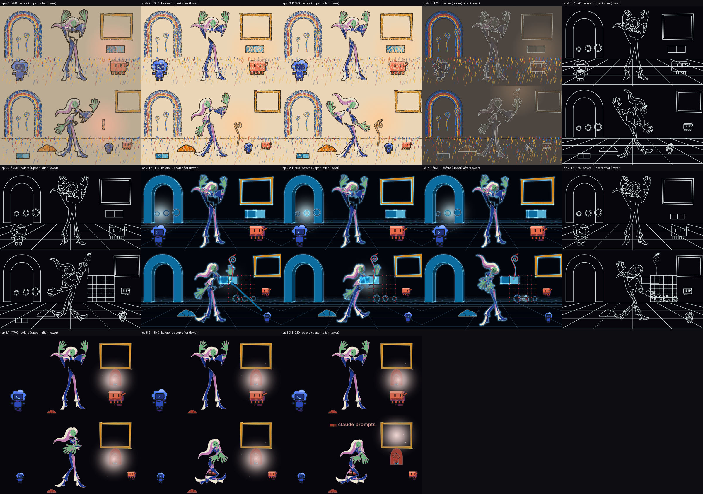

# Beats 5 to 8 restaged and acting on their thirteen story points (2026-10-20)

The owner has not watched this. It is the third slice of plan row 9.6 (`plans/animation-scaffold-2026-10-14.md`): the art world, the crossing, the programming world and the home settle (frames 930-1949) now stage the thirteen story points of `v3/screenplay.json`, sp-5.1 to sp-8.3 (the row says fourteen; the screenplay has 4 + 2 + 4 + 3), so that `probe-story.py` reads them and the theme probe's `th-light-leads` resolves their eye targets. The renders, probes and strips below were made by hand with the commands the chain's gates run, and each is labelled as such. The video is `out/animatic-09-draft.mp4` (65.0 s, 1950 frames, half size); the frames the probes read are `out/animatic-09-draft-seq` (composed, 1280 x 720), `-fig-seq` (the human alone), `-figline-seq` (the 142 line-world frames) and `-seq-b` (every tenth frame again). The earlier drafts are kept.

Codes used below

D-numbers are owner rulings (`v3/creative-spec.md`); p-numbers are proposals on the bible page (`v3/proposals/`); sp-numbers are story points of `v3/screenplay.json`. A "key" is a drawing the human holds; "stage pixels" are the 1280 x 720 picture. The strip shows frames 958, 1050, 1150, 1210, 1270, 1335, 1400, 1480, 1550, 1640, 1700, 1840 and 1930, each inside its story point.

## What the viewer sees now

- **Paper, 940.** A paper field with the crayon arch and the heap she dropped lying on the floor at the left. Clawd, far right, holds a crayon out; it travels up and across to her hand by 968 and she holds it (the light is a warm patch on the crayon).
- **Draw, 1010.** The crayon sweeps and three waxy strokes stay where they were drawn, on 1010, 1018 and 1030: the lower S of a stalk, its upper S and the curl.
- **Real, 1110.** The strokes go and the stalk they outlined stands there, its leaf opening over 14 frames (1110-1124); Codex stands against it. The light is on the leaf.
- **Carry, 1200.** She lifts the stalk like a lantern (it travels up to her hand between 1168 and 1198) and turns toward the edge of the paper.
- **Reduce, 1240, and re-route, 1300.** The world is lines; Clawd steps up-stage (1240-1270), the stalk walks on in her hand, a grid appears at the right on 1296 and the stalk's lines reach it by 1334, and from 1300 Codex strides down-stage past Clawd to the far right (x 925 to 1100 by 1349).
- **Grid, 1360.** The shaded world: a dark grid with lit edges, the two kit blocks in its top cell, three gate rings along its foot; Codex's arm reaches out across the picture to the join between the blocks (1360-1436).
- **Join, 1440.** She sets the stalk against the blocks (1420-1448); the light sat dim on the join until 1452 and is lit from 1464.
- **Run, 1520.** A bead runs right to left along the gates and the world lights each ring as the light stands at it, in order (the third, the brightest and nearest her, is hers); Clawd watches from up-stage.
- **Return, 1620.** The light goes into the frame's interior (the frame's `litFrom`); the picture cuts to home on 1650, inside the crossing's line phase.
- **Stand, 1660.** Home: the structure small under the frame with the stalk and the lit joins inside it and the gadget resting inside, the heap still on the floor; Codex at the left, Clawd at the right.
- **Settle, 1760, and window, 1860.** She turns to the patch, which is set down on 1766, and sinks onto it (her height falls 21.3 % between 1759 and 1859); Codex holds one boil variant from 1760. On 1860 the light goes into the frame, the title mark comes on and the picture holds 90 frames to the end.

## The thirteen story points, before and after (`probe-story.py`)

Before is `out/animatic-07-draft-story.txt` (all of beats 5-8 failed except sp-7.4's frame and sp-8.1 by luck of the earlier home-settle staging); after is `out/animatic-09-draft-story.txt`, the same command on the new frames.

| Story point | Before | After |
| --- | --- | --- |
| sp-5.1 PAPER | FAIL: no key; `'crayon' is not in the blocking` | FAIL on one line (below): `after human.holds_crayon: 'crayon' appears, 61962 px change within 150 px of (930, 402)`; `bound: key 'take' at f942` |
| sp-5.2 DRAW | FAIL: `stroke count is 0 at f1009 and 0 at f1109` | pass: `on frames [1010, 1018, 1030]: the smallest gap is 8 (needs 6)`, `stroke-1/stroke-2/stroke-3 count is 0 at f1009 and 3 at f1109` |
| sp-5.3 REAL | FAIL: `'stalk' is not in the blocking at f1199` | pass: `stalk appears, 4254 px change within 150 px of (880, 548)`, `codex and stalk are 0 px apart at their nearest (f1110); within 8 px needed` |
| sp-5.4 CARRY | FAIL: `human or stalk is not on stage` | pass: `human and stalk are 0 px apart at their nearest (f1200, the human read as her hands); within 12 px needed` |
| sp-6.1 REDUCE | FAIL: `9.1 % ... 9.2 % (+1 %; a fall of 80 % needed)` | FAIL on that line (below): `8.5 % ... 10.2 % (+20 %)` |
| sp-6.2 RE-ROUTE | FAIL: `codex does not pass clawd` | pass: `codex passes: (925, 500) -> (1100, 540)` |
| sp-7.1 GRID | FAIL: no key | pass: `field shaded`, `world 'line>shaded/line' at f1359 and 'shaded' at f1439` |
| sp-7.2 JOIN | FAIL: `the light neither changes colour nor strength`, `stalk or join is not on stage` | pass: `emitter #c5e4f0/0.3 at f1439, #c5e4f0/1 at f1519`, `stalk and join are 3 px apart at their nearest (f1440); within 8 px needed`, `the beat's emitter sits on "the join (empty, then lit), ..."` |
| sp-7.3 RUN | FAIL: `the gates first change at [1556, 1546, 1556]: not in order` | pass: the gates first change in order, each at least 8 frames from the next |
| sp-7.4 RETURN | pass | pass |
| sp-8.1 STAND | pass | pass (`2 of stalk/arch/ring/patch/bead stand at f1759 (at most 2)`) |
| sp-8.2 SETTLE | FAIL: `figure height +0.0 % between f1759 and f1859` | pass: `figure height -21.3 % between f1759 and f1859 (falls by 20 % needed)`, `records: patch appears` |
| sp-8.3 WINDOW | FAIL: `'title' is not in the blocking` | pass: `the longest hold the xsheet declares inside f1860-1949 is 90 frames`, `title present at f1949` |

`FAIL: story - 3 of 29 checks failed: s02/sp-4.6, s03/sp-5.1, s03/sp-6.1` on the whole film (19 of 29 on animatic 07); sp-4.3 now passes because the heap is in the blocking of beats 5-7 (p024's missing half). The three that fail, and why none is a staging defect:

- **sp-5.1**, `crayon prop moves from clawd to human`: the key `human.holds_crayon` wants the crayon absent on f939 and the recipe wants its anchor on f939. Both read the same actor on the same frame; with the crayon on 940 the key passes and the recipe fails, with it on earlier the reverse. p028.
- **sp-6.1**, `fill area falls >= 80 %`: the crossing's reduce is 1195-1218, so f1239 is already a line frame (8.5 % ink), and even paper at its fullest (21.1 % on 1190) against the line world (10.2 %) is a fall of 52 %. p029.
- **sp-4.6** (beat 4's), `next frame's field is paper`, reads the middle of the 70-frame morph: p025, not this slice.

## How each part was made

**1. The worlds draw props.** `WORLD_PARTS` lists `actors` for the crayon, line and shaded worlds (only home drew them), the crayon world passes the beat's `actorRoles`, and the shaded world draws them in the kit's own roles: its pair radiance is `#17263a`, and props in it stood black on black. A beat that names none draws what it drew.

**2. Two pose sheets.** `s03-scaffold` (930-1650) and `s04-settle` (1650-1950) in film frames, from `solvePose` and `npm run plates` (12 and 5 plates, none needing a family), each key bound to a story point and the moves authored (`probe-poses.py --shot` passes on both; `probe-all --contract`: `pass: probe-all --contract - 2 of 2 probe runs passed, 4 shot(s) skipped`). Keys sit on every beat boundary (`paper` 930, `home` 1650) so the figure layer changes only where the exposure sheet has a row; the first version had none and `hold-band` read two pose changes with no row, on 930 and 1650.

**3. New props** (`src/library/props/Scaffold.tsx`, tables in `probe_common.PROP_NATIVE` and `probe-blocking.PROP_EXTENT`): the crayon, the three strokes (cuts of the stalk's own centreline, so the stalk is what they outlined), a stalk whose leaf opens (`openAt`), the grid, Codex's pointing arm and the title mark. The first version also had three lit gate props; the shaded world already lights each gate by how near the emitter stands (`gateLight`), which is the story ("the chain runs down the grid, the third is the human's"), so they were surplus and are gone (their `on` frames also counted as arrivals against `th-one-join`).

**4. Blocking fields** (`blocking.ts`, mirrored in `probe_common.resolve_blocking_at`; parity of the two over 281 sampled frames of all eight beats, 848 actor-frames, 0 mismatches): `carriedBy`, `openAt`, `lit`, `standsOn`, `madeBy` on an actor and `litFrom` on the frame; `README.md` has the semantics. The emitter keys the beat 1 worker added (`emitter.at`: strength and radius) are used as they are: the join is 0.3 until 1452 and 1 from 1464 (the xsheet strength now carries it), and the glow is 60 px wide while the bead runs, so a gate is lit only when the light stands at it.

**5. Probes.** `probe-eyetrace.py` resolves `the crayon's own colour`, `the drawn line`, `the leaf`, `the piece's lines` and `the running bead` to the props that draw them (a region on the frame's own blocking; refused naming the props when none is on stage) and reads `the drawn piece as it fills` as no readable target; its control plants each (the light in the crayon passes, a tenth of the width away fails, the light at the stalk's root fails against the leaf, an absent prop is refused by name). `probe-story.py` counts a family name (`stroke` is `stroke-1` to `stroke-3`; its control is a count over `stroke` passing and `ghost` and `strok` failing). `probe-blocking.py` asks no foot on the floor of a carried prop or one that `standsOn` something (controls: a stalk in the air that is carried or set on the blocks passes, the same stalk with neither is refused).

## Gates (by hand, on the animatic 09 frames)

| Gate | Result |
| --- | --- |
| `probe-story.py` | `FAIL: story - 3 of 29 checks failed: s02/sp-4.6, s03/sp-5.1, s03/sp-6.1`; 11 of the 13 story points of beats 5-8 pass |
| `probe-blocking.py` | `pass: blocking-contract - 8 beats staged: actors placed, emitter inside the frame, a card cited, identity boxes apart, props apart` |
| `probe-all.py --contract v3/poses v3/keys v3/charts` | `pass: probe-all --contract - 2 of 2 probe runs passed, 4 shot(s) skipped` |
| `probe-theme.py` | `th-light-leads` passes (28 story points resolve), `th-glass` and `th-frame-portal` pass; `FAIL th-one-join`: sp-5.2 brings 3 new joins (p026) |
| `probe-eyetrace.py` 930-1949 | 774 frames measured; 0 over 3 % in sp-5.1 to 5.4, 7.1, 8.1 to 8.3; 58 in sp-6.1 (worst 41.2 %) and 46 in sp-6.2 (45.4 %) where the line world has no emitter; 8 in sp-7.2 (27.6 %), 98 in sp-7.3 (24.5 %: the frame's rim is the brightest region while the bead's glow is 60 px wide) and 2 in sp-7.4 (7.0 %) |
| `probe-all.py` (whole film) | `FAIL: probe-all - 5 of 7 probes passed`: twos, hold band, screen time, loop closure (142 line-phase frames) and determinism pass; eye trace as above; colour: the join's glow reads hue 186-189 against the pair's 205-214 on 1432-1515 (the cyan blocks' halo is beside it) and the 1615-1685 crossing detours, as before |
| `npm run typecheck`, `npm run bible` | exit 0 on both (`pass: bible 0f4c577a6ed6 covers 1950 frames in 10 tracks (402 items), 29 proposal(s) sit inside their beats, 56 ruling(s) mirrored, and the page shows this bible`) |

## What is open

- **p026** (finding): `th-one-join` counts the three strokes as three joins; the screenplay's own recipe asks for them.
- **p027** (finding): `strokes.count` counts `stroke`, the recipes name `stroke-1` to `stroke-3` (read as a family here).
- **p028** (finding) and **p029** (finding): sp-5.1 and sp-6.1 above.
- sp-7.4's "three figures cross its x" is not staged: the frame stands at the upper right (x 1040) and Codex and Clawd are already past it; the human cannot cross it without her crop meeting their boxes (`identity boxes apart`).
- Codex's arm is a prop (`pointer`), not a Codex pose: the cast is drawn by `src/library/cast`, which is the beats 1-4 worker's. Clawd's idle boil in beat 8 is not held (`codex.hold` exists, Clawd has none).
- The key plates' film-rig measure (`npm run plates` last step) reads `input error: the film rig could not render the keys` for the new shots, as `s02-cant-build` did (p023); plates and key sheets are written before it.
